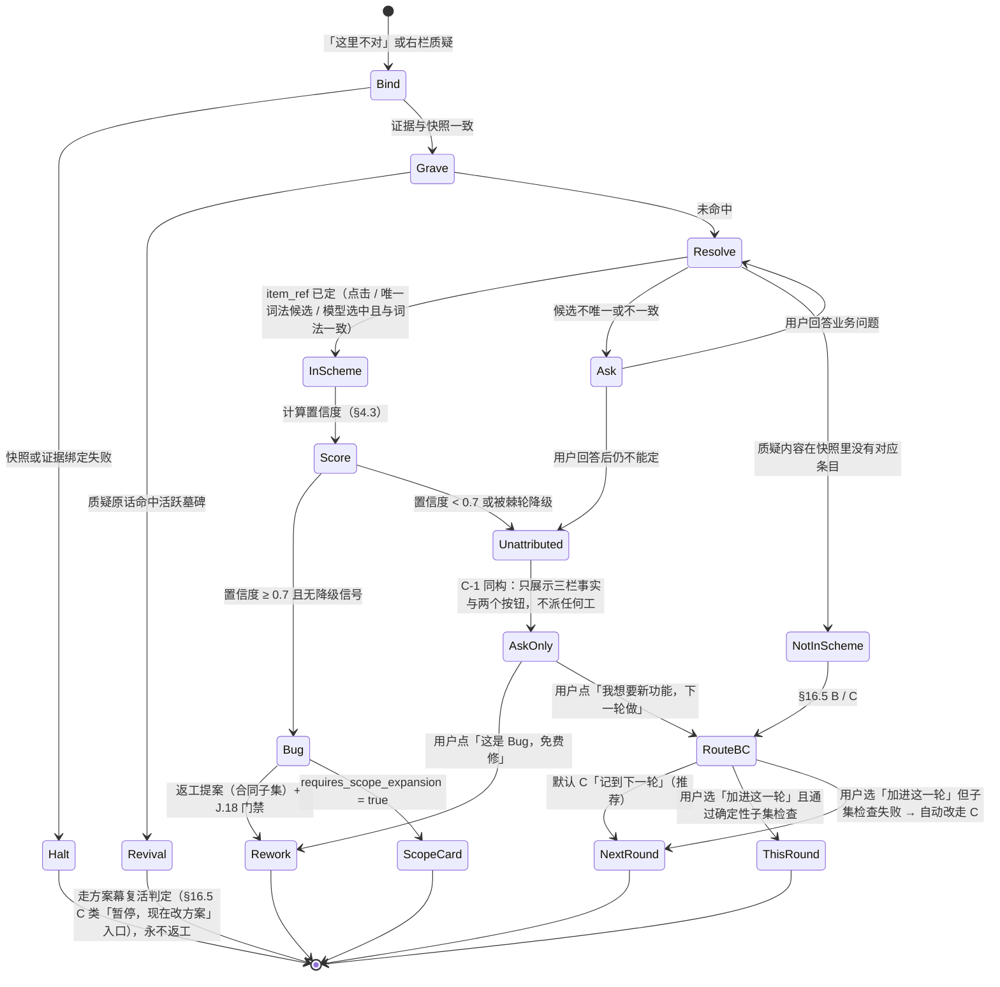

# 试玩自查引擎 · 确定性裁决规范（§16.7「这里不对」与验收清单点亮）

> **状态**：**设计定稿 · 待施工**（归属第二批预告 `J.16`「试玩幕、对话式验收」；本文只覆盖其中的自查与点亮，建议实施时拆卡）
> **建立日期**：2026-10-28（Asia/Hong_Kong）
> **上位规格**：[`supervisor.md`](./supervisor.md) §14.11（台账、子账本四 `attributions`、K-14、K-15、K-16）、§16.5（B/C 分流与不变式 C-1）、§16.7（试玩幕与质询台）、§17 D10；[`runtime-contract-and-safety.md`](./runtime-contract-and-safety.md) §5.4；[`worker-graveyard-gate.md`](./worker-graveyard-gate.md)（返工派工同样过门禁）；架构 [`system-architecture.md`](./system-architecture.md) 步骤六（已被 §16.7 与 D10 修订的部分以 SSOT 为准）。
> **与上位规格的关系**：本文是实施口径，不新增场景、不新增用户决定类型、不新增错误码与原因码。**K-14 / K-15 / K-16、G-MATCH、INV-LEDGER-03 以 [`supervisor.md`](./supervisor.md) §14.11 为准**；冲突时以 SSOT 为准。
> **逐字核对基线**：`main` @ `0613a00`。本文引用的类型、常量与函数名均已对照原文：`src/lib/evidence.schema.ts`（`reasonCodeSchema` 9 码、`evidenceBundleSchema`、`deriveCanMerge`、`tests_modified`）；`daemon/supervisor/dispute/*`（`DISPUTE_CONFIDENCE_THRESHOLD = 0.7`、`DisputeClassification`、`DisputeUserChoice`、`DisputeReport`、`classifyDispute`、`buildReworkProposal`、`assertReworkScopeSubset`、`extractKeywords`、`CodeFactSourceImpl`）。
>
> > **DOC-10（2026-11-01）**：墓地交叉与 K-16 闭集不再复述 SSOT；§4.6 / §5 仅保留试玩引擎特有的裁决算法与兼容处理。

---

## 0. 一句话

**归因的核心问题「方案里有没有」是确定性的；只有「用户说的是哪一条」和「做出来的东西算不算做到」需要语义判断。** 本引擎把这两处语义判断压成**单向棘轮**：模型只能让系统**多问一句**，永远不能让系统**多做一步**（自动返工或自动记到下一轮）。白话 Diff 摘要默认由确定性模板生成，不需要模型，也不读 Worker 的任何自述。

---

## 1. 代码事实基线

现有 TASK-S.5 的自查（`daemon/supervisor/dispute/`）已经是**纯规则、零模型**，这是好的起点。但它与 §16.7 的三方定义和防自证要求之间有七处问题：

| # | 事实 | 位置 | 影响 |
| :-: | :--- | :--- | :--- |
| P-1 | 中栏事实源是 `RequirementsStore` 的 `.stagent/specs/requirements.md`，**不是**冻结快照里的 `SchemeDraftV2` | `evidence-triad.ts:10`、`:18` | §16.7 中栏应是「确认的方案里记的」（冻结快照条目） |
| P-2 | 左栏事实是会话消息的关键词命中（`matched_messages`），**不是**台账 `evidence` 的锚定原话 | `evidence-triad.ts:219` | §16.7 左栏应是 `evidence` 高亮原文 |
| P-3 | 右栏取 worktree 的 `git status --porcelain` 与 `git diff HEAD`。施工后 `commitWorktree` 已执行 `git add -A` + `git commit`，此时两者都为空，`changed_files` 为 `[]` | `evidence-triad.ts` `CodeFactSourceImpl.collect`；`orchestrator.ts:769`、`:1058-1068` | 试玩时右栏事实**极可能全空**，归因落入「信号不足」分支。应改为 `git_info.base_commit_sha..task_commit_sha` |
| P-4 | `diff_matched` 用 `matchesKeywords` 在 `diff_excerpt` 全文上找关键词，**含 Worker 写的注释与字符串** | `classification.ts` `computeSignals` | Worker 写一行 `// 实现按月份切换` 即可让「代码已触及」信号成立（§7 TM-PX-04） |
| P-5 | `DisputeReport.reason_code` 是 `string`，超时报告写入的是错误码 `E_DISPUTE_TIMEOUT`，不是 `reasonCodeSchema` 成员 | `types.ts`、`index.ts:256` | 字段名与证据包 `verdict.reason_code` 同名不同义 |
| P-6 | `extractKeywords` 是第三套自己做 NFKC 与二元组的词法实现 | `evidence-triad.ts:68` | 与 G-MATCH「单一语义源」方向相反；本文要求复用 `graveyard-match.ts` 的 `matchNormalize` / `lexemes` |
| P-7 | 验收条目 `acceptance[]` 只有 `check: "auto" \| "playtest" \| "both"`，**没有**到具体验证命令或模块的链接；`ScopePlan.verification.commands` 是项目级 | SSOT §14.2、§15.3 | 「自动检查」无法零模型地证明**某一条**验收条目，只能证明项目级检查全绿 |

---

## 2. 问题一：三方比对的判定面 · 逐字段责任边界

### 2.1 分类口径

| 记号 | 含义 |
| :-: | :--- |
| **D** | 确定性，零模型可断言，结果可复现 |
| **H** | 确定性启发式：零模型、可复现，但只是**候选**，不构成证明（例如词素重叠） |
| **M** | 必须语义判断（模型）；输出只作**降级信号**，受 §4.4 单向棘轮约束 |
| **U** | 交给用户：问一个业务问题或展示两个按钮 |

### 2.2 左栏「你当时说的」

| 字段 | 来源 | 类 | 断言方式 |
| :--- | :--- | :-: | :--- |
| 原话文本与高亮位置 | 冻结快照条目的 `evidence[].ref`（`TurnRef.anchor`） | D | `anchor.turn_text_sha256` 与对话记录一致（引擎审计 A-01 同口径）；高亮取 `raw_start` / `raw_end` |
| 主锚点 | 第一条 `user_said` / `user_confirmed` 证据 | D | §14.7「锚点规则」 |
| 条目无证据（离线兜底产出） | `evidence` 为空 | D | 左栏显示「这一条没有你的原话记录」，**不**伪造溯源（§14.7「真实性底线」） |
| 用户这次的质疑原话 | 本次「这里不对」或右栏消息 | D | 原样记录 `turn_id` |
| 质疑原话与哪条历史原话相关 | — | 见 §2.5 | 由 `item_ref` 决定，不独立判断 |

### 2.3 中栏「确认的方案里记的」

| 字段 | 来源 | 类 | 断言方式 |
| :--- | :--- | :-: | :--- |
| 快照完整性 | `.stagent/drafts/schemes/{confirmation_id}.json` | D | 快照 digest 与合同 `scheme_binding.snapshot_digest`（J.18 GAP-W1）一致；不一致 → 自查拒绝运行，`E_SCHEME_SNAPSHOT_MISMATCH` |
| 条目内容 | 快照内 `SchemeDraftV2` 条目 | D | 按 `id` 读取 |
| 条目在不在方案里 | 同上 | D（给定 `item_ref` 时） | `item_ref.id ∈ 快照` |
| 条目当时是否**呈现给用户并获批** | 呈现日志 `surface_log`（§5.3，新数据，GAP-P8） | D | 见 §5.3 |
| 质疑指向哪一条 | — | 见 §2.5 | — |

### 2.4 右栏「代码实际做的」

| 字段 | 来源 | 类 | 断言方式 |
| :--- | :--- | :-: | :--- |
| 改动文件清单、增删行数 | `git diff --numstat {base}..{task}`，`base` / `task` 取证据包 `git_info.base_commit_sha` / `task_commit_sha` | D | **修正 P-3**；与 `scope_audit.files_changed` 逐项相等，否则判证据过期 |
| 收敛后清单 | runtime §4.1「落盘收敛」结果 | D | 同上 |
| 文件指纹 | `audit-manifest.json` 的 SHA-256；`git_info.patch_fingerprint` | D | 重新计算后相等 |
| 证据与候选是否同一份代码 | `worktree_snapshot.snapshot_fingerprint`、`head_sha` | D | 与当前 worktree 重算值相等；否则 `EVIDENCE_STALE`（`reasonCodeSchema` 既有成员） |
| 机器检查结果 | `verification_results[].exit_code` / `passed` | D | Daemon 亲自执行的命令；空集不得点亮（runtime §5.4） |
| 测试是否被本轮改过 | `tests_modified` | D | `true` 时机器检查一行降为琥珀色（§3.3） |
| 改动落在哪个白话区域 | `ScopePlan.areas[].paths` 与改动文件做路径匹配 | D | 同 `checkWriteAccess` 的匹配语义 |
| 某条验收条目对应哪个区域 | 条目文本与 `modules[].name + purpose` 的词素重叠 → `areas[].module_ids` | **H** | P-7：Schema 无直接链接；只作候选 |
| 白话 Diff 摘要 | 确定性模板（§3.2） | **D** | 不需要模型 |
| 「做出来的算不算做到」 | — | **M** | 只作降级信号（§4.4） |

### 2.5 跨栏判定

| 判定 | 类 | 方式 |
| :--- | :-: | :--- |
| `item_ref`：用户点了验收条目上的「这里不对」 | D | 按钮自带条目 id |
| `item_ref`：用户在右栏用自然语言质疑 | H → M → U | 先用 G-MATCH-NL 词素对快照的 `acceptance` / `modules` / `goals` 打分（H）；恰好一个候选过阈值且领先第二名 → 采用；否则模型在**枚举的候选 id**中选一个（M）；模型拿不准或与词法候选不一致 → 问用户「你说的是『首页能看到本月逾期项目数』这一条吗？」（U） |
| 质疑原话是否在重提墓碑 | D | 质疑原话按 G-MATCH-NL 对活跃墓碑求 (b)(c)(d)；命中即走 §4 状态机的墓地分支 |
| 方案里有没有 | D（给定 `item_ref`） | 见 §2.3 |
| 改动是否越出合同 | D | 既有 `assertReworkScopeSubset` |
| 返工能否在合同内完成（B 类子集） | D | 既有 `buildReworkProposal` 的 `requires_scope_expansion` |
| 归因置信度 | D | §4.3 公式，模型分量只能扣分 |
| K-14 三分类 | D（给定 `item_ref` 与 `surface_log`） | §5.3 |

---

## 3. 问题二：共享错误源隔离（防自证清白）

### 3.1 原则

**自查者不得使用施工 Worker 能够影响其内容的「叙述」作为正向证据。** Worker 能写的东西分两类：

| 类 | 例 | 在自查中的地位 |
| :--- | :--- | :--- |
| **叙述**（Worker 对自己工作的描述） | `log[]`、`declare_complete` 摘要、提交信息、代码注释、测试名称、它写的 README | **禁止**作为任何正向信号；不进入模型上下文 |
| **产物**（Worker 改动的代码与测试本身） | 改动的文件内容、测试文件 | 只能由 **Daemon 自己计算**出的事实间接使用（文件清单、指纹、Daemon 执行的退出码）；本轮改过的测试不能单独抬高置信度 |

### 3.2 白话 Diff 摘要的确定性管线

```text
证据包 git_info (base, task)
   │  Daemon 重算 numstat 与指纹，比对 scope_audit / patch_fingerprint / snapshot_fingerprint
   ▼
改动文件清单（收敛后）  ──路径匹配──▶  ScopePlan.areas（冻结快照内，带白话 label）
   │                                      │
   │                                      ├─ 命中区域：「首页看板：改了 3 个文件」
   │                                      ├─ 新建区域：「新的月度报表页：新增 2 个文件」
   │                                      └─ 未命中任何区域的文件：「另有 1 处改动不在原定区域里」⚠
   ▼
never_touch 校验：「这次没有碰：密码与钥匙文件、账号与支付相关……」（快照原文）
   ▼
verification_results：「类型检查通过；自动测试 12 项全部通过」
   + tests_modified=true 时：「注意：这次施工改过测试本身」
   ▼
模板渲染（plain_text_version 版本化）──▶ 右栏白话 Diff 摘要
```

- **全部输入来自冻结快照与 Daemon 计算**。区域白话 `label` 是确认前就给用户看过的那份（§15.4 单向投影），Worker 无法改写。
- **「另有改动不在原定区域里」**是对 Worker 越界或「顺手改」的确定性暴露，正是 K-14 (b) 类「差集未上屏」的预防。
- **可选的模型润色**：只允许改写句式，不允许新增事实。润色结果须通过零模型的**断言核对器**：抽出其中出现的文件路径、区域名、数字与「通过 / 失败」字样，必须是模板事实的子集且数值相等；任一不符 → 丢弃润色，显示模板原文。默认关闭。

### 3.3 验收清单的点亮规则

| 清单行 | 点亮条件（全部满足） | 未满足时 |
| :--- | :--- | :--- |
| 「代码通过类型检查，自动测试全部通过（系统已检查）」 | `verdict.status === "PASSED"`；`deriveCanMerge(...) === true`；`verification_results.length > 0`；`snapshot_fingerprint` 与当前重算值相等；`git_info.task_commit_sha` 等于候选 SHA | 不点亮，显示具体哪项检查没通过（白话） |
| 同上，且 `tests_modified === true` | 以上全部满足 | 点亮为**琥珀色**：「已通过，但这次施工改过测试，建议你在试玩时多看一眼」（承接 `evidence.schema.ts` 对 `tests_modified` 的注释：退出码可能由 Agent 自证） |
| 每条方案验收条目（`check` 任意） | **只能由用户点「没问题」点亮** | — |
| `check: "auto"` 或 `"both"` 的条目 | 不因机器检查自动点亮；只在条目旁附一行「自动检查：项目级检查已通过」作为参考信息 | P-7：项目级退出码不能证明**这一条**；Worker 写的测试也不能独立证明它 |

**为什么方案条目不自动点亮**：唯一能把某条验收条目和某个测试对上的东西，是测试名称或测试内容，而它们都是本轮 Worker 写的。把它们当作点亮依据，就是 Worker 自证。若将来要支持条目级自动点亮，前提是条目绑定的测试在合同基线 `base_commit_sha` 上**已经存在且未被本轮修改**（文件哈希相等）。这条留作扩展口子，本版不实现。

### 3.4 语义判断（M 类）的隔离

需要模型的两处（`item_ref` 消歧、「算不算做到」）使用独立调用，约束如下：

| 约束 | 内容 |
| :--- | :--- |
| 会话隔离 | 与施工 Worker 不同的会话；不继承 Worker 的任何上下文 |
| 输入白名单 | 冻结条目原文；该条目的台账原话；用户本次质疑原话；Daemon 计算的改动文件清单与相关区域文件的**新增非注释行**（复用 J.18 `projectArtifact` 的 `U-IDENT` / `U-IMPORT`，去掉 `U-NL`）；机器检查退出码 |
| 输入黑名单 | Worker `log[]`、完成摘要、提交信息、代码注释、测试名称、任何 Worker 会话记录 |
| 输出 | 结构化：`{ item_id: enum \| null, drift: "none" \| "possible" \| "likely", unmet: "none" \| "possible" \| "likely" }`；`item_id` 只能从候选枚举里选 |
| 权力 | 只能**降低**置信度或把 `item_ref` 置空（§4.4），不能新增归因方向 |

---

## 4. 问题三：归因裁决状态机

### 4.1 名称对齐

沿用现有类型，不新增枚举：`DisputeClassification = "IMPLEMENTATION_BUG" | "REQUIREMENT_DRIFT" | "UNATTRIBUTED"`；用户选择 `DisputeUserChoice = "BUG_FIX" | "REQUIREMENT_CHANGE"`；置信度门槛 `DISPUTE_CONFIDENCE_THRESHOLD = 0.7`。用户可见文案按 §16.7：「这是 Bug，免费修」/「我想要新功能，下一轮做」；禁止出现技术分类词。

### 4.2 状态机



### 4.3 置信度（确定性部分）

在现有 `classifyDispute` 的结构上改写信号来源（P-1～P-4），保持「规则顺序即优先级」的原则：

| 规则（按顺序，先命中先用） | 建议归因 | 基础置信度 |
| :--- | :--- | :-: |
| 快照或证据绑定失败 | — | 自查不运行 |
| 质疑命中活跃墓碑 | —（走 Revival） | — |
| `item_ref` 解析为 `ask`，用户回答后仍定不了 | `UNATTRIBUTED` | 0.30 |
| `item_ref` 解析为 `none`：质疑原话与快照任何条目都没有词素重叠（方案里没有） | `REQUIREMENT_DRIFT` | 0.75 |
| `item_ref` 在快照中，且机器检查失败（任一 `exit_code ≠ 0`） | `IMPLEMENTATION_BUG` | 0.90 |
| `item_ref` 在快照中，其词法候选区域**没有任何新增非注释行**（无改动、只改注释、只删除都算） | `IMPLEMENTATION_BUG` | 0.82 |
| `item_ref` 在快照中，候选区域有改动，机器检查通过 | `IMPLEMENTATION_BUG` | 0.72（方案里写了、用户说不对，默认施工没做到，§16.7 第一种） |
| `item_ref` 在快照中，但词法候选区域为空集（条目对不上任何模块） | `IMPLEMENTATION_BUG` | 0.70 |

**修正项**（只做加减，结果截断到 `[0, 0.95]`，沿用现有 `clamp`）：

| 修正 | 增减 | 理由 |
| :--- | :-: | :--- |
| `tests_modified === true` 且结论依赖「机器检查通过」 | −0.10 | 测试由同一 Worker 改过，不能为自己作证 |
| 没有任何验证命令（`verification_results` 为空） | −0.08 | 沿用现有规则 |
| 改动文件全部在合同范围外 | 上限 0.60 | 沿用现有规则：没有合法返工目标 |
| `item_ref` 来自模型消歧（而非点击或唯一词法候选） | −0.05 | 消歧本身有误差 |

现有 `classifyDispute` 的 `has_evidence` +0.03 取消：自查只在绑定成功后运行，证据必然存在，这一加分不再携带信息。

**Worker 叙述永不参与计算**：日志里写「已完成」「超出范围」都不加不减（§7 TM-PX）。

### 4.4 单向棘轮：模型只能降级

| 模型输出 | 作用 |
| :--- | :--- |
| `drift: "likely"`（质疑内容超出条目原文，像是新要求） | 归因为 `IMPLEMENTATION_BUG` 时，置信度上限降到 0.60 → 落入 `UNATTRIBUTED` |
| `drift: "possible"` | 置信度 −0.10 |
| `unmet: "none"`（看起来已经做到了） | 归因为 `IMPLEMENTATION_BUG` 时，置信度 −0.10（可能是口味问题，问一句更稳） |
| `unmet: "likely"` | **不加分** |
| `item_id` 与词法候选不一致 | `item_ref` 置空 → 回到 Ask |
| 词法解析为 `none`（判为方案里没有），但模型选出某个现有条目 | 不采纳模型结论；转 Ask「你说的是方案里的『……』这一条吗？」 |
| 模型超时 / 非法输出 / 未配置 | 视为没有输出；不阻断（不加不减） |

棘轮的意义：模型被诱导（例如 Worker 在代码里埋入「已实现」的字符串，或用户话术刻意模糊）时，最坏结果是**多问用户一句**。模型永远不能把一个低置信度的案子推过 0.7，也不能把「方案里没有」改判成「免费修」。

### 4.5 低置信度保守默认（C-1 同构）

§16.5 不变式 C-1：「分流置信度不足时，默认按 A 类（纯询问）处理……宁可漏判为聊天，不可误判为变更」。试玩幕的同构规则：

**不变式 C-1′**：`UNATTRIBUTED` 时，系统**不派返工、不写下一轮草稿、不改任何状态**；只呈现三栏事实与两个按钮，并在按钮上方显示「我不确定是谁的问题，你定」（§16.7 原文）。**宁可多问一句，不可自动返工到范围外，也不可把施工的漏做推给下一轮。**

两个方向都不能自动走的理由：误判为 Bug → 免费返工可能隐性扩大范围（违反「合同里没写的路径一律不可写」）；误判为新需求 → 把施工方的漏做转嫁给用户，并推迟修复。

**不变式 C-2′（免费返工上限）**：同一验收条目（`item_ref`）在同一旅程内，系统最多自动派发一次免费返工（`IMPLEMENTATION_BUG` 的返工派工）。第二次起即使再次判为 `IMPLEMENTATION_BUG`，也**不派工**，按 C-1′ 呈现三栏事实与两个按钮，并标注「这一条已经免费修过一次」。上限为用户于 2026-10-28 拍板的决定（建议值一次）。

### 4.6 与墓地、§16.5、dispute 阈值的交叉决议

> **SSOT**：墓地不可复活与逃生口见 supervisor §14.11 **INV-LEDGER-03**；匹配语义见 **G-MATCH**。下表是试玩引擎特有的交叉裁决（不重复定义匹配公式）。

| # | 交叉情形 | 裁决 | 依据 |
| :-: | :--- | :--- | :--- |
| X-1 | 质疑原话命中活跃墓碑（用户在试玩时想要回被否决的东西） | 走 Revival：等价 §16.5 C 类「暂停，现在改方案」入口，回方案幕后由引擎 R0～R9 判定；**永不**作为 Bug 返工 | 被否决的东西按定义不在冻结方案里；§16.7「方案里没有」分支 |
| X-2 | 判为 Bug，返工派工 | 返工派工同样经过 J.18 派工检查点与墓地门禁；返工产物命中墓碑照常拦截 | J.18 §3.2；返工不得偷渡已否决方案 |
| X-3 | 判为 Bug 但 `requires_scope_expansion = true` | 仍是免费修，但先出 §15.6 扩权卡「修这个需要多改一处」；用户允许后才返工 | 既有 `buildReworkProposal` 语义；runtime §5.2「扩权 = 新卡重签，禁止默许」 |
| X-4 | 方案里没有，用户选「加进这一轮」 | §16.5 B 类：确定性子集检查（`assertReworkScopeSubset` + 命令集子集）；失败自动改走 C | §16.5「不满足则自动改走 C」 |
| X-5 | 置信度恰为 0.70 | 视为达到门槛（现有 `finalizeClassification` 用 `< 0.7` 降级） | 代码原文 |
| X-6 | 用户在 `UNATTRIBUTED` 时点「这是 Bug，免费修」，但质疑内容命中墓碑 | X-1 优先：用户按钮不能绕过墓地；提示「这一条你之前说过不要。要恢复的话我们回到方案里改一下」 | INV-LEDGER-03 |
| X-7 | 自查 60 秒超时 | 沿用 `buildTimeoutFallbackReport`：`UNATTRIBUTED` + 三栏已取到的事实；超时不改成 Bug 或新需求 | 现有 `DISPUTE_TIMEOUT_MS` |

---

## 5. 问题四：K-14 attributions 回填机

### 5.1 三个 trigger 的判定规则

| trigger | 何时产生 | 判定规则（确定性） | 一次事件产生几条 |
| :--- | :--- | :--- | :--- |
| `first_impression` | 可选速记提示结束或用户跳过/提交后，随验收决定一并入账（SSOT §13.3；**OP-13 · 2026-11-01**：不设等待时长、非阻塞、可跳过） | 速记文本非空才产生；空或跳过不产生（跳过直接进入验收决定） | 1 条；`item_ref` 按 §2.5 的 H 层解析，不调用模型、不问用户（速记不阻断流程） |
| `user_dispute` | 每次「这里不对」或右栏质疑，在 §4 状态机到达终态时 | 必然产生 | 1 条；`item_ref` 取状态机最终值 |
| `acceptance_fail` | 试玩幕期间证据包 `verdict.status ∈ {"FAILED", "BLOCKED"}`（例如返工后的复检未过） | 系统产生，与用户是否质疑无关 | 每个新的失败证据 1 条；同一 `evidence_id` 不重复产生 |

**去重**：同一次用户操作同时满足 `user_dispute` 与 `acceptance_fail`（用户质疑引发返工，返工复检失败）→ 两条都记，`resolution_note` 互相引用对方的 `attribution_id`。它们回答不同的问题：一个是「用户为什么觉得不对」，一个是「系统为什么没做到」。

### 5.2 trigger 收紧为闭集（K-16）

> **SSOT**：闭集定义与字段语义见 [`supervisor.md`](./supervisor.md) §14.11 **K-16**（及 K-14 归因账本）。本文不复述。

**仅属本文件的实现补充（兼容处理）**：读取旧台账时，未知 trigger 映射为 `"user_dispute"` 并在 `resolution_note` 前缀 `[legacy-trigger:<原值>]`，写入时拒绝未知值。回填机代码随 `TASK-J.16` 落地。

### 5.3 三分类裁决算法

三分类的判定依赖一份「当时给用户看过什么」的记录。现有数据只有冻结快照，**没有**呈现记录，因此需要新增 `surface_log`（GAP-P8）：

```ts
interface SurfaceLog {
  confirmation_id: string;
  plain_text_version: string;        // §15.4 投影版本
  at_freeze: {                       // 确认方案那一刻中栏实际渲染的条目
    decision_ids_shown: string[];    // 决议区展示过的 decisions / conflicts
    acceptance_ids_shown: string[];  // 「怎么算做完」展示过的验收条目
    approval_ids_shown: string[];    // 「需要你点头」展示过的敏感项
    high_risk_recapped: string[];    // 确认摘要里复述过的高风险推荐（§14.2 risk:"high"）
  };
  at_playtest: {
    area_ids_shown: string[];        // 「这次改了什么」展示过的区域
    unmapped_files_shown: boolean;   // 「另有改动不在原定区域里」是否展示过
  };
}
```

`surface_log` 由 Daemon 在渲染时写入（与 §15.4 单向投影同一处），是用户可见内容的确定性记录，不由模型或 Worker 写。

**算法**（按顺序，先命中先用）：

```text
输入：item_ref（可空）、冻结快照、surface_log、改动文件清单、ScopePlan.areas

1. 若 item_ref 指向快照条目 X，且 X 在 surface_log.at_freeze 的任一「shown」列表中，
   且 X 的状态为已获批（decision.status ∈ {accepted, changed}；needs_approval.approved = true；
   acceptance 条目在确认时存在即视为获批）
   → approved_on_list        （清单上有，用户批了：审查通道问题）

2. 否则，若满足其一：
   (2a) item_ref 指向快照条目 X，但 X 不在任何「shown」列表中
        （例：ai_inferred 的低风险推荐未进确认摘要）
   (2b) 质疑对应的改动落在未展示的区域，或落在「不在原定区域里」的文件上且 unmapped_files_shown = false
   → diff_unsurfaced         （差集里有，但没分级上屏：分流规则问题）

3. 否则
   → absent_from_diff        （差集里根本没有：规格残缺 / 回写断裂 / 意图未结晶）
```

- `item_ref` 为空时只可能走到 2b 或 3。`resolution_note` 必须写明「未能定位到方案条目」，以免把「定位失败」与「真的没有」混为一谈。
- 算法只读确定性数据，同一输入恒得同一分类；模型不参与（与 `intent-compiler-prompt.md` §2.2「归因字段生成端不可写」一致）。

### 5.4 与 9 个 `reason_code` 的映射：不补码

| 维度 | `reasonCodeSchema`（9 码） | `attributions.category`（3 类） |
| :--- | :--- | :--- |
| 回答的问题 | 证据包**为什么没通过**（执行期失败原因） | 用户的不满**落在流程的哪个缺口**（感知与流程诊断） |
| 写入方 | Daemon，证据包 `verdict.reason_code` | 自查引擎，台账子账本四 |
| 时机 | 每次验证 | 每次质疑事件 |

两者正交，**不需要补码，也不建映射表**。唯一的连接点：`acceptance_fail` 条目附带只读引用 `linked_reason_code`（取自触发它的证据包 `verdict.reason_code`，类型即 `reasonCodeSchema`），用于交叉统计。这是 `attributions` 条目的可选附加字段，随 K-16 一并登记。

**附带纠正（P-5）**：`DisputeReport.reason_code` 存放的是错误码（`E_DISPUTE_TIMEOUT`）。建议更名为 `error_code`，或在类型上收紧为 `ErrorCode`，避免与证据包同名字段混淆。本文不改代码。

---

## 6. 交付蓝图

### 6.1 文件布局（全部是对既有 `daemon/supervisor/dispute/` 的改造）

| 文件 | 改动 |
| :--- | :--- |
| `daemon/supervisor/dispute/evidence-triad.ts` | 三个 FactSource 换源：左栏读快照条目证据（修 P-2），中栏读冻结快照（修 P-1），右栏读 `base..task`（修 P-3）；`extractKeywords` 改为调用 `graveyard-match.ts` 的 `matchNormalize` / `lexemes`（修 P-6） |
| `daemon/supervisor/dispute/classification.ts` | `computeSignals` 去掉 `diff_excerpt` 全文关键词，改用区域命中与 J.18 `projectArtifact` 的非注释新增行（修 P-4）；新增 `applyJudgeRatchet` |
| `daemon/supervisor/dispute/plain-diff-summary.ts`（新） | §3.2 模板渲染与断言核对器 |
| `daemon/supervisor/dispute/acceptance-lighting.ts`（新） | §3.3 点亮规则 |
| `daemon/supervisor/dispute/attribution.ts`（新） | §5 回填机与三分类 |
| `daemon/supervisor/dispute/item-resolver.ts`（新） | §2.5 `item_ref` 三层解析 |
| `daemon/supervisor/dispute/types.ts` | 新增 `SelfCheckReport`（§6.3）；`DisputeReport` 保持兼容 |

### 6.2 函数签名

```ts
// ───── 绑定与事实 ─────
export interface SelfCheckBinding {
  confirmation_id: string;
  snapshot_digest: string;
  evidence_id: string;
  base_commit_sha: string;
  task_commit_sha: string;
  snapshot_fingerprint: string;
}
export type BindResult =
  | { ok: true; binding: SelfCheckBinding }
  | { ok: false; code: "E_SCHEME_SNAPSHOT_NOT_FOUND" | "E_SCHEME_SNAPSHOT_MISMATCH" | "EVIDENCE_STALE" };
export function bindSelfCheck(repoRoot: string, contract: SoftwareContract): Promise<BindResult>;

export interface ChangedFileFact { path: string; additions: number; deletions: number; binary: boolean; sha256: string; area_ids: string[] }
export function collectCodeFacts(repoRoot: string, binding: SelfCheckBinding, plan: ScopePlan): Promise<ChangedFileFact[]>;

// ───── 白话摘要与点亮 ─────
export interface PlainDiffSummary { plain_text_version: string; lines: string[]; unmapped_files: string[] }
export function renderPlainDiffSummary(input: {
  files: readonly ChangedFileFact[]; plan: ScopePlan; verification: readonly VerificationResult[]; tests_modified: boolean;
}): PlainDiffSummary;
export function checkPolishedSummary(polished: string, template: PlainDiffSummary): { ok: boolean; violations: string[] };

export type LightState = "lit" | "lit_amber" | "unlit";
export interface ChecklistLighting {
  machine_row: { state: LightState; failed_checks: string[] };
  items: { acceptance_id: string; state: "user_confirmed" | "pending"; auto_note?: string }[];
}
export function computeChecklistLighting(input: {
  evidence: EvidenceBundle; current_fingerprint: string; candidate_sha: string;
  acceptance: readonly AcceptanceItem[]; user_confirmed_ids: ReadonlySet<string>;
}): ChecklistLighting;

// ───── item_ref 解析 ─────
export type ItemRefSource = "click" | "lexical_unique" | "judge_agreed" | "user_answer";
export interface ResolvedItemRef { section: string; id: string; source: ItemRefSource }
export type ResolveResult =
  | { kind: "resolved"; ref: ResolvedItemRef }
  | { kind: "ask"; candidates: { section: string; id: string; label: string }[] }
  | { kind: "none" };
export function resolveItemRef(input: {
  clicked?: { section: string; id: string };
  challenge: string;
  snapshot: SchemeDraftV2;
  judge?: JudgeOutput | null;
}): ResolveResult;

// ───── 归因 ─────
export interface JudgeOutput { item_id: string | null; drift: "none" | "possible" | "likely"; unmet: "none" | "possible" | "likely" }
export function applyJudgeRatchet(
  base: { suggested: DisputeClassification; confidence: number }, judge: JudgeOutput | null,
): { suggested: DisputeClassification; confidence: number; ratchet_notes: string[] };
export type SelfCheckRoute =
  | { kind: "REVIVAL"; tombstone_id: string }
  | { kind: "REWORK"; rework: ReworkProposal }
  | { kind: "SCOPE_CARD"; rework: ReworkProposal }
  | { kind: "ROUTE_BC"; default: "NEXT_ROUND" }
  | { kind: "ASK_ONLY" };
export function decideSelfCheckRoute(input: {
  classification: DisputeClassification; item_ref: ResolvedItemRef | null;
  graveyard_hit: string | null; rework?: ReworkProposal;
}): SelfCheckRoute;

// ───── K-14 回填 ─────
export type AttributionTrigger = "first_impression" | "user_dispute" | "acceptance_fail";   // K-16：闭集
export type AttributionCategory = "approved_on_list" | "diff_unsurfaced" | "absent_from_diff";
export function classifyAttribution(input: {
  item_ref: ResolvedItemRef | null; snapshot: SchemeDraftV2; surface_log: SurfaceLog;
  files: readonly ChangedFileFact[]; touched_area_ids: readonly string[];
}): { category: AttributionCategory; note: string };
export function backfillAttribution(input: {
  trigger: AttributionTrigger; ledger_revision: number; newId: () => string;
  category: AttributionCategory; note: string; item_ref: ResolvedItemRef | null;
  linked_reason_code?: ReasonCode;
}): AttributionEntry;
```

### 6.3 自查报告 Schema（对接 `evidenceBundleSchema` / `reasonCodeSchema`）

```ts
import { reasonCodeSchema, verificationResultSchema } from "@/lib/evidence.schema";

export const selfCheckReportSchema = z.object({
  report_id: z.string().min(1),
  contract_id: z.string().min(1),
  binding: z.object({
    confirmation_id: z.string().min(1),
    snapshot_digest: z.string().min(1),
    evidence_id: z.string().min(1),                 // 指向 EvidenceBundle.evidence_id
    base_commit_sha: z.string().min(1),             // = git_info.base_commit_sha
    task_commit_sha: z.string().min(1),             // = git_info.task_commit_sha
    patch_fingerprint: z.string().min(1),           // = git_info.patch_fingerprint
    snapshot_fingerprint: z.string().min(1),        // = worktree_snapshot.snapshot_fingerprint
  }),
  trigger: z.enum(["first_impression", "user_dispute", "acceptance_fail"]),
  challenge: z.object({ turn_id: z.string().nullable(), text: z.string() }),
  columns: z.object({
    said: z.array(z.object({ turn_id: z.string(), quote: z.string().nullable(), raw_start: z.number().int().nullable(), raw_end: z.number().int().nullable() })),
    scheme: z.object({ section: z.string(), id: z.string(), text: z.string() }).nullable(),
    code: z.object({
      plain_summary: z.array(z.string()),
      plain_text_version: z.string(),
      unmapped_files: z.array(z.string()),
      verification: z.array(verificationResultSchema),
      tests_modified: z.boolean(),
    }),
  }),
  item_ref: z.object({ section: z.string(), id: z.string(), source: z.enum(["click", "lexical_unique", "judge_agreed", "user_answer"]) }).nullable(),
  graveyard_hit: z.string().nullable(),            // rejected_id
  classification: z.enum(["IMPLEMENTATION_BUG", "REQUIREMENT_DRIFT", "UNATTRIBUTED"]),
  suggested_classification: z.enum(["IMPLEMENTATION_BUG", "REQUIREMENT_DRIFT", "UNATTRIBUTED"]),
  confidence: z.number().min(0).max(0.95),
  rationale: z.array(z.string()),                  // 只含确定性规则与棘轮说明；不含 Worker 叙述
  judge: z.object({ used: z.boolean(), ratchet_notes: z.array(z.string()) }),
  route: z.enum(["REVIVAL", "REWORK", "SCOPE_CARD", "ROUTE_BC", "ASK_ONLY"]),
  attribution: z.object({
    attribution_id: z.string(),
    category: z.enum(["approved_on_list", "diff_unsurfaced", "absent_from_diff"]),
    linked_reason_code: reasonCodeSchema.optional(),   // 仅 acceptance_fail
    resolution_note: z.string(),
  }),
  error_code: z.literal("E_DISPUTE_TIMEOUT").optional(), // 修 P-5：错误码不再放进 reason_code
  generated_at: z.string(),
}).strict();
```

**不变式（Schema 层 `superRefine`）**：

| ID | 断言 |
| :-- | :--- |
| SR-1 | `classification === "UNATTRIBUTED"` ⇔ `route === "ASK_ONLY"` |
| SR-2 | `graveyard_hit !== null` ⇒ `route === "REVIVAL"` 且 `classification !== "IMPLEMENTATION_BUG"` |
| SR-3 | `confidence < 0.7` ⇒ `classification === "UNATTRIBUTED"` |
| SR-4 | `item_ref === null` ⇒ `classification !== "IMPLEMENTATION_BUG"` |
| SR-5 | `linked_reason_code` 存在 ⇒ `trigger === "acceptance_fail"` |
| SR-6 | `rationale` 中不得包含证据包外的 Worker 文本（实现：rationale 只能由规则 id 模板生成） |

### 6.4 缺口登记

| ID | 缺口 | 修法 |
| :-- | :--- | :--- |
| GAP-P1 | P-1 中栏读 `requirements.md` | 改读冻结快照 |
| GAP-P2 | P-2 左栏读会话关键词 | 改读条目 `evidence` |
| GAP-P3 | P-3 右栏在提交后为空 | 改用 `base..task` |
| GAP-P4 | P-4 注释可伪造「代码已触及」 | 去注释、改区域命中 |
| GAP-P5 | P-5 `reason_code` 字段装错误码 | 更名 `error_code` |
| GAP-P6 | P-6 第三套词法实现 | 复用 G-MATCH 实现 |
| GAP-P7 | P-7 验收条目无测试链接 | 本版不做条目级自动点亮（§3.3） |
| GAP-P8 | 没有 `surface_log` | 新增，随 §15.4 投影写入 |
| DEP | 依赖 J.18 GAP-W1（`scheme_binding`）与 J.4（快照 `scope_plan`） | 先行 |
| K-16 | `attributions.trigger` 闭集与 `linked_reason_code` | 已登记（§14.11）；实施期生效 |

---

## 7. 测试矩阵（与 `scheme-patch-engine.md` §6 同构）

### 7.1 组织与夹具

| 文件 | 覆盖 |
| :--- | :--- |
| `tests/unit/self-check-binding.test.ts` | TM-PB |
| `tests/unit/self-check-facts.test.ts` | TM-PF |
| `tests/unit/plain-diff-summary.test.ts` | TM-PS |
| `tests/unit/acceptance-lighting.test.ts` | TM-PL |
| `tests/unit/item-resolver.test.ts` | TM-PR |
| `tests/unit/self-check-route.test.ts` | TM-PA（笛卡尔积对拍）、TM-PG |
| `tests/unit/self-check-adversarial.test.ts` | TM-PX |
| `tests/unit/attribution-backfill.test.ts` | TM-PK |
| 既有 `tests/unit/dispute-triad.test.ts`、`dispute-gray.test.ts` | 回归：换源后既有断言按新口径更新，不得删除 |

夹具：冻结快照含验收条目 `AC-1`「首页能看到本月逾期项目数」（`check: "both"`，证据 U5）、`AC-2`「报表页能按月份切换」（`check: "playtest"`，证据 U6）；模块 `M1` 首页看板（区域 `A1`，`src/pages/home/**`）、`M2` 月度报表（区域 `A2`，`src/pages/report/**`）；决议 `D3`「数据来源 · 假数据」`accepted`，`risk: "low"`，**未**进入确认摘要；墓碑 `REJ-001`「Excel 导出」（user，hard）；证据包 `PASSED`、`tests_modified: false`、验证 2 条全过。

### 7.2 TM-PB 绑定

| ID | 场景 | 期望 |
| :-- | :--- | :--- |
| TM-PB-01 | 一切一致 | `ok` |
| TM-PB-02 | 快照缺失 | `E_SCHEME_SNAPSHOT_NOT_FOUND`，自查不运行 |
| TM-PB-03 | 快照 digest ≠ `scheme_binding.snapshot_digest` | `E_SCHEME_SNAPSHOT_MISMATCH` |
| TM-PB-04 | 当前 worktree 指纹 ≠ `snapshot_fingerprint`（施工后又被改动） | `EVIDENCE_STALE` |
| TM-PB-05 | `task_commit_sha` ≠ 当前 HEAD | `EVIDENCE_STALE` |

### 7.3 TM-PF 事实采集（修 P-1～P-3）

| ID | 场景 | 期望 |
| :-- | :--- | :--- |
| TM-PF-01 | 施工已提交（worktree 干净） | 改动清单非空，等于 `base..task` 的 numstat（P-3 回归用例：旧实现此处为空） |
| TM-PF-02 | numstat 与 `scope_audit.files_changed` 不一致 | `EVIDENCE_STALE` |
| TM-PF-03 | 中栏 | 取自冻结快照，不读 `requirements.md` |
| TM-PF-04 | 左栏 | 取自 `AC-1.evidence`，带 `raw_start/raw_end` |
| TM-PF-05 | 条目无证据 | 左栏标「没有你的原话记录」，`said` 为空数组 |

### 7.4 TM-PS 白话摘要

| ID | 场景 | 期望 |
| :-- | :--- | :--- |
| TM-PS-01 | 改动落在 A1、A2 | 两行区域摘要，使用快照 `label` 原文 |
| TM-PS-02 | 一个改动文件不在任何区域 | 出现「另有 1 处改动不在原定区域里」，`unmapped_files` 含该路径 |
| TM-PS-03 | `tests_modified: true` | 出现「这次施工改过测试本身」 |
| TM-PS-04 | 同一输入两次渲染 | 逐字相同 |
| TM-PS-05 | 润色稿新增一个不存在的文件名 | 核对器拒绝，回退模板 |
| TM-PS-06 | 润色稿把「12 项」写成「全部 13 项」 | 拒绝 |
| TM-PS-07 | 润色稿把「失败」写成「通过」 | 拒绝 |
| TM-PS-08 | 摘要输入中混入 Worker `log[]` | 类型层不可能（`renderPlainDiffSummary` 无此参数）；静态测试断言签名 |

### 7.5 TM-PL 清单点亮

| ID | 证据 | 期望 |
| :-- | :--- | :--- |
| TM-PL-01 | PASSED、可合并、验证非空、指纹一致 | 机器行 `lit` |
| TM-PL-02 | 同上 + `tests_modified: true` | `lit_amber` |
| TM-PL-03 | `verification_results: []` | `unlit`（空验证集不得点亮） |
| TM-PL-04 | 指纹不一致 | `unlit`，`failed_checks` 含快照过期 |
| TM-PL-05 | FAILED | `unlit` |
| TM-PL-06 | `AC-1`（`both`）机器全绿，用户未点 | `pending`，附 `auto_note`，**不**自动点亮 |
| TM-PL-07 | 用户点「没问题」 | `user_confirmed` |

### 7.6 TM-PR item_ref 解析

| ID | 输入 | 期望 |
| :-- | :--- | :--- |
| TM-PR-01 | 点击 `AC-2` | `resolved`，`source: click` |
| TM-PR-02 | 右栏「按月份切换不好使」 | 词法唯一命中 `AC-2` → `lexical_unique` |
| TM-PR-03 | 右栏「这个不太对」 | 无候选 → `ask` |
| TM-PR-04 | 右栏「首页和报表都不对」 | 两个候选 → `ask`，候选含 `AC-1`、`AC-2` |
| TM-PR-05 | 词法候选 `AC-1`，模型选 `AC-2` | 不一致 → `ask` |
| TM-PR-06 | 模型返回不在枚举里的 id | 视为无输出 → 词法结果 |
| TM-PR-07 | 右栏提到快照里没有的「导出 PDF」 | `none` |

### 7.7 TM-PA 归因路由（笛卡尔积，对拍 §4）

维度：`item ∈ {click, lexical, judge, none}`（前三者必在快照中，`none` 即方案里没有，故不另设「在不在方案里」维度）× `grave ∈ {none, hit}` × `impl ∈ {verify_fail, area_untouched, area_touched_pass}` × `judge ∈ {absent, drift_likely, unmet_none}`，共 **4 × 2 × 3 × 3 = 72 组**，断言 `classification`、`confidence`、`route` 与 SR-1～SR-6。独立手写神谕照 §4.3 表与 §4.4 棘轮编写。另加：

| ID | 场景 | 期望 |
| :-- | :--- | :--- |
| TM-PA-01 | 点击 `AC-2`，A2 无改动 | `IMPLEMENTATION_BUG` 0.82（无模型），`REWORK` |
| TM-PA-02 | 点击 `AC-1`，验证失败 | `IMPLEMENTATION_BUG` 0.90，`REWORK` |
| TM-PA-03 | 点击 `AC-1`，A1 有改动、验证通过，无模型 | 0.72，`REWORK` |
| TM-PA-04 | 同上 + `tests_modified: true` | 0.62 → `UNATTRIBUTED`，`ASK_ONLY` |
| TM-PA-05 | 同 TM-PA-03 + 模型 `drift: likely` | 上限 0.60 → `ASK_ONLY` |
| TM-PA-06 | 同 TM-PA-03 + 模型 `unmet: likely` | 仍 0.72（模型不加分） |
| TM-PA-07 | 右栏提快照里没有的功能（零词素重叠） | `REQUIREMENT_DRIFT` 0.75，`ROUTE_BC`，默认 `NEXT_ROUND` |
| TM-PA-07b | 同上，但模型选出现有条目 `AC-2` | 不采纳；`ask` |
| TM-PA-08 | `REQUIREMENT_DRIFT` + 用户选「加进这一轮」+ 子集失败 | 自动改走 C |
| TM-PA-09 | `IMPLEMENTATION_BUG` + 改动全在范围外 | 上限 0.60 → `ASK_ONLY` |
| TM-PA-10 | `IMPLEMENTATION_BUG` + `requires_scope_expansion` | `SCOPE_CARD` |
| TM-PA-11 | 置信度恰为 0.70 | 不降级 |
| TM-PA-12 | 模型超时 | 结果与「无模型」完全相同 |
| TM-PA-13 | 60 秒总超时 | `UNATTRIBUTED`，`error_code: E_DISPUTE_TIMEOUT`，`reason_code` 字段不存在 |

### 7.8 TM-PG 墓地交叉

| ID | 场景 | 期望 |
| :-- | :--- | :--- |
| TM-PG-01 | 右栏「怎么没有 Excel 导出」 | `graveyard_hit: REJ-001`，`REVIVAL`，不返工 |
| TM-PG-02 | `UNATTRIBUTED` 后用户点「这是 Bug」，质疑命中墓碑 | 仍 `REVIVAL`（X-6） |
| TM-PG-03 | Bug 返工，返工产物新增 `xlsx` 依赖 | J.18 门禁拦截 `E_PROPOSAL_PREVIOUSLY_REJECTED` |
| TM-PG-04 | 墓碑已 `revived` | 不命中，按普通流程 |

### 7.9 TM-PX 对抗：Worker 伪造对齐证据 / 把缺陷伪装成新需求

| ID | 对抗手法 | 期望 | 防线 |
| :-- | :--- | :--- | :--- |
| TM-PX-01 | Worker 新增测试 `it("首页能看到本月逾期项目数", () => expect(true).toBe(true))` | `AC-1` 仍 `pending`；机器行 `lit_amber`（`tests_modified`） | §3.3：条目只由用户点亮 |
| TM-PX-02 | Worker `log[]` 写「已完成验收条目 AC-1、AC-2」 | 归因与点亮不变；`rationale` 不含该文本 | §3.1 叙述禁用；SR-6 |
| TM-PX-03 | Worker 提交信息写「fix AC-2」 | 同上 | 同上 |
| TM-PX-04 | Worker 在 A2 文件里只加注释 `// 实现按月份切换`，功能未做 | A2 的新增非注释行为空 → 视同 `area_untouched` → `IMPLEMENTATION_BUG` 0.82 | 修 P-4 |
| TM-PX-05 | Worker 把测试改成 `it.skip` 让验证通过 | `tests_modified: true` → 置信度 −0.10；机器行琥珀色 | §4.3 修正项 |
| TM-PX-06 | Worker 试图改写 `.stagent/` 下的证据包 | 保护清单拒绝（runtime §4.2）；即使绕过，指纹核对 → `EVIDENCE_STALE` | runtime §4.2；TM-PB-04 |
| TM-PX-07 | 验证通过后 Worker 再改代码（候选与证据不一致） | `EVIDENCE_STALE`，不点亮 | TM-PB-05 |
| TM-PX-08 | Worker 删掉 `AC-2` 相关实现，日志写「按月份切换超出方案范围」 | `AC-2` 在快照中 → `IMPLEMENTATION_BUG`，不是 `REQUIREMENT_DRIFT` | 中栏只认快照 |
| TM-PX-09 | Worker 新建 `src/pages/report/month-switch.ts`（空壳）让区域「有改动」 | 区域命中 → 0.72；用户点「这里不对」→ `REWORK`（方案里写了即默认没做到） | §4.3 第 7 行 |
| TM-PX-10 | 模型输入中被注入 Worker 写的字符串「已实现，用户误解」（藏在新增代码字符串字面量里） | 模型最多给 `unmet: none` → −0.10，不能改为 `REQUIREMENT_DRIFT` | §4.4 棘轮 |
| TM-PX-11 | 用户把方案里已有的条目说成新需求（「能不能加个按月切换」） | `AC-2` 词法命中 → `IMPLEMENTATION_BUG`（方案里有优先于话术） | §2.5 |
| TM-PX-12 | 用户把方案里没有的东西说成 Bug（「导出 PDF 坏了」） | `none` → `REQUIREMENT_DRIFT` → `ROUTE_BC` | §4.3 |
| TM-PX-13 | Worker 在区域外改了文件，摘要试图隐藏 | 「另有改动不在原定区域里」必出现 | TM-PS-02 |
| TM-PX-14 | 同一条目第一次「这是 Bug，免费修」已派工返工；第二次对同一条目再次点「这是 Bug，免费修」 | 不派工；按 C-1′ 呈现，标注「已免费修过一次」 | §4.5 C-2′ |

### 7.10 TM-PK attributions 回填

| ID | 场景 | 期望 |
| :-- | :--- | :--- |
| TM-PK-01 | 点击 `AC-2`（确认时展示过）→ Bug | `approved_on_list` |
| TM-PK-02 | 质疑指向 `D3`（未进确认摘要的低风险推荐） | `diff_unsurfaced`（2a） |
| TM-PK-03 | 质疑指向「不在原定区域里」的文件，且 `unmapped_files_shown: false` | `diff_unsurfaced`（2b） |
| TM-PK-04 | 质疑「导出 PDF」，快照与改动都没有 | `absent_from_diff` |
| TM-PK-05 | `item_ref` 为空、改动无对应 | `absent_from_diff`，`resolution_note` 含「未能定位到方案条目」 |
| TM-PK-06 | 速记为空 | 不产生 `first_impression` 条目 |
| TM-PK-07 | 速记非空 | 产生 1 条，`item_ref` 只用词法层，不调用模型 |
| TM-PK-08 | 返工后复检 FAILED（`reason_code: VERIFICATION_RETRY_LIMIT`） | `acceptance_fail` 1 条，`linked_reason_code: VERIFICATION_RETRY_LIMIT` |
| TM-PK-09 | 同一 `evidence_id` 再次读取 | 不重复产生 |
| TM-PK-10 | 用户质疑引发返工且复检失败 | `user_dispute` 与 `acceptance_fail` 各 1 条，互相引用 |
| TM-PK-11 | 写入未知 trigger `"dispute"` | 拒绝（K-16 生效后）；读取旧数据映射为 `user_dispute` 并加 `[legacy-trigger:dispute]` |
| TM-PK-12 | `user_dispute` 条目带 `linked_reason_code` | Schema 拒绝（SR-5） |
| TM-PK-13 | 编译器补丁携带 `attributions` | 引擎忽略（`intent-compiler-prompt.md` §2.2 非码类写入边界） |
| TM-PK-14 | 同一输入两次分类 | 结果相同 |

---

## 8. 已知局限

1. 条目级自动点亮本版不做（P-7）：没有基线已存在、未被本轮修改的测试，就没有独立于 Worker 的条目级证据。
2. `item_ref` 的词法解析对同义改写无能为力，此时依赖模型消歧与问用户；模型只能让系统多问。
3. 「区域有改动但没做对」（TM-PX-09）只能由用户的「这里不对」暴露；系统默认按「方案里写了即没做到」处理，可能把口味问题当作缺陷免费返工一次。这是有意的偏向：漏做的代价由施工方承担。同一条目在同一旅程内最多免费返工一次，上限见 §4.5 C-2′。
4. `surface_log` 是新数据（GAP-P8）；落地前三分类的 (a)/(b) 无法区分，只能退化为「`item_ref` 在快照中 → (a)，否则 (c)」并在 `resolution_note` 标注「无呈现记录」。
5. K-16（trigger 闭集与 `linked_reason_code`）已登记；在 `TASK-J.16` 实施前，回填机代码可能仍按旧的 `| string` 类型写入，但只写三个已知值。
