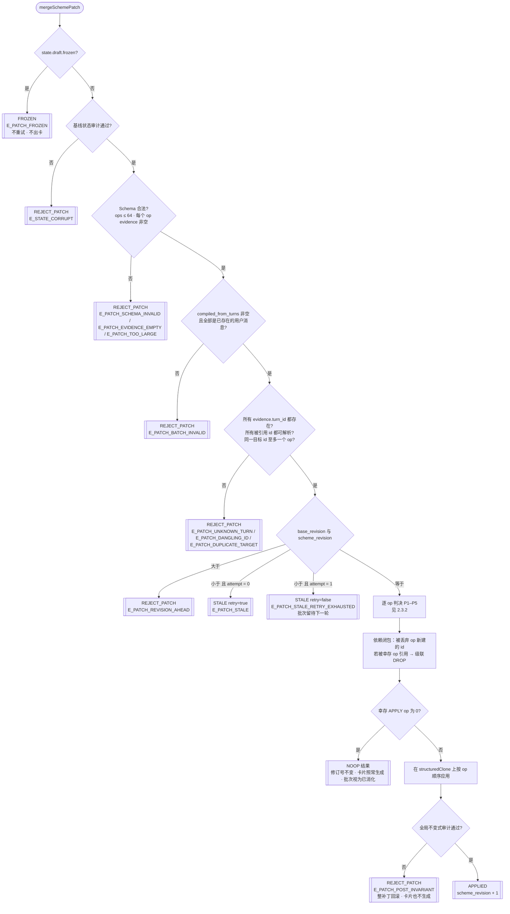
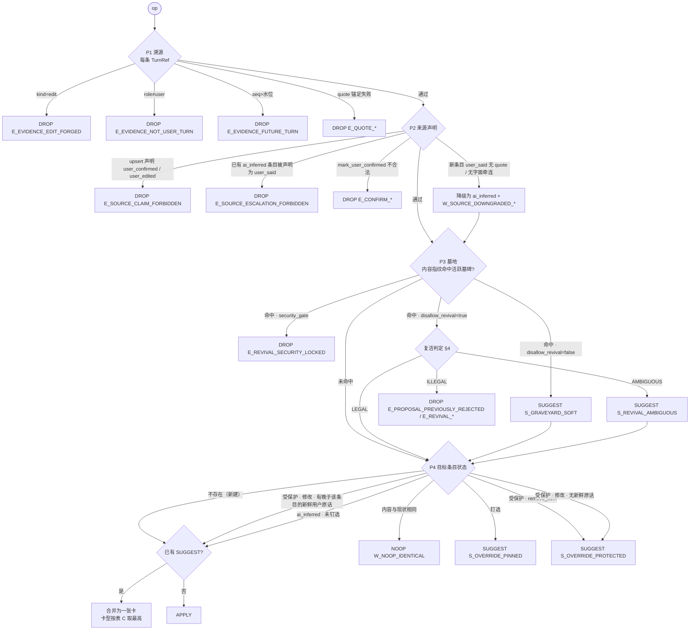

# SchemePatch 零模型确定性合并引擎 · 架构规范与测试矩阵（TASK-J.9）

> **状态**：**设计定稿 · 待施工**（立卡见 [`development-tasks.md`](./development-tasks.md) §3.4c `TASK-J.9`）
> **建立日期**：2026-10-27（Asia/Hong_Kong）
> **上位规格**：[`supervisor.md`](./supervisor.md) 第三部分 §14.2（`SchemeDraftV2`）、§14.3（`SchemePatch` 与合并规则）、§14.11（证据台账与 `INV-LEDGER-01～04`）；相关 §3.3（pin 与覆盖建议）、§14.7（溯源高亮与撤销）、§16.5（冻结后分流）。
> **与上位规格的关系**：本文是上述条款的**实施口径**，不新增产品行为。**K-1～K-16、G-MATCH、墓地不可变式的权威正文只在 [`supervisor.md`](./supervisor.md) §14.11**；冲突以 supervisor 为准，并回头修本文。
> **读者**：实现 `src/lib/journey/scheme-patch-engine.ts` 的本地工程团队；评审 J.9 PR 的人。
>
> > **DOC-10（2026-11-01）**：本文曾自带 K-1～K-13 全表与 G-MATCH 公式副本，已与 SSOT 出现 K-9 / K-13 编号漂移。重复条款已删除，改为下方指针与实现索引。

---

## 0. 一句话

**引擎是一个纯函数**：`(当前台账状态, 编译器补丁, 只读对话记录, 上下文) → (新状态 | 拒绝 | 过期 | 冻结, 逐 op 判决日志)`。它不调用模型、不读磁盘、不读时钟、不生成随机数；同样的输入永远得到逐字节相同的输出。

---

## 1. 范围、术语与对上位规格的收紧

### 1.1 范围

| 在范围内（J.9） | 不在范围内 |
| :--- | :--- |
| 补丁解析、结构校验、修订号与冻结闸门 | 编译器调用真模型、防抖、预算（J.10） |
| 逐 op 判决：溯源、来源声明、墓地、pin / 受保护条目 | 金标对话集（J.11） |
| 引用子串锚定算法（`INV-LEDGER-01`） | Worker 产出物的墓地门禁（`INV-LEDGER-03` 第 1 款，Worker 侧） |
| 墓地复活判定（`INV-LEDGER-03` 第 2 款） | 冻结后回写补丁（`INV-LEDGER-04`，J.16） |
| 用户手改、覆盖建议的采纳 / 拒绝、否决入墓（三个配套纯函数） | `renderSchemeDiagrams`（V-07，拆为 J.9b） |
| `SchemeDraftV2 → EvidenceLedger` 投影 | Daemon 持久化、广播、触发范围预检（J.10 接线） |

### 1.2 术语

| 术语 | 含义 |
| :--- | :--- |
| **对话记录（Transcript）** | 只追加的消息序列。每条消息有 `turn_id`、`role`、单调递增的 `seq`、原文 `text` 与 `text_sha256`。提交后不可改；用户「编辑消息」在记录里是一条新消息。 |
| **批次（Batch）** | 补丁的 `compiled_from_turns`，即本次编译新消化的用户消息。 |
| **水位（Watermark）** | 批次里最大的 `seq`。补丁不得引用水位之后的消息。 |
| **受保护条目** | `source ∈ {user_said, user_confirmed, user_edited}` 的条目。 |
| **钉选条目** | `user_pinned === true` 的条目（用户手改过）。钉选比受保护更强。 |
| **活跃墓碑** | `status === "active"` 的墓地条目。已复活的墓碑不再拦截。 |
| **判决（Verdict）** | 每个 op 的处理结果，取值见 §2.2 的判决格。 |

### 1.3 对上位规格的收紧与补全（登记表）

> **SSOT**：K-1～K-16 的权威正文**只**在 [`supervisor.md`](./supervisor.md) §14.11 第 4 小节。**冲突以 supervisor 为准**（含 **K-9 / K-15**：`E_PROPOSAL_PREVIOUSLY_REJECTED` 编译日志码 vs 工地 L3 运行时码 / `ERROR_CODES` 关系）。本文**不再复述** K 表全文。

**本文实现索引**（仅落点指针，不重复条款）：

| # | 本文落点（算法 / 类型 / 码） |
| :--- | :--- |
| K-1 | §5.2 类型；P1 伪造 `EditRef` |
| K-2 | §3 锚定；`mark_user_confirmed` / 复活 / `user_said` 的 `quote` |
| K-3 | §2.4 两级原子性 |
| K-4 | §5.1 / §5.2 墓地扩展字段与 `migrateGraveyardEntry` |
| K-5 / K-6 | §2.3 P3；`E_REVIVAL_SECURITY_LOCKED` / `S_GRAVEYARD_SOFT` |
| K-7 | §5.4 `EditResult`；撤销 → 新修订 |
| K-8 | §5.2 `introduced_after_turn_seq` |
| K-9 | **以 supervisor K-9 + K-15 为准**（本文码表 §5.3 只列编译日志码） |
| K-10 | §4.2 命中 (d)；语义见 SSOT G-MATCH-NL-4 |
| K-11 | §2.3.2 / §5.4 `reject_item` |
| K-12 | §4.4 `ignoreOccurrence` |
| K-13 | **以 supervisor 为准**（生成端 `reject_item`）；见下方「仅属本文件」迁移注 |
| K-14～K-16 | 试玩 / 归因侧，见 [`playtest-self-check.md`](./playtest-self-check.md)；权威仍在 supervisor |

**仅属本文件的非重复补充**（原引擎表曾误把下列口径标成「K-13」，与 supervisor 的 K-13 编号冲突；编号以 SSOT 为准，内容保留为 K-4 迁移实现注）：

- `migrateGraveyardEntry` 对缺失 `rejected_after_turn_seq` 的旧墓碑**默认 0**。含义：任何 `seq > 0` 的用户消息都满足复活判定 R2 的时间条件，时间下界被放宽到几乎无约束；风险由 R1–R9 其余闸门兜底。旧数据无法确知否决水位；取 0 偏宽放而非偏紧收。实施期若需收紧须改 supervisor 登记并回写本注。

---

## 2. 问题一：不变式交叉碰撞的确定性决议流

### 2.1 总原则

1. **分层闸门，先粗后细**：补丁级闸门（冻结 → 结构 → 修订号）全部通过后，才进入逐 op 判决。补丁级闸门失败时**不评估任何 op**，也不产生覆盖建议卡。
2. **拒绝优先（deny-overrides）**：一个 op 同时触发多条规则时，取判决格里**最严重**的那个结果。「拦截」压过「问用户」，「问用户」压过「直接写入」。
3. **规则按固定顺序求值，短路**：每个 op 依次经过 P1 溯源 → P2 来源声明 → P3 墓地 → P4 钉选与受保护 → P5 写入。前一级给出「丢弃」即短路；前一级给出「问用户」时，后一级只能把结果再收紧，不能放宽。
4. **一个 op 至多一张卡**：同一 op 触发多种「问用户」时，只出一张卡，卡型取优先级最高者（§2.3 表 C）。
5. **一个修订**：幸存 op 在克隆体上一次性应用，再做全局不变式审计；审计失败则整补丁回滚。成功时 `scheme_revision` 只加 1，与幸存 op 数无关。

### 2.2 判决格（从严到宽）

```text
REJECT_PATCH   整补丁丢弃（结构错误 / 基线损坏 / 审计失败）
FROZEN         整补丁丢弃（方案已冻结；无重试；新意图走 §16.5 分流）
STALE          整补丁暂不合并（修订号落后；可重试 0 或 1 次）
  ── 以下为 op 级 ──
DROP           单 op 丢弃（溯源失败 / 墓地拦截 / 越权升级 / 依赖被丢弃）
SUGGEST        单 op 不写入，转成一张卡（覆盖建议 / 复活追问 / 软墓碑推荐）
APPLY          单 op 写入
NOOP           单 op 内容与现状相同，什么都不做
```

op 级严重度：`DROP > SUGGEST > APPLY > NOOP`。

### 2.3 判定树

#### 2.3.1 补丁级（Mermaid）



**补丁级优先级的理由**：

| 次序 | 闸门 | 为什么排在这里 |
| :--- | :--- | :--- |
| 1 | 冻结 | 冻结是终态权威。先查修订号会触发一次无意义的重编译；先查 Schema 会为一个注定作废的补丁记编译失败，污染 §14.8「连续 3 次失败」计数。 |
| 2 | 基线审计 | 基线已损坏时，任何合并都会把损坏传下去。 |
| 3 | 结构（Schema / 批次 / 悬空 id / 重复目标） | 结构错误说明编译器出了缺陷，应计入失败计数，不应消耗唯一一次重试机会。 |
| 4 | 修订号 | 只有结构合法的补丁才值得重编译。 |
| 5 | 逐 op | — |

**`base_revision` × `frozen` × 原子性 真值表**（`struct` 指第 2、3 步全部通过）：

| # | frozen | struct | base vs cur | attempt | 结果 | 修订号 | 出卡 | 批次游标 |
| :-: | :-: | :-: | :-: | :-: | :--- | :-: | :-: | :--- |
| 1 | T | 任意 | 任意 | 任意 | `FROZEN` | 不变 | 否 | 不推进（冻结后消息走 §16.5） |
| 2 | F | F | 任意 | 任意 | `REJECT_PATCH` | 不变 | 否 | 不推进 |
| 3 | F | T | `>` | 任意 | `REJECT_PATCH`（`E_PATCH_REVISION_AHEAD`） | 不变 | 否 | 不推进 |
| 4 | F | T | `<` | 0 | `STALE(retry=true)` | 不变 | 否 | 不推进 |
| 5 | F | T | `<` | 1 | `STALE(retry=false)` | 不变 | 否 | 不推进 |
| 6 | F | T | `=` | 任意 | 进入 op 判决；全部 DROP/SUGGEST/NOOP → `NOOP` | 不变 | 视判决 | 推进 |
| 7 | F | T | `=` | 任意 | 进入 op 判决；有 APPLY，审计通过 → `APPLIED` | +1 | 视判决 | 推进 |
| 8 | F | T | `=` | 任意 | 进入 op 判决；有 APPLY，审计失败 → `REJECT_PATCH` | 不变 | 否 | 不推进 |

「批次游标」指调用方保存的「已消化到哪条用户消息」。引擎只在结果里给出 `batch_consumed: boolean`，调用方据此推进游标。游标不推进时，下一次 `USER_TURN_COMMITTED` 触发编译会把这些消息再带上——**用户的话不会因为合并失败而丢失**。

#### 2.3.2 op 级（P1–P5）



**op 级优先级的理由**：

| 次序 | 规则 | 为什么排在这里 |
| :--- | :--- | :--- |
| P1 | 溯源（`INV-LEDGER-01`） | 证据不成立，后面所有判断都没有事实基础。 |
| P2 | 来源声明（`INV-LEDGER-02`） | 越权升级是硬拒绝，不能被后续「问用户」软化。 |
| P3 | 墓地（`INV-LEDGER-03`） | 墓地拦截是**否决**，钉选是**询问**。按拒绝优先，墓地必须先于钉选。否则一个已被否决的想法会借「覆盖建议卡」重新出现在用户面前，等于 AI 自行重提。 |
| P4 | 钉选与受保护（§3.3） | 只决定「直接写」还是「先问」。 |
| P5 | 写入 | — |

**`reject_item` 的 op 级判定**（K-11）：P1 在通用溯源之外追加两条。其一，证据 turn 必须在 `compiled_from_turns` 内，否则 `E_REJECT_TURN_NOT_IN_BATCH`。其二，锚定句须含 `NEGATION_CUES` 中的否定词且不是问句，否则 `E_REJECT_NOT_NEGATED`；否定判定只看引擎词表，不采信 op 自报。P3 墓地不适用，与 `remove_item` 同理。P4 复用受保护规则：目标不存在 → `E_REJECT_TARGET_MISSING`；`user_pinned` → `SUGGEST S_OVERRIDE_PINNED`；`user_said` / `user_confirmed` 未钉选 → `SUGGEST S_OVERRIDE_PROTECTED`；其余 → APPLY（生效规则见 §5.4）。

#### 2.3.3 三方碰撞真值表：`user_pinned` × 墓地 × AI 覆盖

列含义：`pin` 目标是否钉选；`grave` 内容是否命中活跃墓碑（`H` 命中且 `disallow_revival=true`；`S` 命中且为 `false`；`G` 命中且 `rejected_by=security_gate`；`-` 未命中）；`rev` 复活判定（`L` 合法、`A` 模糊、`I` 非法、`-` 不适用）。

| # | pin | grave | rev | 结果 | 码 |
| :-: | :-: | :-: | :-: | :--- | :--- |
| Z-01 | F | - | - | APPLY | — |
| Z-02 | T | - | - | SUGGEST（覆盖建议） | `S_OVERRIDE_PINNED` |
| Z-03 | F | H | I | DROP | `E_PROPOSAL_PREVIOUSLY_REJECTED` |
| Z-04 | T | H | I | DROP（**不出卡**） | `E_PROPOSAL_PREVIOUSLY_REJECTED` |
| Z-05 | F | H | L | APPLY，来源 `user_said`，墓碑标 `revived` | — |
| Z-06 | T | H | L | SUGGEST（覆盖建议；采纳时同时复活墓碑） | `S_OVERRIDE_PINNED` |
| Z-07 | F | H | A | SUGGEST（复活追问） | `S_REVIVAL_AMBIGUOUS` |
| Z-08 | T | H | A | SUGGEST（**一张**复活追问卡，携带覆盖目标） | `S_REVIVAL_AMBIGUOUS` |
| Z-09 | F | S | - | SUGGEST（软墓碑推荐） | `S_GRAVEYARD_SOFT` |
| Z-10 | T | S | - | SUGGEST（一张覆盖建议卡，标注「曾被否决」） | `S_OVERRIDE_PINNED` |
| Z-11 | F | G | 任意 | DROP | `E_REVIVAL_SECURITY_LOCKED` |
| Z-12 | T | G | 任意 | DROP | `E_REVIVAL_SECURITY_LOCKED` |

**表 C：一张卡的卡型优先级**（高 → 低）：`S_REVIVAL_AMBIGUOUS` > `S_OVERRIDE_PINNED` > `S_OVERRIDE_PROTECTED` > `S_GRAVEYARD_SOFT`。卡上同时列出全部触发原因（`reasons[]`），用户一次点击即可同时解决。

**卡片采纳的连锁效果**（由 `acceptSuggestion` 执行，见 §6.3）：采纳 Z-06 / Z-08 类卡片时，在同一修订内同时完成「解 pin 并覆盖」与「墓碑标 `revived`」。拒绝任何一张卡时，该 op 的内容指纹以 `rejected_by: "user"`、`disallow_revival: true` 入墓——同一个建议不会在下一轮再冒出来（防卡片风暴，§2.5 D-3）。

### 2.4 补丁原子性的精确定义

1. **结构级原子**：任一结构错误 → 整补丁丢弃，零 op 生效（§14.3 第 1 行）。
2. **op 级原子**：一个 op 要么完整生效，要么完整不生效。**禁止**「去掉 op 里不合格的那条证据 / 那个选项，剩余部分照写」。例：`raise_conflict` 的三个选项里有一个命中墓地 → 整个 op DROP，不是删掉那个选项。
3. **依赖闭包**：op 被 DROP 或 SUGGEST 后，它**本应新建**的 id 视为不存在。幸存 op 若引用这些 id（如 `upsert_flow.steps[].module_id` 指向被丢弃的 `upsert_module`），级联 DROP，码 `E_OP_DEPENDENCY_DROPPED`。迭代至不动点；按 op 原始下标升序处理，结果与迭代次序无关。
4. **修订级原子**：幸存 op 在 `structuredClone(state)` 上按原始顺序应用，然后跑全局审计（§6.4）。审计失败 → 丢弃克隆体，整补丁 `REJECT_PATCH`，本次的卡片也一并作废。成功 → 一次性替换，修订号 +1。
5. **id 解析与顺序无关**：判断「被引用 id 是否存在」时，可解析集合 = 基线已有 id ∪ 本补丁所有 `upsert_*` / `propose_decision` / `raise_conflict` 的 `item.id`。前向引用合法。
6. **同一目标至多一个 op**：一个补丁里两个 op 指向同一 `id`（如同时 `remove_item X` 与 `mark_user_confirmed X`）→ `E_PATCH_DUPLICATE_TARGET` 整补丁丢弃。编译器自相矛盾时，引擎不替它挑一个。

### 2.5 死锁、活锁与竞态

| # | 情形 | 风险 | 确定性处置 | 测试 |
| :-: | :--- | :--- | :--- | :--- |
| D-1 | 每次重编译都恰好落后 | 无界重试 | `attempt ∈ {0,1}`；第 2 次仍落后 → `STALE(retry=false)`，批次留待下一条用户消息 | TM-R-05 |
| D-2 | 用户持续手改中栏，编译永远落后 | 活锁 | 同 D-1；编译器只由用户消息触发（§14.4），用户沉默时不会空转 | TM-D-01 |
| D-3 | 同一覆盖建议每轮重复出现 | 卡片风暴 | 卡片按 `(target_id, op_fingerprint)` 去重（`W_SUGGESTION_DEDUPED`）；用户拒绝 → 入墓，下次直接 DROP | TM-D-02、TM-D-03 |
| D-4 | 合法复活的内容撞上钉选条目 | 两条规则互等 | 不互等：复活合法只解除墓地拦截，钉选仍出卡，由用户决定（Z-06） | TM-Z-06 |
| D-5 | 编译器反复产出自相矛盾的补丁 | 持续 REJECT | 计入 §14.8 失败计数；批次不推进但不热循环（无空闲触发） | TM-D-04 |
| D-6 | 覆盖建议卡未处理时方案被冻结 | 冻结后卡片被采纳 | 冻结时调用方对全部待决卡执行 `expireSuggestionsOnFreeze`，状态 `expired_by_freeze`；`acceptSuggestion` 对冻结方案返回 `E_PATCH_FROZEN` | TM-D-05 |
| D-7 | 撤销让内容回到修订 N，再来一个基于 N 的补丁 | ABA | 撤销产生修订 N+2（K-7），基于 N 的补丁判 STALE | TM-D-06 |
| D-8 | 两个补丁并发合并 | 丢更新 | 引擎是纯函数，结果携带 `expected_prev_revision`。调用方必须持方案互斥锁，并在落盘时做 CAS（`当前修订 === expected_prev_revision`），失败则以 attempt=1 重跑 | TM-D-07（调用方契约测试，桩存储） |

---

## 3. 问题二：零模型子串校验与锚定算法（`INV-LEDGER-01`）

### 3.1 设计目标

- **只容忍「排版噪声」，不容忍「措辞变化」**。排版噪声包括：换行符风格、空白种类与数量、首尾空白、零宽字符、全角半角等 Unicode 兼容等价。措辞变化包括：同义替换、增删任意可见字符、繁简转换、大小写、标点增删、省略号拼接。
- **锚点必须能还原到原文偏移**，供 §14.7 高亮使用。
- **结果唯一**：同一段话出现多次时，有确定的选取规则。

### 3.2 规范化函数 `normalizeForAnchor`

对**对话原文**与 **quote** 应用同一函数，并为原文构建偏移映射。步骤按顺序执行：

| 步 | 操作 | 例 |
| :-: | :--- | :--- |
| N1 | 换行统一：`\r\n` → `\n`，孤立 `\r` → `\n` | `"a\r\nb"` → `"a\nb"` |
| N2 | 删除零宽与格式字符：U+200B、U+200C、U+200D、U+2060、U+FEFF、U+00AD | `"登​录"` → `"登录"` |
| N3 | **按字素簇**做 NFKC（`Intl.Segmenter("und", { granularity: "grapheme" })`） | `"ＡＰＩ"` → `"API"`；`"é"` → `"é"` |
| N4 | 任意连续空白（JS `\s`，含 `\n`、`\t`、U+00A0、U+3000）折叠为单个 U+0020 | `"第一行\n\n  第二行"` → `"第一行 第二行"` |
| N5 | 去首尾空格（只对 quote 有意义；对原文执行不影响匹配） | `"  导出 "` → `"导出"` |

**刻意不做**：大小写折叠、去标点、繁简转换、同义词、编辑距离、省略号展开。`"excel"` 与 `"Excel"` 不相等；`"导出Excel"` 与 `"导出 Excel"` 也不相等（N4 只折叠已有空白，不插入或删除空白）。

**为什么按字素簇做 NFKC**：整串 NFKC 会改变长度且无法逐字映射回原文。按字素簇规范化，可以为每个规范化后的 UTF-16 码元记录它来自哪个原文簇。对常见中文、英文与 emoji 文本，结果与整串 NFKC 相同。少数跨簇组合（如孤立韩文字母序列）可能有差异；这对两侧一致生效，不会造成误判。

**Unicode 版本漂移**：NFKC 与字素切分依赖运行时 ICU 数据。测试夹具只使用 Unicode 13 之前已稳定的字符，避免 Node 升级导致测试漂移。

**偏移映射**：

```ts
interface NormalizedText {
  text: string;        // 规范化结果
  rawStart: number[];  // rawStart[i] = 规范化第 i 个 UTF-16 码元对应的原文起始偏移
  rawEnd: number[];    // rawEnd[i]   = 对应原文簇的结束偏移（不含）
}
```

折叠空白时，一个空格映射到被折叠空白段的第一个原文码元；`rawEnd` 指向该段末尾。被 N2 删除的字符不产生规范化码元。这样，规范化区间 `[s, e)` 映射回原文区间 `[rawStart[s], rawEnd[e-1])`，高亮会自然覆盖被折叠的换行与零宽字符。

### 3.3 匹配与锚定算法 `anchorQuote`

```ts
function anchorQuote(turn: TranscriptTurn, ref: TurnRef, opts?: { requireQuote?: boolean }): AnchorResult
```

```text
输入：turn（原文 + text_sha256），ref.quote，ref.occurrence?（可选，0 起）
1. 若 ref.quote 缺失：
     requireQuote ? 失败 E_QUOTE_REQUIRED : 返回 { kind: "whole_turn" }（无高亮）
2. q = normalizeForAnchor(ref.quote).text
   若 q.length === 0               → 失败 E_QUOTE_EMPTY
   若 字素数(q) > 500              → 失败 E_QUOTE_TOO_LONG
3. h = normalizeForAnchor(turn.text)
4. 枚举 h.text 中 q 的全部出现位置（允许重叠；逐位 indexOf，fromIndex = 上次起点 + 1）
   若 0 处                         → 失败 E_QUOTE_NOT_FOUND
5. 短引用约束：若 字素数(q) < 4，则每个出现位置都必须满足「整句边界」：
     左侧是文本开头或句界符，右侧是文本结尾或句界符；
     句界符 = 空格 或 [。！？!?；;，,、…~]
   过滤后 0 处                     → 失败 E_QUOTE_TOO_SHORT_UNBOUNDED
   （过滤先于选取：步骤 6 只在本步骤保留的候选中取值，不回头取被过滤掉的出现处。）
6. 选取锚点：
     若 ref.occurrence 有值：越界 → 失败 E_QUOTE_OCCURRENCE_OUT_OF_RANGE；否则取第 occurrence 处
     否则取**最后一处**
   出现处数 > 1 时附 W_QUOTE_MULTI_MATCH
7. 返回 {
     kind: "span",
     norm_start, norm_end,
     raw_start = h.rawStart[norm_start], raw_end = h.rawEnd[norm_end - 1],
     occurrence_index, occurrence_count,
     turn_text_sha256: turn.text_sha256
   }
```

**为什么默认取最后一处**：同一条消息里，用户后说的话代表他在这条消息里的最终态度（例：「先别加 Excel 导出……想了想，还是加 Excel 导出吧」）。§4 的复活判定与 §3.4 的确认判定都在这一处上做否定词与问句检查，高亮也落在这一处，三者口径一致。编译器给出的 `occurrence` 只影响锚点选择；复活判定路径忽略它（§4.4，K-12）。确认判定路径（§3.4）存在同型洗白面，修法待定（显式风险，见 K-12）。

**为什么短引用要整句边界**：「对」「好」「可以」是合法的确认原话，不能设最小长度拒之门外。但一个字的 quote 几乎能在任何消息里找到（「对」出现在「对比」里）。要求它构成一个完整的短句，就排除了这种碰巧命中。

**锚点不可信任编译器**：编译器提交的 `anchor` 字段一律丢弃，由引擎重算后写入存储。存储的锚点带 `turn_text_sha256`；全局审计时若发现哈希与对话记录不符，判 `E_STATE_CORRUPT`。

### 3.4 边界判例

> **勘误（2026-10-28，Tina 裁决）**：Q-16、Q-19 原判例与步骤 5「过滤后选取」冲突（Q-16 期望的第 2 处、Q-19 期望的「哈哈」均不满足整句边界）。以步骤 5 为准，判例已改写；台账 J9-2 登记。判例与算法冲突时以算法为准，但判例必须同步修改，不得保留旧期望。

| # | 原文（`␤` 表示换行） | quote | 结果 | 原因 |
| :-: | :--- | :--- | :--- | :--- |
| Q-01 | `我要导出报表` | `导出报表` | 通过 | 精确子串 |
| Q-02 | `第一行\r\n第二行` | `第一行\n第二行` | 通过 | N1 |
| Q-03 | `第一行␤␤第二行` | `第一行 第二行` | 通过 | N4 |
| Q-04 | `要  导出` | `  要 导出  ` | 通过 | N4 + N5 |
| Q-05 | `调用ＡＰＩ` | `调用API` | 通过 | N3 |
| Q-06 | `登​录页` | `登录页` | 通过 | N2 |
| Q-07 | `café`（e + U+0301） | `café`（U+00E9） | 通过 | N3 |
| Q-08 | `我要导出报表` | `我想导出报表` | 失败 `E_QUOTE_NOT_FOUND` | 释义 |
| Q-09 | `用 Excel` | `用 excel` | 失败 | 不折叠大小写 |
| Q-10 | `导出Excel` | `导出 Excel` | 失败 | 不插入空白 |
| Q-11 | `我要报表，还要导出` | `我要报表…导出` | 失败 | 省略号拼接 |
| Q-12 | `用户登录` | `用戶登錄` | 失败 | 不做繁简 |
| Q-13 | `对比一下` | `对` | 失败 `E_QUOTE_TOO_SHORT_UNBOUNDED` | 短引用不在整句边界 |
| Q-14 | `对，就用假数据` | `对` | 通过 | 「对」后是句界符 |
| Q-15 | `对` | `对` | 通过 | 整条消息 |
| Q-16 | `导出，先导出再说` | `导出` | 通过：候选仅第 1 处（第 2 处「先导出」左侧非边界，被步骤 5 过滤），取第 1 处，附 `W_QUOTE_MULTI_MATCH`（原文出现 2 处） | 过滤后取最后一处（唯一候选即第 1 处） |
| Q-17 | 同上 | `导出` + `occurrence: 0` | 通过，取第 1 处 | 显式指定 |
| Q-18 | 同上 | `导出` + `occurrence: 5` | 失败 `E_QUOTE_OCCURRENCE_OUT_OF_RANGE` | 越界 |
| Q-19 | `哈哈哈` | `哈哈` | 失败 `E_QUOTE_TOO_SHORT_UNBOUNDED`：两处出现（重叠）均无整句边界，过滤后候选为空 | 短引用须整句边界 |
| Q-20 | `👍🏽 好的` | `好的` | 通过；`raw_start` 按 UTF-16 计（emoji 占 4 码元 + 空格） | 偏移单位 |
| Q-21 | 任意 | `"   "` | 失败 `E_QUOTE_EMPTY` | 规范化后为空 |
| Q-22 | 任意 | 501 字 | 失败 `E_QUOTE_TOO_LONG` | 上限 |
| Q-23 | `做登录页` | `做登录页。` | 失败 | 标点增加即变化 |

---

## 4. 问题三：墓地逃生口的确定性判定（`INV-LEDGER-03`）

### 4.1 核心思路

「用户明确重提」被拆成六个**可机械检查**的条件。全部满足才是合法复活；任一硬条件不满足即拒绝；硬条件满足但「明确性」不足则转追问卡。三值结果的不对称设计是有意的：**误复活代价高（推翻用户的否决），误追问代价低（用户多点一下）**，所以所有拿不准的情况都落到追问。

### 4.2 墓碑指纹（入墓时一次性计算并存储）

```ts
// matchNormalize / lexemes：签名与语义见 SSOT G-MATCH-NL-1/NL-2；实现见 graveyard-match.ts
function matchNormalize(s: string): string;
function lexemes(s: string): string[];

interface GraveyardFingerprint {
  key: string;          // matchNormalize(主文本)
  lexemes: string[];    // lexemes(主文本)
}
```

「主文本」按条目类别取：`modules → name + " " + purpose`；`goals / out_of_scope / acceptance / open_questions → text`；`flows / entities → name`；`decisions → question + " " + (chosen ?? recommended)`；`conflicts → question`；`set_title / set_summary / set_audience → value`。

> **语义源（DOC-10）**：`matchNormalize`、`lexemes`、Dice、阈值与命中 (a)～(d) **只**以 [`supervisor.md`](./supervisor.md) §14.11 第 5 小节 **G-MATCH-NL** 为准；本文与 [`worker-graveyard-gate.md`](./worker-graveyard-gate.md) 只做投影，**禁止复述公式或常量值**。代码唯一实现：`src/lib/journey/graveyard-match.ts`。

**命中判定** `matchesTombstone(opContent, entry)`：按 **G-MATCH-NL-4** 求值（与条目类别无关，防止「换个 op 类型偷渡」）。多个墓碑同时命中时，按 `rejected_id` 字典序取第一个作为主墓碑，其余写入 `reasons[]`。

**(d) 的引擎侧处置（非重复语义）**：(d) 命中**不直接 DROP**，与 (a)(b)(c) 同一汇合点，进入 §4.4 `judgeRevival`（P3 → RV）。它让拦截与复活使用同一套关键词，消除「复活认得、拦截不认得」的不对称。

**能力边界（必须写进 PR 描述）**：(b)(c)(d) 都是字面匹配，**抓不住纯语义改写**（「用 MongoDB」与「换成文档数据库」Dice 为 0）。零模型方案在此处的残余风险由三层兜底：① 编译器与 Worker 的提示词注入活跃墓碑（§14.11 已规定）；② 金标对话集加入「语义改写偷渡」样本并要求 0 漏网（J.11）；③ Worker 产出物门禁（不在 J.9）。阈值 0.75 是保守取值：宁可误拦一个相似的新想法（用户仍可亲口说出来走合法复活），不可漏放一个已否决的想法。(d) 只抓复用了用户原话关键词的重提。「MongoDB 存储」与墓碑「用 MongoDB 存数据」之间只有模块名重叠，既不超过 Dice 阈值，也不含用户原话的完整关键词，(d) 不命中，仍放行。这是已登记的残余风险，由 J.11 金标覆盖。

### 4.3 复活关键词 `revival_keys`

入墓时确定性计算并存储：

```text
revival_keys = 去重排序(
  [ entry.fingerprint.key ]
  ∪ { matchNormalize(q) | q 是被否决条目入墓前所有 user_said / user_confirmed 证据的 quote，且字素数 ≥ 2 }
)
```

第二项的意义：用户重提时最可能复用**自己当初的说法**，而不是 AI 起的模块名。例：模块名是「月度报表导出为 Excel 文件」，它入墓前的 `user_said` 证据 quote 是「Excel 导出」。`revival_keys = ["excel导出", "月度报表导出为excel文件"]`。用户说「还是加上 Excel 导出吧」时，R6 命中前者；只靠长名则永远命中不了。编译器给的 quote 越贴近用户原话的最小切片，复活越容易被识别。

### 4.4 判定函数 `judgeRevival`

```ts
type RevivalJudgement =
  | { kind: "LEGAL"; turn_id: string; anchor: QuoteAnchor; key: string }
  | { kind: "AMBIGUOUS"; code: "S_REVIVAL_AMBIGUOUS"; why: RevivalAmbiguity }
  | { kind: "ILLEGAL"; code: RevivalErrorCode };

function judgeRevival(input: {
  op: ClassifiedOp;                 // 已过 P1/P2
  entry: GraveyardEntry;            // 主墓碑
  batch: ReadonlySet<string>;       // compiled_from_turns
  transcript: TranscriptView;
}): RevivalJudgement;
```

候选证据 = `op.revival?.evidence`（显式复活声明）优先；没有显式声明时取 `op.evidence`（**隐式复活自动识别**：编译器忘了声明，但用户确实重提了，也能放行；编译器没声明且用户没重提，就是偷渡，拦截）。对每条候选 `TurnRef` 依次检查，**任一条 LEGAL 即 LEGAL**；否则若任一条 AMBIGUOUS 即 AMBIGUOUS；否则 ILLEGAL（取第一条候选的失败码）。

**锚点选择（K-12）**：`judgeRevival` 调用 `anchorQuote` 时传入可选项 `ignoreOccurrence: true`（默认 false）。编译器提供的 `ref.occurrence` 被丢弃并记 `W_REVIVAL_OCCURRENCE_IGNORED`，锚点一律取最后一处。若允许 `occurrence` 指向前面的出现，「还是加上 X。算了，不要 X」就能被洗成 LEGAL（R-18）。

| 条件 | 类型 | 检查 | 不满足 |
| :-: | :-: | :--- | :--- |
| R0 | 硬 | `entry.rejected_by === "user"` | ILLEGAL `E_REVIVAL_SECURITY_LOCKED` |
| R1 | 硬 | 候选消息 `role === "user"`（P1 已查，此处断言） | ILLEGAL `E_EVIDENCE_NOT_USER_TURN` |
| R2 | 硬 | 候选消息 `seq > entry.rejected_after_turn_seq`（**严格晚于否决**；否决那句话本身不能复活） | ILLEGAL `E_REVIVAL_NOT_AFTER_REJECTION` |
| R3 | 硬 | 候选 `turn_id ∈ batch`（**必须来自本批新消化的话**；更早的话若当时没触发复活，现在拿来复活就是推测） | ILLEGAL `E_REVIVAL_TURN_NOT_IN_BATCH` |
| R4 | 硬 | `quote` 存在且按 §3.3 锚定成功（`requireQuote: true`） | ILLEGAL `E_QUOTE_*` |
| R5 | 硬 | op 内容命中**该**墓碑（§4.2）；显式声明 `revival.rejected_id` 时必须等于主墓碑 | ILLEGAL `E_REVIVAL_FINGERPRINT_MISMATCH` |
| R6 | 明确性 | `matchNormalize(锚定句)` 包含某个 `revival_keys` 元素 | AMBIGUOUS `NO_KEY`（用户可能在指代「刚才否掉的那个」，按规格走追问） |
| R7 | 明确性 | 关键词左侧 8 个字素窗口内**无**否定词 | 见下 |
| R8 | 明确性 | 锚定句**不是**问句 | AMBIGUOUS `QUESTION` |
| R9 | 明确性 | 锚定句含肯定动作词 | AMBIGUOUS `NO_AFFIRMATION` |

R7 的特殊处理：命中否定词说明用户在**重申否决**（「还是不要 Excel 导出」）。这不是模糊，而是明确的反向意图 → ILLEGAL `E_REVIVAL_NEGATED`。

「锚定句」= 锚点所在的句子：从锚点向两侧扩展到最近的句界符 `[。！？!?；;\n]` 或文本端点（在 `normalizeForAnchor` 之后、N4 之前的文本上切分，以保留换行作为句界）。

**词表（常量，冻结在代码里，改动须改测试）**：

```ts
export const NEGATION_CUES = [
  "不要", "不用", "不需要", "别", "甭", "不做", "不加", "去掉", "取消", "删掉", "算了",
  "no", "not", "don't", "dont", "without", "remove", "drop",
] as const;

export const QUESTION_CUES = ["?", "？", "吗", "么", "呢", "要不要", "是否", "是不是", "好不好", "行不行"] as const;

export const AFFIRMATION_CUES = [
  "要", "加上", "加回", "还是", "恢复", "改回", "用回", "就用", "重新", "需要", "做", "保留", "留着",
  "add", "bring back", "restore", "keep", "use", "need",
] as const;
```

词表匹配在 `matchNormalize` 之后的文本上做子串查找（英文词条带词边界）。「要」同时出现在「不要」里，所以 R7 先于 R9 求值；R9 查找时先把锚定句里所有否定词条替换为占位符，避免「不要」被当成肯定。

**词表的定位**：这是启发式，但它只能把结果推向「更保守」。R6–R9 任一不满足，结果最好也只是 AMBIGUOUS（问用户），从不会因为词表漏词而自动复活。词表漏掉的否定写法（如「Excel 导出就免了吧」）会因为缺少肯定词而落到 AMBIGUOUS；词表漏掉的肯定写法同样落到 AMBIGUOUS。

### 4.5 判例

前提：墓碑 `REJ-001`，主文本「Excel 导出」，`revival_keys = ["excel导出"]`，`rejected_after_turn_seq = 10`，`rejected_by: "user"`，`disallow_revival: true`。

| # | 候选消息 seq / 是否在批次 | quote（=锚定句） | 结果 | 码 |
| :-: | :--- | :--- | :--- | :--- |
| R-01 | 14 / 是 | `还是把 Excel 导出加上吧` | LEGAL | — |
| R-02 | 14 / 是 | `还是不要 Excel 导出` | ILLEGAL | `E_REVIVAL_NEGATED` |
| R-03 | 14 / 是 | `Excel 导出要不要加？` | AMBIGUOUS | `QUESTION` |
| R-04 | 14 / 是 | `Excel 导出那个` | AMBIGUOUS | `NO_AFFIRMATION` |
| R-05 | 14 / 是 | `刚才否掉的那个还是加上吧` | AMBIGUOUS | `NO_KEY` |
| R-06 | 9 / 是 | `要 Excel 导出` | ILLEGAL | `E_REVIVAL_NOT_AFTER_REJECTION` |
| R-07 | 10 / 是 | `不要 Excel 导出`（否决原话） | ILLEGAL | `E_REVIVAL_NOT_AFTER_REJECTION` |
| R-08 | 12 / 否 | `要 Excel 导出` | ILLEGAL | `E_REVIVAL_TURN_NOT_IN_BATCH` |
| R-09 | 14 / 是 | `要 excel 导出`（原文是 `要 Excel 导出`） | ILLEGAL | `E_QUOTE_NOT_FOUND` |
| R-10 | 14 / 是 | 无 quote | ILLEGAL | `E_QUOTE_REQUIRED` |
| R-11 | AI 消息 | `要 Excel 导出` | ILLEGAL | `E_EVIDENCE_NOT_USER_TURN` |
| R-12 | 14 / 是，但 `rejected_by: "security_gate"` | `要 Excel 导出` | ILLEGAL | `E_REVIVAL_SECURITY_LOCKED` |
| R-13 | 14 / 是，op 内容为「PDF 导出」，声明复活 `REJ-001` | `要 Excel 导出` | ILLEGAL | `E_REVIVAL_FINGERPRINT_MISMATCH` |
| R-14 | 14 / 是，同一消息 `先不要 Excel 导出。想了想还是加上 Excel 导出`，无 occurrence | 取最后一处所在句 | LEGAL | — |
| R-15 | 同 R-14，`occurrence: 0`（被忽略） | 最后一处所在句 | LEGAL（自动识别） | `W_REVIVAL_OCCURRENCE_IGNORED` |
| R-16 | 14 / 是，op 未声明 `revival`（隐式） | `还是把 Excel 导出加上吧` | LEGAL（自动识别） | — |
| R-17 | 14 / 是，op 未声明 `revival`，evidence 是 `我想要报表` | — | ILLEGAL | `E_PROPOSAL_PREVIOUSLY_REJECTED` |
| R-18 | 14 / 是，消息 `还是加上 Excel 导出。算了，不要 Excel 导出`，op 声明复活，`occurrence: 0`（被忽略） | 最后一处所在句（`W_REVIVAL_OCCURRENCE_IGNORED`） | ILLEGAL | `E_REVIVAL_NEGATED` |

### 4.6 复活生效

LEGAL 且 P4 判 APPLY 时，在同一修订内：

1. 条目以 `source: "user_said"` 写入；复活 `TurnRef`（含引擎重算的锚点）排在 `evidence[0]`。
2. 墓碑**不删除**（台账只追加）：`status: "revived"`，`revived = { turn_id, anchor, at_revision }`。
3. 用户日后再次否决 → 新建墓碑（新 `rejected_id`），旧墓碑保持 `revived`。

---

## 5. 问题四：交付蓝图

### 5.1 文件布局

| 文件 | 内容 | 依赖 |
| :--- | :--- | :--- |
| `src/lib/journey/scheme-patch-types.ts` | 全部类型、zod Schema、常量、码表 | `zod` |
| `src/lib/journey/evidence-anchor.ts` | `normalizeForAnchor` / `anchorQuote` / `matchNormalize` / `lexemes` / `dice` / `sentenceAt` | 无 |
| `src/lib/journey/graveyard-revival.ts` | `fingerprintOf` / `matchesTombstone` / `judgeRevival` / `buildTombstone` / `migrateGraveyardEntry` | `evidence-anchor` |
| `src/lib/journey/scheme-patch-engine.ts` | `mergeSchemePatch` 主 Pipeline；`applyUserEdit` / `acceptSuggestion` / `rejectSuggestion` / `rejectItemToGraveyard` / `expireSuggestionsOnFreeze` / `auditLedgerState` / `projectEvidenceLedger` | 上面三个 |

**硬约束**：四个文件**零 `node:*` 导入**、零 `Date.now()` / `Math.random()` / `crypto.randomUUID()`、零 `fetch`、零 fs。前后端共享（与 `scope-plan.ts` 同一纪律）。新 id 与时间戳全部从 `ctx` 注入。ESLint 可加 `no-restricted-globals` / `no-restricted-imports` 守卫。

### 5.2 类型（`scheme-patch-types.ts`）

```ts
// ───────────── 对话记录（只读视图，由调用方提供） ─────────────
export interface TranscriptTurn {
  turn_id: string;
  role: "user" | "assistant" | "system";
  seq: number;                 // 单调递增，全局唯一
  text: string;                // 原文，提交后不可变
  text_sha256: string;         // 由 Daemon 计算（引擎不算哈希，保持零 node 依赖）
}
export interface TranscriptView {
  get(turn_id: string): TranscriptTurn | undefined;
}

// ───────────── 证据 ─────────────
export interface QuoteAnchor {
  kind: "span";
  norm_start: number; norm_end: number;
  raw_start: number;  raw_end: number;     // UTF-16 偏移，供 UI 高亮
  occurrence_index: number; occurrence_count: number;
  turn_text_sha256: string;
}
export interface TurnRef {
  turn_id: string;
  quote?: string;
  occurrence?: number;          // 编译器可选提示
  anchor?: QuoteAnchor;         // 仅引擎写入；编译器提交的会被丢弃
}
export interface EditRef {
  edit_event_id: string; edited_at: number; field_name?: string; previous_value?: string;
}
export type EvidenceItem = { kind: "turn"; ref: TurnRef } | { kind: "edit"; ref: EditRef };

// 与 supervisor.md §14.2 ItemSource 同形；权威定义以 SSOT 为准，此别名仅为本文档类型块自洽
export type ItemSource = "user_said" | "user_confirmed" | "ai_inferred" | "user_edited";

export interface SchemeItemMeta {
  id: string;
  source: ItemSource;
  evidence: EvidenceItem[];
  user_pinned: boolean;
  updated_in_revision: number;
  introduced_after_turn_seq?: number;   // K-8，引擎自有
}

// SchemeDraftV2 结构与 supervisor.md §14.2 一致，仅 evidence 字段类型按 K-1 使用 EvidenceItem[]
export type SchemeCollection =
  | "goals" | "out_of_scope" | "modules" | "flows" | "entities"
  | "decisions" | "conflicts" | "open_questions" | "acceptance";

// ───────────── 墓地（§14.11 RejectedAlternative + K-4 扩展字段） ─────────────
export interface GraveyardEntry {
  rejected_id: string;
  proposal: string;
  rejected_by: "user" | "security_gate";
  rejection_reason: string;
  evidence: EvidenceItem[];
  disallow_revival: boolean;
  updated_in_revision: number;
  // K-4
  item_ref?: { collection: SchemeCollection; id: string };
  fingerprint: { key: string; lexemes: string[] };
  revival_keys: string[];
  rejected_after_turn_seq: number;
  status: "active" | "revived";
  revived?: { turn_id: string; anchor: QuoteAnchor; at_revision: number };
}

// ───────────── 卡片 ─────────────
export type SuggestionKind =
  | "S_REVIVAL_AMBIGUOUS" | "S_OVERRIDE_PINNED" | "S_OVERRIDE_PROTECTED" | "S_GRAVEYARD_SOFT";
export interface Suggestion {
  suggestion_id: string;               // ctx.newId("SUG")
  kind: SuggestionKind;                // 表 C 最高者
  reasons: SuggestionKind[];           // 全部触发原因
  target?: { collection: SchemeCollection; id: string };
  op: SchemeOp;                        // 原 op（已去掉编译器 anchor）
  op_fingerprint: string;              // stableStringify(op 内容) 的规范串，用于去重
  tombstone_ids: string[];
  created_in_revision: number;
  status: "pending" | "accepted" | "rejected" | "expired_by_freeze";
}

// ───────────── 引擎状态 ─────────────
export interface LedgerState {
  draft: SchemeDraftV2;
  graveyard: GraveyardEntry[];
  suggestions: Suggestion[];
}

// ───────────── 补丁（§14.3 + 可选 revival） ─────────────
export interface RevivalClaim { rejected_id: string; evidence: TurnRef[] }
export type SchemeOp =
  | { op: "set_title" | "set_summary" | "set_audience"; value: string; evidence: TurnRef[]; revival?: RevivalClaim }
  | { op: "upsert_module" | "upsert_flow" | "upsert_entity" | "upsert_goal"
        | "upsert_out_of_scope" | "upsert_acceptance";
      item: Record<string, unknown> & { id: string; source?: ItemSource };
      evidence: TurnRef[]; revival?: RevivalClaim }
  | { op: "remove_item"; id: string; reason: string; evidence: TurnRef[] }
  | { op: "reject_item"; id: string; reason?: string; evidence: TurnRef[] }   // K-11，见 §2.3.2
  | { op: "propose_decision" | "raise_conflict"; item: Record<string, unknown> & { id: string };
      evidence: TurnRef[]; revival?: RevivalClaim }
  | { op: "mark_user_confirmed"; id: string; evidence: TurnRef[] }
  | { op: "add_open_question"; text: string; evidence: TurnRef[] }
  | { op: "set_size_hint"; value: "tiny" | "standard" | "large"; evidence: TurnRef[] };
export interface SchemePatch {
  base_revision: number;
  compiled_from_turns: string[];
  ops: SchemeOp[];
  partner_hint?: string;
}

// ───────────── 上下文与结果 ─────────────
export interface MergeContext {
  attempt: 0 | 1;
  newId: (prefix: "SUG" | "REJ" | "ITEM") => string;  // 确定性：测试里用计数器
}
export interface MergeInput {
  state: LedgerState;
  patch: unknown;              // 原始 JSON，引擎内部 zod 校验
  transcript: TranscriptView;
  ctx: MergeContext;
}

export interface OpVerdict {
  index: number;
  op_kind: SchemeOp["op"] | "unknown";
  target_id?: string;
  verdict: "APPLY" | "SUGGEST" | "DROP" | "NOOP";
  code?: OpCode | SuggestionKind;
  warnings: WarningCode[];
  stage: "P1" | "P2" | "P3" | "P4" | "P5" | "CLOSURE";
}
export interface MergeJournal {
  base_revision: number | null;
  observed_revision: number;
  verdicts: OpVerdict[];
  patch_warnings: WarningCode[];
}

export type MergeResult =
  | { status: "applied"; next: LedgerState; expected_prev_revision: number; revision: number;
      batch_consumed: true; journal: MergeJournal }
  | { status: "noop"; next: LedgerState;   // 修订号不变；可能新增了卡片
      expected_prev_revision: number; batch_consumed: true; journal: MergeJournal }
  | { status: "rejected"; code: PatchCode; batch_consumed: false; journal: MergeJournal }
  | { status: "stale"; code: "E_PATCH_STALE" | "E_PATCH_STALE_RETRY_EXHAUSTED"; retry: boolean;
      batch_consumed: false; journal: MergeJournal }
  | { status: "frozen"; code: "E_PATCH_FROZEN"; batch_consumed: false; journal: MergeJournal };
```

### 5.3 码表（`scheme-patch-types.ts`）

```ts
/** 补丁级：整补丁不生效 */
export const PATCH_CODES = [
  "E_PATCH_FROZEN",                 // 方案已冻结（V-04）
  "E_STATE_CORRUPT",                // 基线审计失败（含锚点哈希不符）
  "E_PATCH_SCHEMA_INVALID",         // zod 校验失败 / 未知 op
  "E_PATCH_TOO_LARGE",              // ops.length > MAX_OPS_PER_PATCH(64)
  "E_PATCH_EVIDENCE_EMPTY",         // 任一 op evidence 为空数组（§14.3 第 1 行）
  "E_PATCH_BATCH_INVALID",          // compiled_from_turns 为空 / 含非用户消息 / 含不存在消息 / 有重复
  "E_PATCH_UNKNOWN_TURN",           // evidence 引用的 turn_id 不存在
  "E_PATCH_DANGLING_ID",            // remove / mark / module_id / chosen_id 等引用不可解析
  "E_PATCH_DUPLICATE_TARGET",       // 同一目标 id 多个 op
  "E_PATCH_REVISION_AHEAD",         // base_revision > scheme_revision
  "E_PATCH_STALE",                  // base_revision < scheme_revision，可重试（V-03）
  "E_PATCH_STALE_RETRY_EXHAUSTED",  // 重试后仍落后
  "E_PATCH_POST_INVARIANT",         // 应用后审计失败，整补丁回滚
] as const;

/** op 级：单 op 丢弃 */
export const OP_CODES = [
  // P1 溯源（INV-LEDGER-01）
  "E_EVIDENCE_NOT_USER_TURN",       // V-01
  "E_EVIDENCE_FUTURE_TURN",         // seq > 水位
  "E_EVIDENCE_EDIT_FORGED",         // 编译器 op 携带 kind:"edit"（K-1）
  "E_QUOTE_REQUIRED",
  "E_QUOTE_EMPTY",
  "E_QUOTE_TOO_LONG",
  "E_QUOTE_NOT_FOUND",
  "E_QUOTE_TOO_SHORT_UNBOUNDED",
  "E_QUOTE_OCCURRENCE_OUT_OF_RANGE",
  // P2 来源（INV-LEDGER-02）
  "E_SOURCE_CLAIM_FORBIDDEN",       // upsert 声明 user_confirmed / user_edited
  "E_SOURCE_ESCALATION_FORBIDDEN",  // 已有 ai_inferred 被 upsert 声明为 user_said；或 op 把 decision.status 写成 accepted / changed
  "E_CONFIRM_TARGET_NOT_INFERRED",  // mark_user_confirmed 指向的条目不是 ai_inferred 且也不是 pending decision
  "E_CONFIRM_TURN_NOT_IN_BATCH",    // 确认原话不在本批
  "E_CONFIRM_PREDATES_TARGET",      // 确认原话 seq ≤ 条目 introduced_after_turn_seq（假冒确认）
  "E_CONFIRM_NEGATED",              // 确认句含否定词
  "E_CONFIRM_QUESTION",             // 确认句是问句
  // P3 墓地（INV-LEDGER-03）
  "E_PROPOSAL_PREVIOUSLY_REJECTED",  // 门禁层码（runtime §8 L3），引擎以 DROP 裁决输出至 journal.verdicts，权威定义见 INV-LEDGER-03
  "E_REVIVAL_SECURITY_LOCKED",      // op 级：门禁墓碑永不复活，直接 DROP（K-5、Z-11/Z-12），不经包装码 E_PROPOSAL_PREVIOUSLY_REJECTED
  "E_REVIVAL_NOT_AFTER_REJECTION",
  "E_REVIVAL_TURN_NOT_IN_BATCH",
  "E_REVIVAL_FINGERPRINT_MISMATCH",
  "E_REVIVAL_NEGATED",
  "E_REJECT_NOT_NEGATED",          // reject_item 锚定句不含否定词或为问句（K-11）
  "E_REJECT_TURN_NOT_IN_BATCH",    // reject_item 证据不在本批（K-11）
  "E_REJECT_TARGET_MISSING",       // reject_item 目标不存在（K-11）
  // 闭包
  "E_OP_DEPENDENCY_DROPPED",
] as const;

export const SUGGESTION_KINDS = [
  "S_REVIVAL_AMBIGUOUS", "S_OVERRIDE_PINNED", "S_OVERRIDE_PROTECTED", "S_GRAVEYARD_SOFT",
] as const;

export const WARNING_CODES = [
  "W_SOURCE_DOWNGRADED_NO_QUOTE",   // 新条目声明 user_said 但无 quote → ai_inferred
  "W_SOURCE_DOWNGRADED_UNTETHERED", // quote 与条目主文本无共同词素 → ai_inferred
  "W_QUOTE_MULTI_MATCH",
  "W_SUGGESTION_DEDUPED",
  "W_NOOP_IDENTICAL",
  "W_COMPILER_ANCHOR_IGNORED",      // 编译器提交了 anchor / introduced_after_turn_seq，已丢弃
  "W_REVIVAL_OCCURRENCE_IGNORED",   // 复活判定路径丢弃了编译器 occurrence（K-12，§4.4）
  "W_PARTNER_HINT_TRUNCATED",       // partner_hint > 200 字被截断
] as const;

export const MAX_OPS_PER_PATCH = 64;
export const MAX_QUOTE_GRAPHEMES = 500;
export const SHORT_QUOTE_GRAPHEMES = 4;
export const GRAVEYARD_DICE_THRESHOLD = 0.75; // 数值 SSOT：supervisor §14.11 G-MATCH-NL-3；此处仅实现导出清单
export const NEGATION_WINDOW_GRAPHEMES = 8;
```

**`mark_user_confirmed` 的完整条件**（P2，全部满足才 APPLY）：目标存在；目标 `source === "ai_inferred"`（或为 `status: "pending"` 的 decision）；至少一条 `TurnRef` 满足：`quote` 锚定成功（`requireQuote`）、`turn_id ∈ batch`、`seq > 目标.introduced_after_turn_seq`、锚定句非问句、关键位置无否定词。目标已是 `user_confirmed` → NOOP。满足后：`source → "user_confirmed"`；若为 decision，`status → "accepted"`、`chosen ??= recommended`；确认 `TurnRef` 置于 `evidence[0]`（§14.7 主锚点规则）。

**字面牵连（tether）**：新条目声明 `user_said` 且 quote 锚定成功时，要求 `lexemes(quote) ∩ lexemes(主文本) ≠ ∅`。不满足 → 降级 `ai_inferred` 并附 `W_SOURCE_DOWNGRADED_UNTETHERED`。它挡住「拿用户一句『你好』给『支付网关』模块背书」这类张冠李戴；挡不住语义层面的牵强，那部分由 §14.9 金标集「凭空捏造 = 0」兜底。

### 5.4 主函数与 Pipeline（`scheme-patch-engine.ts`）

```ts
export function mergeSchemePatch(input: MergeInput): MergeResult;

// 配套纯函数（都返回新 LedgerState，冻结方案一律返回 { ok:false, code:"E_PATCH_FROZEN" }）
export function applyUserEdit(state: LedgerState, edit: UserEdit, ctx: MergeContext):
  EditResult;                                   // 打 pin，source → user_edited，追加 EditRef，修订号 +1
export function undoLastPatch(state: LedgerState, previous: SchemeDraftV2, edit: UserEdit, ctx: MergeContext):
  EditResult;                                   // K-7：内容回到 previous，修订号 +1，涉及条目打 pin
export function acceptSuggestion(state: LedgerState, suggestion_id: string, edit: UserEdit, ctx: MergeContext):
  EditResult;                                   // 执行卡片 op；复活类同时标记墓碑 revived
export function rejectSuggestion(state: LedgerState, suggestion_id: string, edit: UserEdit, ctx: MergeContext):
  EditResult;                                   // 卡片 op 内容入墓（rejected_by:"user", disallow_revival:true）
export function rejectItemToGraveyard(state: LedgerState, input: RejectItemInput, ctx: MergeContext):
  EditResult;                                   // 用户否决某条目 / 推荐 → 移出方案 + 建墓碑
export function expireSuggestionsOnFreeze(state: LedgerState): LedgerState;
export function auditLedgerState(state: LedgerState, transcript: TranscriptView): AuditIssue[];
export function projectEvidenceLedger(state: LedgerState): EvidenceLedger;   // §14.11 结构
```

**`mergeSchemePatch` 内部 Pipeline**（每一级是一个独立导出的纯函数，便于单测；名字以 `stage` 开头）：

```text
stageFreezeGate(state)                         → FROZEN | 继续
stageAuditBase(state, transcript)              → REJECT(E_STATE_CORRUPT) | 继续
stageParse(patch)                              → REJECT(SCHEMA/TOO_LARGE/EVIDENCE_EMPTY) | ParsedPatch
                                                 （剥离编译器 anchor / introduced_after_turn_seq，记 W_COMPILER_ANCHOR_IGNORED）
stageResolveStructure(parsed, state, transcript)
                                               → REJECT(BATCH/UNKNOWN_TURN/DANGLING/DUPLICATE) | ResolvedPatch { batch, watermark, resolvableIds }
stageFreshness(resolved, state, ctx.attempt)   → REJECT(AHEAD) | STALE | 继续
stageClassifyOps(resolved, state, transcript)  → OpVerdict[]（P1→P5，逐 op，互不影响）
stageDependencyClosure(verdicts, resolved)     → OpVerdict[]（级联 DROP 至不动点）
stageBuildSuggestions(verdicts, state, ctx)    → Suggestion[]（表 C 合卡；按 (target, op_fingerprint) 去重）
stageApply(verdicts, state, ctx)               → { draft', graveyard', touched }（structuredClone 上按原下标顺序）
stageAuditPost(next, transcript)               → REJECT(POST_INVARIANT) | 继续
stageCommit(...)                               → applied | noop
```

**`stageApply` 的写入规则**：

- 新建条目：`source` 取 P2 判定后的值；`user_pinned: false`；`introduced_after_turn_seq = watermark`；`evidence` = op 证据（含引擎锚点）包成 `{ kind:"turn" }`。
- 更新条目：只覆盖 op 提供的业务字段；`evidence` 追加（按 `turn_id + raw_start` 去重）；`source` 永不降级（`user_*` 不会被写回 `ai_inferred`）。
- `remove_item`：从集合移除；**不**自动入墓（AI 删掉的东西不是用户否决的东西）。
- `reject_item`（K-11）：移除条目，经依赖闭包与后置审计（同 `remove_item`）；随后以该 op 调用 `rejectItemToGraveyard`，建墓碑 `rejected_by: "user"`、`disallow_revival: true`，`rejected_after_turn_seq` 取证据消息的 seq，`reason` 缺省为「用户在聊天中否决」。
- 所有被触及条目 `updated_in_revision = 新修订号`。
- `partner_hint` 不进入方案，原样（截断到 200 字）放在结果的 `journal` 里给调用方。

### 5.5 全局审计 `auditLedgerState`（`stageAuditBase` 与 `stageAuditPost` 共用）

| ID | 断言 | 对应 |
| :-: | :--- | :--- |
| A-01 | `source ∈ {user_said, user_confirmed}` 的条目至少有一条 `kind:"turn"` 证据，指向用户消息，且带 `anchor` 的锚点 `turn_text_sha256` 与对话记录一致 | INV-LEDGER-01 |
| A-02 | `source === "user_edited"` 的条目至少有一条 `kind:"edit"` 证据 | INV-LEDGER-01 |
| A-03 | `decisions[].status ∈ {accepted, changed}` ⇒ `source ∈ {user_confirmed, user_edited}` | INV-LEDGER-02 |
| A-04 | 方案中不存在命中**活跃**、`disallow_revival:true` 墓碑的条目。**豁免**：墓碑 `item_ref` 指向且仍存活的条目本身不视为命中（该条目是用户选择保留的版本；后续补丁仍由 P3 的 (a) 拦截） | INV-LEDGER-03 |
| A-05 | 全部集合的条目 id 全局唯一 | §14.2 |
| A-06 | `flows[].steps[].module_id` 都能解析；`conflicts[].chosen_id ∈ options[].id ∪ {null}` | §14.2 |
| A-07 | 墓碑 `status === "revived"` ⇒ `revived` 字段存在且其 `turn_id` 是用户消息 | INV-LEDGER-03 |
| A-08 | `scheme_revision` 是非负整数；每个条目 `updated_in_revision ≤ scheme_revision` | K-7 |

### 5.6 `projectEvidenceLedger` 映射

| `SchemeDraftV2` | `EvidenceLedger`（§14.11） |
| :--- | :--- |
| `goals` | `claims.goals` |
| `out_of_scope` | `claims.boundaries` |
| `acceptance` | `claims.acceptance` |
| `decisions[]`：`topic = question`；`chosen = chosen ?? recommended`；`status: pending → "pending"`，`accepted / changed → "confirmed"` | `decisions` |
| `graveyard`（扩展字段原样保留） | `graveyard` |

投影是纯函数，对同一输入 `stableStringify` 结果恒定。

---

## 6. 测试矩阵（Vitest · 真值表级）

### 6.1 组织与夹具

| 文件 | 覆盖 | SSOT §18 行 |
| :--- | :--- | :--- |
| `tests/unit/evidence-anchor.test.ts` | §3 全部判例（TM-Q） | V-10 |
| `tests/unit/graveyard-revival.test.ts` | §4 全部判例（TM-Y） | V-12 |
| `tests/unit/scheme-patch-merge.test.ts` | 闸门、溯源、来源、钉选、原子性、死锁（TM-G/P/S/C/X/A/R/D/L/E） | V-01～V-04、V-10、V-11 |
| `tests/unit/scheme-patch-precedence.test.ts` | 三方碰撞全组合（TM-Z）+ 判定树神谕对拍 | V-13 |

**夹具约定**（`tests/helpers/scheme-patch-fixtures.ts`）：

- `transcript([...])`：按顺序生成消息，`seq` 从 1 递增，`text_sha256` 用测试内的 `node:crypto` 计算后注入（测试可用 node，引擎不可）。
- `ctxCounter()`：`newId` 返回 `SUG-1`、`SUG-2`…，保证确定性。
- `deepFreeze(state)`：所有用例的输入状态都深冻结。引擎若修改输入，会在严格模式下抛错。
- `oracle(row)`：TM-G 与 TM-Z 用一个**独立手写的**判定函数（直接照 §2.3 表格写 if 链）计算期望值，与引擎做笛卡尔积对拍。两份实现由不同人写，避免同一误解写两遍。

### 6.2 TM-G 补丁级闸门（笛卡尔积，对拍 §2.3.1 真值表）

维度：`frozen ∈ {T,F}` × `struct ∈ {ok, schema_bad, batch_bad, unknown_turn, dangling, duplicate}` × `rev ∈ {<, =, >}` × `attempt ∈ {0,1}` × `ops ∈ {全部可应用, 全部 DROP}` = **2 × 6 × 3 × 2 × 2 = 144 组**，`it.each` 全量枚举，与 `oracle` 对拍 `status`、`code`、`retry`、修订号增量、`batch_consumed`、卡片数。另加以下具名用例：

| ID | 输入要点 | 期望 |
| :-- | :--- | :--- |
| TM-G-01 | frozen + schema_bad | `frozen`（冻结优先于结构） |
| TM-G-02 | frozen + base 落后 | `frozen`，`retry` 字段不存在 |
| TM-G-03 | schema_bad + base 落后 | `rejected E_PATCH_SCHEMA_INVALID`（结构优先于修订号） |
| TM-G-04 | 65 个 op | `rejected E_PATCH_TOO_LARGE` |
| TM-G-05 | 某 op `evidence: []` | `rejected E_PATCH_EVIDENCE_EMPTY`，其他合法 op 也不生效 |
| TM-G-06 | `compiled_from_turns: []` | `rejected E_PATCH_BATCH_INVALID` |
| TM-G-07 | `compiled_from_turns` 含 AI 消息 | `rejected E_PATCH_BATCH_INVALID` |
| TM-G-08 | `compiled_from_turns` 有重复 id | `rejected E_PATCH_BATCH_INVALID` |
| TM-G-09 | 基线状态里 user_said 条目锚点哈希被篡改 | `rejected E_STATE_CORRUPT` |
| TM-G-10 | 未知 op 名 `"replace_all"` | `rejected E_PATCH_SCHEMA_INVALID`（§14.1「永远不能整份替换」） |
| TM-G-11 | `ops: []`，批次合法 | `noop`，`batch_consumed: true` |

### 6.3 TM-P 溯源（`INV-LEDGER-01`，V-01）

| ID | evidence | 期望 |
| :-- | :--- | :--- |
| TM-P-01 | 用户消息，无 quote，op 为 ai_inferred upsert | APPLY |
| TM-P-02 | AI 消息 | DROP `E_EVIDENCE_NOT_USER_TURN`；同补丁其他 op 照常 APPLY |
| TM-P-03 | system 消息 | DROP `E_EVIDENCE_NOT_USER_TURN` |
| TM-P-04 | 两条证据：一条用户、一条 AI | DROP（任一证据不合格即整 op 丢弃，不剔除坏证据） |
| TM-P-05 | 用户消息但 seq > 水位 | DROP `E_EVIDENCE_FUTURE_TURN` |
| TM-P-06 | `{ kind: "edit", ref: {...} }` 混入编译器 op | DROP `E_EVIDENCE_EDIT_FORGED`；同补丁其他 op 照常 APPLY（Schema 层**显式识别**这一形状并放行到 P1，以便记录伪造行为，而不是笼统判 Schema 错） |
| TM-P-07 | 编译器提交 `anchor` 字段，偏移伪造 | APPLY；存储的锚点等于引擎重算值；`W_COMPILER_ANCHOR_IGNORED` |
| TM-P-08～30 | §3.4 Q-01～Q-23 逐条，作为 op 证据 | 通过者 APPLY 且锚点偏移逐字段相等；失败者 DROP 且码一致 |
| TM-P-31 | 不存在的 turn_id | `rejected E_PATCH_UNKNOWN_TURN`（补丁级，与 TM-P-02 的 op 级区分） |

### 6.4 TM-S 来源声明（`INV-LEDGER-02`）

| ID | 场景 | 期望 |
| :-- | :--- | :--- |
| TM-S-01 | 新条目声明 `user_said`，quote 锚定成功且有共同词素 | APPLY，`source: "user_said"` |
| TM-S-02 | 新条目声明 `user_said`，无 quote | APPLY，`source: "ai_inferred"`，`W_SOURCE_DOWNGRADED_NO_QUOTE` |
| TM-S-03 | 新条目声明 `user_said`，quote 锚定成功但无共同词素（quote「你好」，模块「支付网关」） | APPLY，`ai_inferred`，`W_SOURCE_DOWNGRADED_UNTETHERED` |
| TM-S-04 | 新条目声明 `user_said`，quote 是释义 | DROP `E_QUOTE_NOT_FOUND`（释义不降级，直接丢） |
| TM-S-05 | 新条目声明 `user_confirmed` | DROP `E_SOURCE_CLAIM_FORBIDDEN` |
| TM-S-06 | 新条目声明 `user_edited` | DROP `E_SOURCE_CLAIM_FORBIDDEN` |
| TM-S-07 | 已有 ai_inferred 条目被 upsert 声明 `user_said`（§14.3 第 4 行） | DROP `E_SOURCE_ESCALATION_FORBIDDEN`，原条目逐字段不变 |
| TM-S-08 | 已有 user_said 条目被 upsert 声明 `ai_inferred`，有新鲜原话 | APPLY 内容，`source` 保持 `user_said`（永不降级） |
| TM-S-09 | 新条目不声明 source | APPLY，`ai_inferred` |
| TM-S-10 | `propose_decision` | APPLY，`source: "ai_inferred"`，`status: "pending"`（AI 默认值停留在决议区） |

### 6.5 TM-C `mark_user_confirmed`（正常升级与假冒确认）

前提：decision `D1` 为 ai_inferred / pending，`introduced_after_turn_seq = 4`；批次为 seq 5。

| ID | 确认证据 | 期望 |
| :-- | :--- | :--- |
| TM-C-01 | seq 5 `对，就用假数据`，quote `对，就用假数据` | APPLY：`user_confirmed`，`status: accepted`，`chosen = recommended`，确认证据在 `evidence[0]` |
| TM-C-02 | seq 5 `对`，quote `对` | APPLY |
| TM-C-03 | seq 5，quote 缺失 | DROP `E_QUOTE_REQUIRED` |
| TM-C-04 | seq 5 是 AI 消息「好的，就用假数据」 | DROP `E_EVIDENCE_NOT_USER_TURN` |
| TM-C-05 | seq 3（早于条目出现）`对` | DROP `E_CONFIRM_TURN_NOT_IN_BATCH`（若 seq 3 不在批次）|
| TM-C-06 | seq 3 在批次内（批次 3、5），但 ≤ `introduced_after_turn_seq` | DROP `E_CONFIRM_PREDATES_TARGET` |
| TM-C-07 | seq 5 `不用假数据` | DROP `E_CONFIRM_NEGATED` |
| TM-C-08 | seq 5 `用假数据吗？` | DROP `E_CONFIRM_QUESTION` |
| TM-C-09 | seq 5 `就用假数据吧`，quote `就用 假数据`（多空格） | APPLY（N4） |
| TM-C-10 | quote 释义 `好，用模拟数据` | DROP `E_QUOTE_NOT_FOUND` |
| TM-C-11 | 目标已是 `user_confirmed` | NOOP |
| TM-C-12 | 目标是 `user_said` 的模块 | DROP `E_CONFIRM_TARGET_NOT_INFERRED` |
| TM-C-13 | 目标 id 不存在 | `rejected E_PATCH_DANGLING_ID` |
| TM-C-14 | 无 `mark_user_confirmed`，改用 `propose_decision` 以已有 id 把 `status` 写成 `accepted` | DROP `E_SOURCE_ESCALATION_FORBIDDEN`（静默升级被挡）；审计 A-03 作为二道防线 |
| TM-C-15 | seq 5 `对`，但「对」出现在 `对比一下` 中 | DROP `E_QUOTE_TOO_SHORT_UNBOUNDED` |

### 6.6 TM-X 钉选与受保护（V-02）

| ID | 目标 | op | 期望 |
| :-- | :--- | :--- | :--- |
| TM-X-01 | pinned | upsert 改内容 | SUGGEST `S_OVERRIDE_PINNED`；原条目 `stableStringify` 前后相等 |
| TM-X-02 | pinned | upsert 内容完全相同 | NOOP `W_NOOP_IDENTICAL`，不出卡 |
| TM-X-03 | pinned | remove_item | SUGGEST `S_OVERRIDE_PINNED` |
| TM-X-04 | user_said 未钉选 | remove_item | SUGGEST `S_OVERRIDE_PROTECTED` |
| TM-X-05 | user_confirmed 未钉选 | remove_item | SUGGEST `S_OVERRIDE_PROTECTED` |
| TM-X-06 | user_said 未钉选 | upsert，证据是晚于该条目最新证据的新用户原话 | APPLY |
| TM-X-07 | user_said 未钉选 | upsert，证据是旧消息 | SUGGEST `S_OVERRIDE_PROTECTED` |
| TM-X-08 | ai_inferred 未钉选 | upsert | APPLY |
| TM-X-09 | ai_inferred 未钉选 | remove_item | APPLY；**不**入墓 |
| TM-X-10 | pinned | 同一 op 连续两个补丁 | 第二次 `W_SUGGESTION_DEDUPED`，卡片总数仍为 1 |
| TM-X-11 | `acceptSuggestion` 采纳 TM-X-01 的卡 | 条目被覆盖，`user_pinned` 保持 true，`source: user_edited`，追加 EditRef，修订号 +1 |
| TM-X-12 | `rejectSuggestion` 拒绝 TM-X-01 的卡 | 卡 `rejected`；op 内容入墓；下一补丁同内容 → DROP `E_PROPOSAL_PREVIOUSLY_REJECTED` |

### 6.7 TM-Y 墓地与复活（`INV-LEDGER-03`）

| ID | 场景 | 期望 |
| :-- | :--- | :--- |
| TM-Y-01～17 | §4.5 R-01～R-17 逐条 | 判决与码一致 |
| TM-Y-18 | AI upsert 主文本 `matchNormalize` 等于墓碑 key（大小写、空格不同） | DROP `E_PROPOSAL_PREVIOUSLY_REJECTED` |
| TM-Y-19 | Dice 恰为 0.75 | DROP（阈值含等号） |
| TM-Y-20 | Dice 为 0.74 | APPLY |
| TM-Y-21 | op 目标 id 等于墓碑 `item_ref.id`，内容完全不同 | DROP |
| TM-Y-22 | 跨类别：墓碑来自 decision「用 MongoDB」，AI 发 `upsert_module` 名「MongoDB」 | DROP |
| TM-Y-23 | `disallow_revival: false` 命中 | SUGGEST `S_GRAVEYARD_SOFT`，不写入 |
| TM-Y-24 | 墓碑 `status: revived` 后，AI 再发相同内容 | APPLY（墓碑不再拦截） |
| TM-Y-25 | 合法复活生效 | 条目 `user_said`，`evidence[0]` 为复活证据；墓碑 `revived.at_revision` = 新修订号；墓地长度不变 |
| TM-Y-26 | 复活后用户再否决（`rejectItemToGraveyard`） | 新墓碑，新 `rejected_id`；旧墓碑仍为 `revived` |
| TM-Y-27 | `raise_conflict` 三个选项中一个命中墓碑 | 整 op DROP（不剔除选项） |
| TM-Y-28 | 两个活跃墓碑同时命中 | 主墓碑取 `rejected_id` 字典序最小者，另一个在 `reasons` / `tombstone_ids` 中 |
| TM-Y-29 | `migrateGraveyardEntry` 补全旧数据（无 fingerprint 等字段） | 输出字段与 `buildTombstone` 对同一输入的结果相等 |
| TM-Y-30 | `remove_item` 的目标恰好与某墓碑相似 | 墓地检查不适用于删除，按 P4 处理 |
| TM-Y-31 | 墓碑「Excel 导出」活跃且 `disallow_revival: true`；新想法与其 Dice ≥ 0.75 但意图不同，用户无复活证据（误拦方向） | DROP `E_PROPOSAL_PREVIOUSLY_REJECTED`；`journal.verdicts` 留有该 verdict 且含命中的 `rejected_id`；卡片数为 0；随后用户以原话复活（同 TM-Y-25 路径）可成功 |
| TM-Y-32 | R-18 复引用：复活判定中编译器给出显式 `occurrence` | ILLEGAL，`E_REVIVAL_NEGATED`；`occurrence` 被忽略并记 `W_REVIVAL_OCCURRENCE_IGNORED` |
| TM-Y-33 | 墓碑「用 MongoDB 存数据」，`revival_keys` 含 `用mongodb存数据`（字素 ≥ 4）；AI 发 `upsert_module`，主文本 `matchNormalize` 包含该 key，Dice < 0.75；op 锚定句不含该 key | SUGGEST `S_REVIVAL_AMBIGUOUS`（R6 `NO_KEY`），不写入；卡片数为 1 |
| TM-Y-34 | 对照：同一墓碑；AI 发 `upsert_module`「MongoDB 存储」，`matchNormalize` 不包含任何 key，Dice 0.33 | APPLY。**已知残余风险**：(d) 不覆盖模块名重叠的改写（§4.2 能力边界），此行记录现行口径 |
| TM-Y-35 | 下限：墓碑 `revival_keys` 含字素数为 3 的 key（如 `excel`）；AI op 主文本包含该 key，Dice < 0.75 | APPLY（字素数 < 4，不触发 (d)） |
| TM-Y-36 | `reject_item`：本批用户消息，锚定句「不要 Excel 导出」（含否定词，非问句），目标为未钉选的 `ai_inferred` 条目 | APPLY：条目移出方案；新墓碑 `rejected_by: "user"`、`disallow_revival: true`、`rejected_after_turn_seq` 为该消息 seq；修订号 +1 |
| TM-Y-37 | `reject_item`：锚定句「加上 Excel 导出」（无否定词） | DROP `E_REJECT_NOT_NEGATED`；不建墓碑，方案不变 |
| TM-Y-38 | `reject_item`：锚定句「不要 Excel 导出吗？」（否定词 + 问句） | DROP `E_REJECT_NOT_NEGATED`（问句不算否决） |
| TM-Y-39 | `reject_item`：证据为更早批次的用户消息（不在 `compiled_from_turns` 内） | DROP `E_REJECT_TURN_NOT_IN_BATCH` |
| TM-Y-40 | `reject_item`：目标为 `user_pinned` 条目；另一组目标为未钉选的 `user_said` 条目 | pinned → SUGGEST `S_OVERRIDE_PINNED`；`user_said` → SUGGEST `S_OVERRIDE_PROTECTED`；两者均不删除、不入墓 |
| TM-Y-41 | `reject_item`：目标 id 不存在 | DROP `E_REJECT_TARGET_MISSING` |

### 6.8 TM-Z 三方碰撞（对拍 §2.3.3）

维度：`pin ∈ {T,F}` × `grave ∈ {-, H, S, G}` × `rev ∈ {-, L, A, I}`（`grave = -` 或 `S` 时 `rev` 只取 `-`；`G` 时取 `L` 与 `I` 各一）= 2 × (1 + 3 + 1 + 2) = **14 组**，与 Z-01～Z-12 对拍，另加：

| ID | 场景 | 期望 |
| :-- | :--- | :--- |
| TM-Z-13 | Z-08：每个 op 只产生 **1** 张卡，`kind = S_REVIVAL_AMBIGUOUS`，`reasons` 含 `S_OVERRIDE_PINNED` | 卡片数恰为 1 |
| TM-Z-14 | Z-06 采纳 | 同一修订内：条目被覆盖 + 墓碑 `revived` |
| TM-Z-15 | Z-04 | 卡片数为 0（被否决的想法不得借覆盖卡重现） |

### 6.9 TM-A 原子性与依赖闭包

| ID | 场景 | 期望 |
| :-- | :--- | :--- |
| TM-A-01 | 5 个 op，第 3 个 Schema 错 | `rejected`；状态逐字节不变 |
| TM-A-02 | 5 个 op，第 3 个证据指向 AI | 其余 4 个生效；修订号 **+1**（不是 +4） |
| TM-A-03 | `upsert_module M1`（DROP）+ `upsert_flow` 引用 `M1` | 两者都 DROP；flow 码 `E_OP_DEPENDENCY_DROPPED` |
| TM-A-04 | 两级级联：M1 DROP → F1 引用 M1 → `upsert_acceptance` 无依赖 | M1、F1 DROP；acceptance APPLY |
| TM-A-05 | 新建 `upsert_module M1` 命中软墓碑（SUGGEST）+ `upsert_flow` 引用 M1 | M1 出卡；flow DROP `E_OP_DEPENDENCY_DROPPED`（SUGGEST 的 op 同样不新建 id） |
| TM-A-06 | 前向引用：flow 在前、module 在后 | 均 APPLY |
| TM-A-07 | `remove_item X` + `mark_user_confirmed X` | `rejected E_PATCH_DUPLICATE_TARGET` |
| TM-A-08 | 全部 op DROP | `noop`，修订号不变，`batch_consumed: true` |
| TM-A-09 | 构造会让应用后 A-06 失败的补丁（flow 引用被同补丁 `remove_item` 的模块） | `rejected E_PATCH_POST_INVARIANT`；本次卡片不入状态 |
| TM-A-10 | **确定性**：同一输入调用两次 | 两次结果 `stableStringify` 相等 |
| TM-A-11 | **交换律**：目标互不相同、互不引用的 op，用 10 个固定种子的排列打乱 | 最终 `draft` 相等（`journal.verdicts` 的下标不同属预期） |
| TM-A-12 | **不变性**：输入状态深冻结 | 不抛错；输入对象引用与内容均不变 |
| TM-A-13 | **单调性**：任意 `applied` 结果 | `revision === expected_prev_revision + 1` |

### 6.10 TM-R 修订号与冻结（V-03、V-04）

| ID | 场景 | 期望 |
| :-- | :--- | :--- |
| TM-R-01 | base = cur | 进入 op 判决 |
| TM-R-02 | base = cur − 1，attempt 0 | `stale`，`retry: true`，状态不变 |
| TM-R-03 | base = cur − 5，attempt 0 | 同上 |
| TM-R-04 | base = cur + 1 | `rejected E_PATCH_REVISION_AHEAD` |
| TM-R-05 | base = cur − 1，attempt 1 | `stale`，`retry: false`，`E_PATCH_STALE_RETRY_EXHAUSTED` |
| TM-R-06 | frozen，任意补丁 | `frozen`；状态不变；无卡片 |
| TM-R-07 | frozen 后调用 `applyUserEdit` / `acceptSuggestion` | `E_PATCH_FROZEN` |
| TM-R-08 | 桩编译器：第一次 STALE → 调用方以最新修订重编译 → `applied` | 端到端重试一次成功（V-03 的「触发一次重编译」） |

### 6.11 TM-D 死锁、活锁与竞态

| ID | 场景 | 期望 |
| :-- | :--- | :--- |
| TM-D-01 | 每次重编译前都插入一次 `applyUserEdit` | 第 2 次 `retry: false`；调用循环在 2 次内结束 |
| TM-D-02 | 同一覆盖建议跨 3 个补丁 | 卡片 1 张，`W_SUGGESTION_DEDUPED` 2 次 |
| TM-D-03 | 拒绝卡片后同内容再来 | DROP `E_PROPOSAL_PREVIOUSLY_REJECTED` |
| TM-D-04 | 连续 3 个自相矛盾补丁 | 3 次 `rejected`，`batch_consumed: false` 3 次（调用方据此显示 §14.8 提示） |
| TM-D-05 | 有 pending 卡时冻结 → `expireSuggestionsOnFreeze` → `acceptSuggestion` | 卡 `expired_by_freeze`；采纳返回 `E_PATCH_FROZEN` |
| TM-D-06 | 修订 5 合并 → 6；`undoLastPatch` → 7（内容同 5）；来一个 base=5 的补丁 | `stale`（ABA 被挡） |
| TM-D-07 | 调用方契约：两个 base=5 的补丁先后合并，桩存储做 CAS | 第一个成功；第二个 CAS 失败后以 attempt 1 重跑得 `stale` |

### 6.12 TM-L 台账投影

| ID | 场景 | 期望 |
| :-- | :--- | :--- |
| TM-L-01 | decision pending / accepted / changed | 投影 `pending` / `confirmed` / `confirmed` |
| TM-L-02 | `out_of_scope` 两条 | `claims.boundaries` 两条，字段一致 |
| TM-L-03 | decision `chosen` 缺失 | 投影 `chosen = recommended` |
| TM-L-04 | 同一状态投影两次 | `stableStringify` 相等 |

### 6.13 TM-E 其他边界

| ID | 场景 | 期望 |
| :-- | :--- | :--- |
| TM-E-01 | `partner_hint` 300 字 | 截断 200 字，`W_PARTNER_HINT_TRUNCATED`；不进入方案 |
| TM-E-02 | `set_title` 证据合法 | APPLY；`title` 改变；修订号 +1 |
| TM-E-03 | `set_size_hint` 证据指向 AI | DROP |
| TM-E-04 | 对话原文只有 `\r` 换行 | 锚定成功，`raw_*` 指向原文 `\r` 所在偏移 |
| TM-E-05 | 引擎模块静态扫描 | 源码不含 `node:`、`Date.now`、`Math.random`、`randomUUID`、`fetch(`（用 `fs.readFileSync` + 正则在测试里断言） |

**矩阵规模**：具名用例约 190 条 + TM-G 笛卡尔积 144 组 + TM-Z 14 组 + TM-A-11 10 个排列。

---

## 7. 施工顺序建议（单人串行）

1. `scheme-patch-types.ts` + zod Schema（先跑通 TM-G 的结构类用例）。
2. `evidence-anchor.ts` + TM-Q / TM-P（最独立，最先稳定）。
3. `graveyard-revival.ts` + TM-Y。
4. `scheme-patch-engine.ts` 的 Pipeline，按 stage 顺序逐个接入，每接一级跑对应 TM 组。
5. 配套函数（用户编辑 / 卡片 / 入墓 / 冻结作废 / 投影）+ TM-X / TM-D / TM-L。
6. `oracle` 对拍（TM-G、TM-Z）由第二人编写。
7. 合入前：`npm run typecheck`、`npm run lint`、`npx vitest run tests/unit/evidence-anchor.test.ts tests/unit/graveyard-revival.test.ts tests/unit/scheme-patch-merge.test.ts tests/unit/scheme-patch-precedence.test.ts`。

## 8. 已知局限（须在 J.9 PR 描述中复述）

1. 墓地匹配是字面相似度，纯语义改写可以绕过（§4.2）。兜底在 J.11 金标集与 Worker 侧门禁。
2. 否定 / 问句 / 肯定词表是启发式；设计上只会把结果推向「问用户」，不会推向「自动复活」或「自动确认」。
3. 字面牵连（tether）只挡张冠李戴，不挡牵强附会；「凭空捏造 = 0」仍以 §14.9 金标集为准。
4. NFKC 与字素切分依赖运行时 ICU 版本；测试夹具避开新近 Unicode 字符。
5. TM-G / TM-Z（§6.2、§6.8）的 oracle 由单人编写，违反下文 §6.1 的独立编写要求；J.9 转正式评审前须由非实现者、非本轮上下文的第三方独立复核（台账 OP-23）。
