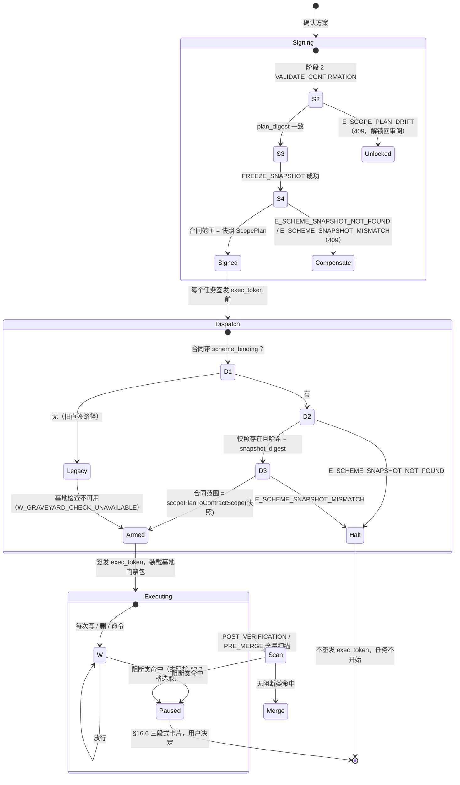

# Worker 派工门禁 · 墓地确定性拦截规范（INV-LEDGER-03 工地侧 · TASK-J.18）

> **状态**：**设计定稿 · 待施工（已拆卡）**（母卡 [`TASK-J.18`](./development-tasks.md) 为 `[SPLIT]`；可开工子卡 **`TASK-J.18a`～`J.18d`**，见 `development-tasks.md` §3.4c。原单卡估算 L，按 DoR R-11 禁止直接开工。）
> **建立日期**：2026-10-28（Asia/Hong_Kong）
> **上位规格**：[`supervisor.md`](./supervisor.md) §14.11（`INV-LEDGER-03` 第 1 款「机器侧拦截」）、§14.11 第 5 小节 G-MATCH（本卡新增的单一语义源）、§15.6、§16.6；[`runtime-contract-and-safety.md`](./runtime-contract-and-safety.md) §2.1、§2.3、§5.2、§8；[`scheme-patch-engine.md`](./scheme-patch-engine.md) §4.2～§4.3（墓碑指纹、`matchesTombstone`、`revival_keys`）。
> **与上位规格的关系**：本文是工地侧的实施口径。墓地匹配的**语义**只在 SSOT G-MATCH 定义一次；引擎与本门禁是它的两处投影。冲突时以 SSOT 为准。
> **逐字核对基线**：本文引用的码名、常量与规则均已对照 `main` @ `c9922b1` 原文。引擎码表为 51 码（`PATCH_CODES` 13 + `OP_CODES` 26 + `SUGGESTION_KINDS` 4 + `WARNING_CODES` 8）。

---

## 0. 一句话

**门禁不读 Worker 的意图，只读 Worker 留下的东西。** 它把 Worker 的产出物投影成若干「判定单元」，按单元类型分成**强证据**（新增依赖、新增 import、安装命令）与**弱证据**（标识符、路径、注释与文字）。只有强证据命中 `disallow_revival === true` 的活跃墓碑才拦截；弱证据只记录、进红队质询，不停工。

---

## 1. 代码事实基线（决定设计边界）

以下事实取自 `main` 代码，设计必须适配它们，而不是假设一个理想系统。

| # | 事实 | 位置 | 对设计的影响 |
| :-: | :--- | :--- | :--- |
| F-1 | API Worker 返回**完整文件内容**，不是 diff：`workerPatchSchema = { changes: {path, content}[], log: string[] }` | `daemon/worker/parse-worker-output.ts:11-21` | 「新增内容」须由门禁自己从前后两版文件算出 |
| F-2 | API Worker 写盘前对整批改动做 `validateChanges`，任一 blocker 抛 `WorkerScopeError`（`E_OUT_OF_SCOPE`），整批不写 | `daemon/worker/ai-worker.ts:322`、`:85` | 墓地检查挂在同一处，天然整批原子 |
| F-3 | CLI Worker（Claude Code）直接写 worktree；PreToolUse hook 只读 `tool_input.file_path` / `command`，**不读** `content` / `new_string` | `daemon/worker/cli-host/pretool-hook.mjs:284-348` | CLI 路径无法在写前看到内容的全部；权威检查只能在 diff 上做 |
| F-4 | Gateway 写入顺序：Schema → exec_token → 成本 → 路径穿越 → `checkWriteAccess` → 保护清单 → 测试文件 → 文件数 → 冲突 | `daemon/mcp/gateway.ts:~975-1110` | 墓地检查插在保护清单之后 |
| F-5 | 未跟踪文件越界检查在 `PRE_EXECUTION`、`POST_VERIFICATION`、`PRE_MERGE` 三个检查点执行 | `orchestrator.ts:761`、`:848`；`merger.ts:314` | 墓地全量扫描复用 `POST_VERIFICATION` 与 `PRE_MERGE` |
| F-6 | 越界停止序列 `runBoundaryStop`：BLOCK_IO → SIGINT → SIGKILL → REVOKE_EXEC_TOKEN → CLEAR_INDEX_LOCK → ENTER_PAUSED | `daemon/guard/boundary-stop.ts:135` | 墓地强命中复用同一停止序列 |
| F-7 | 没有逐 hunk 的 diff 解析器；`readDiffFiles` 给出每个文件的完整 before / after | `daemon/diff/diff-files.ts:129` | 「新增内容」用行多重集差（§2.3），不做 hunk 解析 |
| F-8 | `confirmation_id` 只在 `POST /api/contracts` 与 `/approve` 请求体中使用，**不写入合同**；合同 Schema 无快照字段 | `server.ts:3660-3697`、`:3954-3990`；`contract.schema.ts` 0 命中 | 派工时无从回到快照：**缺口 GAP-W1** |
| F-9 | `E_SCOPE_PLAN_DRIFT`、`E_SCHEME_SNAPSHOT_MISMATCH`、`plan_digest` 在代码中 0 命中（仅规格，`TASK-J.4` 未落地） | 全仓 | 本卡对 J.4 有硬依赖 |
| F-10 | 派工提示 `buildWorkerTaskInstruction` 只取合同字段，**不注入墓地**（违反 INV-LEDGER-03「强制自动注入 graveyard 活跃条目」） | `session-task-injector.ts:268` | **缺口 GAP-W3** |
| F-11 | 冻结快照只含方案与 Demo；J.4 后增 `scope_plan`。**墓地不在快照里** | `scheme-snapshot-store.ts` | 冻结后墓地无权威来源：**缺口 GAP-W2** |

---

## 2. 问题一：判定面设计（粒度）

### 2.1 三种候选粒度的权衡

| 粒度 | 做法 | 误拦（假阳性） | 漏拦（假阴性） | 结论 |
| :--- | :--- | :--- | :--- | :--- |
| **整文件** | 把改动后的整个文件交给 `matchesTombstone` | **高**：文件里**早已存在**的 `mongodb` 字样、注释里的「没有用 MongoDB」都会命中 (b)(d)；Worker 改了无关的一行也会触发 | **高**：词素集合被整文件稀释，Dice 永远到不了 0.75，(c) 形同虚设 | 否决 |
| **逐 hunk** | 只看本次新增的内容 | 中：新增注释、文案、文档里提到被否决方案会命中 | 中：hunk 内仍有稀释；动态拼接、包装模块抓不住 | **采用其变体**（§2.3 新增行多重集） |
| **符号级** | AST 解析出 import、依赖、调用的标识符 | 低 | 低（对字面别名） | 需要逐语言解析器，零依赖做不到；仓库现有 `daemon/arch` 只覆盖 JS/TS。**部分采用**：用正则抽 import 行与依赖清单（§2.4），不做完整 AST |

关键洞察：**`matchesTombstone` 的 (b)(c)(d) 是为自然语言设计的**（中文二元组词素 + ASCII 词）。代码不是自然语言：标识符是驼峰与下划线，依赖是包名，Dice 在代码上没有意义。所以不能选「一个粒度喂给同一个函数」，而要**按单元类型分通道**，自然语言单元走引擎原语义，代码单元走 SSOT 新定义的代码通道。

### 2.2 判定单元（Gate Unit）与通道

| 单元 | 来源 | 通道 | 证据强度 | 理由 |
| :--- | :--- | :--- | :-: | :--- |
| `U-DEP` 新增依赖 | `package.json` 的 `dependencies` / `devDependencies` / `optionalDependencies` / `peerDependencies` 新增键（含 `npm:` 别名的真实包名）；`requirements*.txt` 新增行；`go.mod` 新增 `require` | 代码 | **强** | 引入依赖是采用某方案的最直接证据，几乎不会是「顺口提到」 |
| `U-CMD` 安装命令 | Bash / 声明命令里的 `npm|pnpm|yarn|bun add|install <pkg>`、`pip install <pkg>`、`go get <mod>` | 代码 | **强** | 同上；且 CLI 路径可在执行前拦截 |
| `U-IMPORT` 新增导入 | 新增行中的 `import … from "x"`、`require("x")`、`import x`（Python）、`from x import`、Go `import "x"` | 代码 | **强** | 导入即使用 |
| `U-PATH` 新文件路径 | 新增文件的路径段 | 代码 | 弱 | `src/export/excel.ts` 可能只是 CSV 导出起了个坏名字 |
| `U-IDENT` 新增标识符 | 新增的非注释代码行中的标识符与字符串字面量 | 代码 | 弱 | 变量名、URL、提示文案都可能顺带出现关键词 |
| `U-NL` 自然语言 | Worker `log[]`、`declare_complete` 摘要、提交信息、新增的 `*.md` / `*.txt` 行、新增注释行 | 自然语言（引擎原语义） | 弱 | 文字可能是否定式（「按要求没有用 MongoDB」）；门禁不做否定判断，所以只记录 |

**升级规则**：同一墓碑在同一批改动里同时被 `U-PATH` 与 `U-IDENT` 命中（例：新增 `vendor/mongo-driver/client.ts` 且新增行含 `MongoClient`）→ 视为强证据。这是对「自建包装模块」的确定性补强。

### 2.3 「新增内容」= 行多重集差（hunk 的确定性近似）

不解析 hunk。对每个改动文件：

```text
before_lines = 规范化后按行切分（新文件为空集）
after_lines  = 同上
added_lines  = after_lines 中出现次数超过 before_lines 中出现次数的那部分（多重集差）
规范化 = 换行统一（\r\n→\n）+ 去行尾空白；不做大小写与 NFKC（代码区分大小写）
```

| 性质 | 结果 |
| :--- | :--- |
| 文件里早已存在的 `import mongodb` | 不计入（假阳性消除） |
| 把已有 import 挪到另一行 | 不计入（移动不是新增） |
| 改了已有行的一个字符 | 新行计入、旧行不计入 |
| 确定性 | 只依赖两版文本，O(n)，与 diff 算法无关 |

before 的来源：API Worker 写前读 worktree 当前文件（F-2 处已有上下文）；全量扫描时取 `readDiffFiles` 的 `before`（相对合同基线分支，F-7）。

### 2.4 代码通道的匹配语义（G-MATCH-CODE，正文在 SSOT §14.11 第 5 小节）

```text
artifact_keys(entry) =
    去重排序(
      { w | w 是 entry.fingerprint.lexemes 与 entry.revival_keys 中的 ASCII 字母数字词，长度 ≥ 3，且 w ∉ CODE_STOPLIST }
      ∪ ALIAS_LEXICON[w]  对上述每个 w 展开
    )

code_tokens(text) =
    把 text 按非字母数字切分；驼峰与下划线再切分；全部转小写；
    同时保留完整模块说明符（"@scope/name"、"mongodb"、"github.com/x/y"）的小写原样

命中(unit, entry) ⇔ entry.status === "active" 且 ∃ k ∈ artifact_keys(entry)：
    U-DEP / U-CMD / U-IMPORT：k === 包名（或模块说明符的最后一段、或 @scope/name 的 name）
    U-PATH / U-IDENT：k ∈ code_tokens(unit.text)
```

- **不用 Dice**：代码单元的词素集合与墓碑的中文词素几乎不相交，Dice 只会制造假阴性。
- **`CODE_STOPLIST`**：`api data file user list page app src lib test util index main config server client db http json` 等通用编程词。墓碑「做个 API 网关」的 `api` 因此不进入代码通道，只走自然语言通道（弱）。这是为了防止大面积误拦，代价已列入残余风险。
- **`ALIAS_LEXICON`**：版本化的静态别名表（`ALIAS_LEXICON_VERSION`），只收「同一方案的常见包名」，例：

| 键 | 别名 |
| :--- | :--- |
| `mongodb` / `mongo` | `mongodb`、`mongoose`、`mongo`、`@mongodb-js/*`、`pymongo`、`motor`、`go.mongodb.org/mongo-driver` |
| `excel` / `xlsx` | `xlsx`、`exceljs`、`sheetjs`、`xlsx-populate`、`openpyxl`、`xlsxwriter` |
| `redis` | `redis`、`ioredis`、`@redis/client`、`go-redis` |
| `graphql` | `graphql`、`apollo-server`、`@apollo/client`、`graphql-yoga` |

  别名表的增删是规格变更：改表须递增版本号并补共享用例（§4.3）。
- **自然语言通道**：`U-NL` 单元原样调用 SSOT G-MATCH 的 (b)(c)(d)（即引擎 `matchesTombstone` 去掉只对方案条目有意义的 (a)），只产生弱证据。

### 2.5 哪些墓碑参与拦截

| 墓碑状态 | 强证据命中 | 弱证据命中 | 依据 |
| :--- | :--- | :--- | :--- |
| `active` 且 `disallow_revival === true` | **拦截** `E_PROPOSAL_PREVIOUSLY_REJECTED` | 记 `W_GRAVEYARD_WEAK_MATCH` | INV-LEDGER-03 第 1 款原文：「命中 `disallow_revival === true` 的方案时，门禁直接拦截」 |
| `active` 且 `disallow_revival === false` | 记 `W_GRAVEYARD_WEAK_MATCH`（标 `soft`） | 同左 | 同一款原文只授权拦截 `true`；`false` 在编译期也只是转推荐卡（K-6） |
| `status === "revived"` | 不参与 | 不参与 | 用户已亲口复活 |
| `rejected_by === "security_gate"` 且 `disallow_revival === true` | 拦截，主码优先级更高（§3.3 P3） | 记录 | 同上 |

**冻结后不复活**：施工期间不存在复活通道。用户想要被拦的方案，只能经 §5.1 的「我改主意了」回到方案幕，由引擎走正常复活判定后重签。

---

## 3. 问题二：四防线裁决顺序

### 3.1 四条防线不在同一时刻

| 防线 | 码（逐字） | 层（runtime §8） | 发生时刻 | 代码状态 |
| :--- | :--- | :-: | :--- | :--- |
| 合同越界 | `E_OUT_OF_SCOPE` / `E_OUT_OF_SCOPE_UNTRACKED` / `E_FORBIDDEN_PATH` | L3 | 每次写 / 删、三个检查点 | 已实现（F-4、F-5） |
| 墓地 | `E_PROPOSAL_PREVIOUSLY_REJECTED` | L3 | 本卡新增：派工后每次写、全量扫描 | 本卡 |
| 范围漂移 | `E_SCOPE_PLAN_DRIFT` | L2（Daemon 专属码） | 确认事务第 2 阶段 / 冻结时重跑预检 | 规格已定，代码 0 命中（J.4） |
| 快照不匹配 | `E_SCHEME_SNAPSHOT_MISMATCH`（另有 `E_SCHEME_SNAPSHOT_NOT_FOUND`） | L2（Daemon 专属码） | 带 `confirmation_id` 建合同 / 批准 | `NOT_FOUND` 已实现；`MISMATCH` 代码 0 命中（J.4） |

**结论一**：`E_SCOPE_PLAN_DRIFT` 只属于签署期。施工期重跑预检没有意义（仓库在施工中本来就会变），因此**派工与执行期永不产生 `E_SCOPE_PLAN_DRIFT`**。

**结论二**：四者「同时命中」只可能以两种方式出现：
- 签署期内，漂移与快照不匹配分属事务的不同阶段（第 2 阶段 vs 第 4 阶段），按阶段先后自然短路，不会同时报出；
- 执行期内，越界与墓地可在**同一次写入**同时命中。这是唯一需要优先级裁决的组合。

为了让执行期的墓地检查有权威输入，本文新增**派工检查点**，在签发 `exec_token` 前复核合同与快照的绑定，并复用 L2 已登记的快照码。

### 3.2 三个检查点的状态机



### 3.3 执行期优先级格（同一次写入多条命中）

**求值不短路，报告取最高**：P0 之外的全部检查都执行，命中全部写入证据；用户面只显示**一个主码**，按下表取最高优先级者。

| 级 | 命中 | 主码（逐字） | 停止语义 | 为什么排在这里 |
| :-: | :--- | :--- | :--- | :--- |
| P0 | 执行凭证 / 路径穿越 / 运行时越权 | `E_UNSAFE_EXECUTION` / `PATH_TRAVERSAL_DETECTED`（既有） | 既有语义，**短路** | 安全致命，后续检查的输入不可信 |
| P1 | 派工绑定失败 | `E_SCHEME_SNAPSHOT_NOT_FOUND` / `E_SCHEME_SNAPSHOT_MISMATCH` | 不签发 exec_token | 没有权威快照，就没有可信的范围与墓地 |
| P2 | 严禁 / 保护路径 | `E_FORBIDDEN_PATH`（既有） | §5.2 停止序列 | P.1 一票否决，涉及具体受保护资产 |
| P3 | 强证据命中 `rejected_by: "security_gate"` 墓碑 | `E_PROPOSAL_PREVIOUSLY_REJECTED`（`detail.lock = "security"`） | §5.2 停止序列 | 安全门禁否决过的方案 |
| P4 | 强证据命中 `rejected_by: "user"`、`disallow_revival: true` 墓碑 | `E_PROPOSAL_PREVIOUSLY_REJECTED`（`detail.lock = "user"`） | §5.2 停止序列 | 见下方「为什么墓地压过越界」 |
| P5 | 范围越界 | `E_OUT_OF_SCOPE_UNTRACKED` > `E_OUT_OF_SCOPE`（既有） | §5.2 停止序列；§15.6 扩权卡 | — |
| P6 | 弱证据 / 软墓碑 | `W_GRAVEYARD_WEAK_MATCH`（门禁日志码） | **不停工**；进入红队质询与试玩幕「疑似」清单 | 误停一次施工的代价远高于多一条审阅提示 |

**为什么墓地压过越界（P4 > P5）**：两者都会停工，差别只在用户看到什么、会怎么做。越界的推荐动作是 §15.6「允许这一处并继续」（扩权）。如果 Worker 是在**为一个被否决的方案**越界（例如为接 MongoDB 去改 `package.json`），把越界作为主码，用户最可能点「允许」，等于亲手为被否决的方案扩权。墓地作为主码时，推荐动作是「换个思路」，这才是根因修复。

**为什么保护路径压过墓地（P2 > P3/P4）**：保护路径是具体资产（`.env*`、锁文件），用户可行动的信息更明确；而且墓地命中是基于字面证据的推断，保护路径命中是确定事实。

### 3.4 与签署链 `confirmation_id` 的关系

| 合同来源 | 派工检查点 | 墓地门禁 | 依据 |
| :--- | :--- | :--- | :--- |
| 带 `confirmation_id`（新路径） | **必须**通过 D2、D3；任一失败 → P1，不开工 | 墓地取自快照（GAP-W2 修复后），强证据拦截 | runtime §1「带 `confirmation_id` 的合同只能从快照里的 `ScopePlan` 原样生成」 |
| 不带 `confirmation_id`（旧路径：SSOT 第二部分 D4 第 ②③ 条；`TASK-J.4` 范围第 5 条「旧路径行为不变」） | 跳过 | **不可用**：证据记 `graveyard_check: "unavailable"` 与 `W_GRAVEYARD_CHECK_UNAVAILABLE`，不拦截、不静默 | 没有快照就没有冻结时的墓地权威源；拿冻结前的活台账代替会违反 §14.11「冻结后以快照为唯一权威」 |

**`scheme_binding`（GAP-W1 修复）**：合同新增可选字段 `scheme_binding = { confirmation_id, snapshot_digest, plan_digest }`。`POST /api/contracts` 在带 `confirmation_id` 且通过 J.4 校验后写入；合同签署后不可改（runtime §2「改合同本身」禁止）。派工检查点只信任这个字段，不信任请求体。

---

## 4. 问题三：单一语义源、两处投影

### 4.1 三层结构

```text
                    ┌───────────────────────────────────────────────┐
  语义层（唯一）     │ SSOT supervisor.md §14.11 第 5 小节 G-MATCH        │
                    │  G-MATCH-NL：matchNormalize / lexemes / Dice /   │
                    │              (a)(b)(c)(d) 与常量                    │
                    │  G-MATCH-CODE：artifact_keys / code_tokens /       │
                    │              CODE_STOPLIST / ALIAS_LEXICON          │
                    └───────────────┬───────────────────────────────┘
                                    │ 只引用编号，不复述公式
         ┌──────────────────────────┼──────────────────────────────┐
  实现层  │ src/lib/journey/graveyard-match.ts（唯一实现，纯函数，零依赖）  │
         │  matchNormalize · lexemes · dice · matchesTombstoneText ·     │
         │  artifactKeys · codeTokens · matchArtifactUnit · 常量与词表     │
         └──────────┬──────────────────────────────┬──────────────────┘
  投影层            │                              │
         引擎：graveyard-revival.ts           门禁：worker-graveyard-gate.ts
         op → 主文本（引擎 §4.2 表）            产出物 → GateUnit[]（§2.2）
         → matchesTombstoneText (a)–(d)        NL 单元 → matchesTombstoneText (b)–(d)
         → judgeRevival                       代码单元 → matchArtifactUnit
                                              CLI hook：读取 gate pack（预编译，§4.4）
```

### 4.2 规范写法

1. **SSOT 段落只写定义，不写实现**：每条规则一个编号（`G-MATCH-NL-1`…、`G-MATCH-CODE-1`…）。引擎文档与本文在需要处写「按 G-MATCH-NL-3」，**禁止**复述公式或常量值。现有引擎文档 §4.2 的公式文字保留为历史记录，并加一行「语义以 SSOT G-MATCH 为准」（随本卡 PR 只加指针，不改正文）。
2. **代码只有一份实现**：`matchNormalize`、`lexemes`、`dice` 在引擎 §5.1 布局里归属 `evidence-anchor.ts`。本卡把它们迁到 `graveyard-match.ts`，由 `evidence-anchor.ts` **再导出**，保持引擎文档里的导入路径仍然有效。`GRAVEYARD_DICE_THRESHOLD`、`NEGATION_CUES` 等常量同样只定义一次。
3. **投影函数显式命名**：引擎侧 `primaryTextOf(op)`，门禁侧 `projectArtifact(change) → GateUnit[]`。两者都不得自己实现匹配逻辑，只能调用实现层。
4. **ESLint 守卫**：`no-restricted-syntax` 禁止在 `graveyard-match.ts` 之外出现 `GRAVEYARD_DICE_THRESHOLD` 字面值 `0.75` 与 `.normalize("NFKC")` 用于墓地比较（以注释标签 `// G-MATCH` 定位）。

### 4.3 共享用例（双方测试矩阵共用一份夹具）

`tests/fixtures/graveyard-match/cases.json`：

```jsonc
{
  "version": 1,
  "alias_lexicon_version": 1,
  "tombstones": { "T-MONGO": { "fingerprint": { "key": "用mongodb存数据", "lexemes": ["mongodb", "存数", "数据", "用"] },
                               "revival_keys": ["mongodb", "用mongodb存数据"], "status": "active",
                               "disallow_revival": true, "rejected_by": "user" } },
  "nl_cases": [
    { "id": "GM-NL-01", "text": "用 MongoDB 存数据", "tombstone": "T-MONGO", "expect": { "b": true, "c": true, "d": true } },
    { "id": "GM-NL-02", "text": "MongoDB 存储", "tombstone": "T-MONGO", "expect": { "b": false, "c": false, "d": false } }
  ],
  "code_cases": [
    { "id": "GM-CODE-01", "unit": "U-DEP", "text": "mongoose", "tombstone": "T-MONGO", "expect": { "hit": true, "via": "alias" } }
  ]
}
```

| 消费者 | 读取 | 断言 |
| :--- | :--- | :--- |
| `tests/unit/graveyard-revival.test.ts`（引擎，J.9） | `nl_cases` | 把 `text` 当作 op 主文本，`matchesTombstone` 的 (b)(c)(d) 分量与 `expect` 一致 |
| `tests/unit/worker-graveyard-gate.test.ts`（本卡） | `nl_cases` + `code_cases` | NL 单元结果与引擎**逐条相同**；代码单元与 `expect` 一致 |
| `tests/unit/pretool-hook-graveyard.test.ts`（本卡） | `code_cases` 中 `U-CMD` 与 `U-DEP` | `.mjs` hook 读取由同一夹具生成的 gate pack，判定与 TS 实现一致（跨实现一致性） |
| `tests/unit/graveyard-match-conformance.test.ts`（本卡） | 全部 | 同一输入下，引擎投影与门禁投影对 `matchesTombstoneText` 的调用结果逐位相等；改任一实现而不改另一处，此测试失败 |

**夹具纪律**：新增或修改匹配规则 → 先改 SSOT G-MATCH → 再改夹具 → 两侧测试同时变红 → 改实现。夹具 `version` 必须随之递增。

### 4.4 CLI hook 的投影：gate pack

`pretool-hook.mjs` 是独立 `.mjs`，不能导入 TS 模块。为避免第三份实现：

- 派工检查点（D3 通过后）由 `buildGatePack(snapshot)` 生成 `.stagent/claude-config/graveyard-pack.json`（该目录已被 hook 的 deny 规则保护，Worker 不可读写）：只含每个阻断类墓碑的 `rejected_id`、`lock` 与**预展开**的 `artifact_keys`（已含别名，已小写）。
- hook 只做两件事：对 `Bash` 的安装命令抽包名做集合查找（`U-CMD`）；对 `Write` / `Edit` 的 `content` / `new_string` 抽 import 行与 `package.json` 新增键做集合查找（`U-IMPORT` / `U-DEP` 的写前近似）。**不做** Dice、NL、弱证据。
- hook 命中 → 按既有 `deny()` 输出 `permissionDecisionReason` 白话原因，并在日志写 `E_PROPOSAL_PREVIOUSLY_REJECTED`。gate pack 缺失或损坏 → 放行并记 `W_GATE_PACK_MISSING`（hook 是纵深防御，权威检查在全量扫描）。

---

## 5. 问题四：拦截后的用户面

### 5.1 三段式卡片（§16.6 增行）

```text
【发生了什么】  施工时它开始用「MongoDB 存数据」——这是你之前说过不要的（当时的理由：团队只会 MySQL）
【你的代码现在】在隔离区，主项目没有任何变化
【你可以】      [让它换个思路再试一次]（推荐）  [我改主意了，这次就要它]  [放弃本轮]
```

| 按钮 | 行为 |
| :--- | :--- |
| 让它换个思路再试一次（推荐） | 重新派工；派工提示追加一行白话约束「不要使用：MongoDB 存数据（用户否决过）」；同一墓碑本轮第二次强命中 → 卡片不再推荐重试，改推荐「放弃本轮」或「我改主意了」 |
| 我改主意了，这次就要它 | 等价于 §16.5 C 类「暂停，现在改方案」：施工暂停 → 回到「① 方案」幕 → 右栏预填「我想恢复：MongoDB 存数据」**但不自动发送** → 用户亲口发出后由引擎走复活判定（R0～R9）→ 重签。施工期内**没有**任何复活捷径 |
| 放弃本轮 | 既有 §16.9 |

- `lock = "security"`：去掉「我改主意了」按钮，换成「看看为什么不行」（右栏搭档只读解释）。安全门禁否决不可经聊天恢复（引擎 K-5）。
- 文案取自墓碑的 `proposal` 与 `rejection_reason`，不出现 `rejected_id`、码名、包名之外的技术词；码名与命中单元放进「技术细节」折叠区（§16.6 原有纪律）。
- 包名可以出现（「它加了一个叫 mongoose 的依赖」放在技术细节里），帮助懂行的用户判断是否误拦。

### 5.2 是否进决议区

**不进。** 决议区属于「① 方案」幕，方案已冻结（§16.5）。墓地拦截是施工期的意外，按 §16.6 统一用中栏三段式卡片呈现。只有用户选「我改主意了」回到方案幕之后，才在方案幕里按引擎的正常流程出现（复活合法 → 写入；模糊 → `S_REVIVAL_AMBIGUOUS` 追问卡，此时才在决议区）。

**弱证据**（P6）不出卡：进入红队质询（runtime §5.4）与试玩幕「这次改了什么」下的一行「可能涉及你否决过的：……（点开看依据）」。

### 5.3 「门禁码无成表闭集」缺口与补登方案

现状（逐字核对 runtime §8）：L3 行只有「代表码」`E_OUT_OF_SCOPE` / `E_OUT_OF_SCOPE_UNTRACKED` / `E_BUDGET_EXCEEDED` / `E_WORKSPACE_LOCKED` / `E_CHECKPOINT_FAILED` / `E_PROPOSAL_PREVIOUSLY_REJECTED`，没有闭集表。核对代码后发现三处不一致：

| # | 不一致 | 证据 |
| :-: | :--- | :--- |
| W5-a | `E_FORBIDDEN_PATH` 是执行期码（`gateway.ts:165` `scopeErrorCode`；`ERROR_CODES` 内），却不在 L3 行 | `src/lib/error-codes.ts`、`daemon/mcp/gateway.ts:165` |
| W5-b | `E_CHECKPOINT_FAILED` 实际是「开一轮前打检查点失败」（`server.ts:1767`、`:1844`，`POST /api/protection/round/start`），不是执行期码；且不在 `ERROR_CODES` | `daemon/server.ts:1767` |
| W5-c | `E_TEST_FILE_WRITE_BLOCKED` 是 Gateway 执行期码（`gateway.ts:137`），不在 L3 行也不在 `ERROR_CODES` | `daemon/mcp/gateway.ts:137` |

**补登方案（提案；随本卡 PR 只在 runtime §8 加指针，闭集表由 **TASK-J.18c** 实施 PR 合入 runtime §8.1）**：

runtime §8 新增 §8.1「L3 执行期码闭集」，列：码 / 触发点 / 停止语义 / 用户面（§16.6 卡片情形）/ `ERROR_CODES` 是否登记 / `reason_code`。

| 码 | 触发点 | 停止语义 | 用户面 | `ERROR_CODES` | `reason_code` |
| :--- | :--- | :--- | :--- | :-: | :--- |
| `E_UNSAFE_EXECUTION` | runtime-interceptor | 短路、降级 | 「Worker 失联 / 不受控」 | ✓ | `UNSAFE_EXECUTION` |
| `PATH_TRAVERSAL_DETECTED` | Gateway 路径解析 | 短路 | 同上 | ✓ | `SCOPE_VIOLATION` |
| `E_FORBIDDEN_PATH` | Gateway `checkWriteAccess` | §5.2 | 超出范围（保护） | ✓ | `SCOPE_VIOLATION` |
| `E_OUT_OF_SCOPE` | Gateway / AiWorker / 检查点 | §5.2 | §15.6 扩权卡 | ✓ | `SCOPE_VIOLATION` |
| `E_OUT_OF_SCOPE_UNTRACKED` | 未跟踪文件检查点 | §5.2 | §15.6 扩权卡 | ✓ | `SCOPE_VIOLATION` |
| `E_TEST_FILE_WRITE_BLOCKED` | Gateway 测试文件守卫 | 拒绝当次写 | 检查反复失败类 | **待登记** | `SCOPE_VIOLATION`（提案） |
| `E_BUDGET_EXCEEDED` | 成本监视 | 熔断 | 接近 / 超出预算 | ✓ | `BUDGET_EXHAUSTED` |
| `E_COMMAND_TIMEOUT` / `E_TASK_TIMEOUT` | 命令执行 | 熔断 | 同上 | ✓ | `BUDGET_EXHAUSTED` |
| `E_UNAUTHORIZED_COMMAND` | 命令白名单 | 拒绝 | 超出范围 | ✓ | `UNAUTHORIZED_COMMAND` |
| `E_WORKSPACE_LOCKED` | 工作区互斥 | 拒绝 | 「等一下」 | ✓ | `WORKSPACE_LOCKED` |
| `E_PROPOSAL_PREVIOUSLY_REJECTED` | **本卡**：派工门禁、全量扫描、CLI hook | §5.2 | §5.1 墓地卡 | **待登记**（见下） | `SCOPE_VIOLATION`（提案） |
| `E_GATE_SCAN_FAILED` | **本卡新增**：全量扫描无法读取 diff | 失败关闭：不进入合并 | 「自动检查没跑完」 | **待登记** | `PREPARATION_INTERRUPTED`（提案） |
| `E_CHECKPOINT_FAILED` | 开一轮前打检查点 | 不开工 | — | 否 | **移出 L3**，改登记为开工前码（提案） |

**K-9 解释冲突（已拍板：按建议登记，见 K-15）**：K-9 规定引擎码「不登记入 `src/lib/error-codes.ts` 的 `ERROR_CODES`」，并把 `E_PROPOSAL_PREVIOUSLY_REJECTED` 列为例外，但例外条文只说明它出现在 `journal.verdicts` 且归属门禁层，**没有说明它是否进 `ERROR_CODES`**。工地侧拦截要写证据包 `verdict.reason_code`，而 `error-codes.ts` 规定每个运行时 `error_code` 都映射到一个 `reason_code`。**决定**：作为 L3 运行时码登记进 `ERROR_CODES`，映射 `SCOPE_VIOLATION`（不新增原因码）；由 K-15 明确「引擎编译期产出的同名码仍是编译日志码，工地侧产出的才是运行时码」。登记的代码动作随 **TASK-J.18c** 实施 PR 完成；在该 PR 合入前，门禁只写日志与 `forbiddenViolations`，不写 `reason_code` 新映射。

---

## 5.9 拆卡映射（2026-10-31 · DoR R-11）

| 子卡 | 交付层 | 主要章节 / 缺口 / 测试 |
| :--- | :--- | :--- |
| `TASK-J.18a` | 纯函数 | §2、§4.1～§4.3；TM-GM、TM-GU |
| `TASK-J.18b` | Schema / 快照 | §3.4；GAP-W1、GAP-W2 |
| `TASK-J.18c` | 门禁裁决 + 派工绑定 + 码表 | §3、§5.3、§6.2～§6.3；TM-GS、TM-GA、TM-GP、TM-GB、TM-GE |
| `TASK-J.18d` | 生产接线 + CLI + 集成 | §4.4、§5.1～§5.2、§6.4；GAP-W3/W4/W6；TM-GH、TM-GI |

母卡 `TASK-J.18` 保留一句话目标与非目标，**不得**被 Agent 直接认领开工。

## 6. 交付蓝图

### 6.1 文件布局

| 文件 | 内容 | 纯函数 |
| :--- | :--- | :-: |
| `src/lib/journey/graveyard-match.ts` | G-MATCH 唯一实现：`matchNormalize`、`lexemes`、`dice`、`matchesTombstoneText`、`artifactKeys`、`codeTokens`、`matchArtifactUnit`；常量 `GRAVEYARD_DICE_THRESHOLD`、`CODE_STOPLIST` | 是 |
| `src/lib/journey/artifact-alias-lexicon.ts` | `ALIAS_LEXICON`、`ALIAS_LEXICON_VERSION` | 是 |
| `src/lib/journey/artifact-projection.ts` | `addedLines(before, after)`、`projectArtifact(change)`、依赖清单与安装命令解析 | 是 |
| `daemon/guard/worker-graveyard-gate.ts` | `evaluateGraveyardGate`、`pickPrimaryVerdict`、`buildGatePack` | 是 |
| `daemon/guard/dispatch-binding.ts` | `verifyDispatchBinding` | 否（读快照） |
| 改动：`daemon/worker/ai-worker.ts::validateChanges`、`daemon/mcp/gateway.ts::handleWriteFile`、`orchestrator.ts`（派工前、`POST_VERIFICATION`）、`merger.ts`（`PRE_MERGE`）、`pretool-hook.mjs`、`session-task-injector.ts`（注入墓地，GAP-W3）、`contract.schema.ts`（`scheme_binding`，GAP-W1）、`scheme-snapshot-store.ts`（快照 1.2 含 `graveyard`，GAP-W2） | — | — |

### 6.2 类型与函数签名

```ts
// ───── graveyard-match.ts（G-MATCH 唯一实现）─────
export function matchNormalize(s: string): string;                       // G-MATCH-NL-1
export function lexemes(s: string): string[];                            // G-MATCH-NL-2
export function dice(a: readonly string[], b: readonly string[]): number;// G-MATCH-NL-3
export interface NlMatch { a: boolean; b: boolean; c: boolean; d: boolean }
export function matchesTombstoneText(
  text: string, entry: GraveyardEntry, opts?: { targetId?: string },
): NlMatch;                                                              // G-MATCH-NL-4（(a) 仅在给出 targetId 时求值）
export function artifactKeys(entry: GraveyardEntry, lexicon?: AliasLexicon): string[];  // G-MATCH-CODE-1
export function codeTokens(text: string): string[];                      // G-MATCH-CODE-2
export function matchArtifactUnit(unit: GateUnit, entry: GraveyardEntry): ArtifactMatch | null; // G-MATCH-CODE-3

// ───── artifact-projection.ts ─────
export type GateUnitKind = "U-DEP" | "U-CMD" | "U-IMPORT" | "U-PATH" | "U-IDENT" | "U-NL";
export interface GateUnit {
  kind: GateUnitKind;
  text: string;                  // 包名 / 模块说明符 / 路径 / 新增行 / 文字
  file?: string;                 // 仓库相对路径
  line_hint?: number;            // after 文件中的行号（展示用，不参与判定）
  source: "change" | "command" | "log" | "summary" | "commit_message";
}
export interface ArtifactChange { path: string; before: string | null; after: string | null } // null = 不存在
export function addedLines(before: string | null, after: string | null): string[];
export function projectArtifact(change: ArtifactChange): GateUnit[];
export function projectCommand(argv: readonly string[]): GateUnit[];
export function projectText(text: string, source: GateUnit["source"]): GateUnit[];

// ───── worker-graveyard-gate.ts ─────
export type GateStrength = "strong" | "weak";
export interface GraveyardHit {
  rejected_id: string;
  lock: "user" | "security" | "soft";
  strength: GateStrength;
  units: GateUnit[];             // 命中的单元（证据）
  via: "direct" | "alias" | "path+ident" | "nl";
}
export interface GateInput {
  graveyard: readonly GraveyardEntry[];     // 取自快照（GAP-W2）
  changes: readonly ArtifactChange[];
  commands: readonly (readonly string[])[];
  texts: readonly { text: string; source: GateUnit["source"] }[];
  availability: "snapshot" | "unavailable"; // 旧直签路径为 unavailable
}
export interface GateResult {
  block: boolean;
  hits: GraveyardHit[];          // 全部命中，按 rejected_id 字典序
  warnings: GateWarningCode[];
  primary?: { code: "E_PROPOSAL_PREVIOUSLY_REJECTED"; rejected_id: string; lock: "user" | "security" };
}
export function evaluateGraveyardGate(input: GateInput): GateResult;

export type BlockingCode =
  | "E_UNSAFE_EXECUTION" | "PATH_TRAVERSAL_DETECTED"
  | "E_SCHEME_SNAPSHOT_NOT_FOUND" | "E_SCHEME_SNAPSHOT_MISMATCH"
  | "E_FORBIDDEN_PATH" | "E_PROPOSAL_PREVIOUSLY_REJECTED"
  | "E_OUT_OF_SCOPE_UNTRACKED" | "E_OUT_OF_SCOPE";
export interface LineVerdict { code: BlockingCode; detail?: Record<string, unknown> }
export function pickPrimaryVerdict(verdicts: readonly LineVerdict[]): LineVerdict | null;  // §3.3 格

export interface GatePack { pack_version: 1; alias_lexicon_version: number;
  tombstones: { rejected_id: string; lock: "user" | "security"; keys: string[] }[] }
export function buildGatePack(graveyard: readonly GraveyardEntry[]): GatePack;

// ───── dispatch-binding.ts ─────
export interface SchemeBinding { confirmation_id: string; snapshot_digest: string; plan_digest: string }
export type DispatchBindingResult =
  | { ok: true; mode: "bound"; graveyard: GraveyardEntry[]; pack: GatePack }
  | { ok: true; mode: "legacy" }
  | { ok: false; code: "E_SCHEME_SNAPSHOT_NOT_FOUND" | "E_SCHEME_SNAPSHOT_MISMATCH"; message: string };
export function verifyDispatchBinding(repoRoot: string, contract: SoftwareContract): Promise<DispatchBindingResult>;
```

### 6.3 码表增补

| 码 | 类别 | 层 | 是否新增 | 说明 |
| :--- | :--- | :-: | :-: | :--- |
| `E_PROPOSAL_PREVIOUSLY_REJECTED` | 阻断 | L3 | 否（复用 §14.11 / runtime §8 L3 原名） | `detail = { rejected_id, lock, via, units }` |
| `E_SCHEME_SNAPSHOT_NOT_FOUND` / `E_SCHEME_SNAPSHOT_MISMATCH` | 阻断 | L2 码在派工检查点复用 | 否 | runtime §8「L2 只可额外使用 Daemon 专属码表中登记的码」：派工检查点是 Daemon 判定，复用不违规；L3 闭集表注明「复用 L2」 |
| `E_GATE_SCAN_FAILED` | 阻断（失败关闭） | L3 | **是** | 全量扫描读不到 diff（`readDiffFiles` 抛错、`truncatedList` 非空导致覆盖不完整）→ 不进合并 |
| `W_GRAVEYARD_WEAK_MATCH` | 门禁日志 | — | **是** | 弱证据或软墓碑命中 |
| `W_GRAVEYARD_CHECK_UNAVAILABLE` | 门禁日志 | — | **是** | 旧直签路径，无快照墓地 |
| `W_GATE_PACK_MISSING` | 门禁日志 | — | **是** | CLI hook 读不到 gate pack，放行 |
| `W_GATE_DIFF_TRUNCATED` | 门禁日志 | — | **是** | 单文件超过 `MAX_DIFF_FILE_BYTES`：该文件只做 `U-PATH` 判定；若该文件是依赖清单 → 升级为 `E_GATE_SCAN_FAILED` |

门禁日志码（`W_*`）与引擎码同属「开发者与审计」类，不进 runtime §2.3，也不进 `ERROR_CODES`（口径同 K-9）。`E_GATE_SCAN_FAILED` 是运行时码，进 §8.1 闭集。

### 6.4 接线点

| 检查点 | 调用 | 失败处理 |
| :--- | :--- | :--- |
| 派工（签发 `exec_token` 前） | `verifyDispatchBinding` → `buildGatePack` 写 hook 配置 → 派工提示注入墓地（GAP-W3） | P1：不签发，合同停在批准后状态，§16.6 卡「方案快照对不上，需要重新确认」 |
| API Worker 写前 | `validateChanges` 内：既有 `checkWriteAccess` + `evaluateGraveyardGate(changes, log)` → `pickPrimaryVerdict` | 任一阻断 → 整批不写（F-2 语义），抛带主码的 `WorkerScopeError` |
| Gateway 写 | `handleWriteFile` 在 `protectionDenied` 之后调用 `evaluateGraveyardGate([该文件])` | 阻断 → `onScopeBlocked` → `runBoundaryStop` |
| CLI hook 写前 / 命令前 | gate pack 集合查找（§4.4） | `deny()`；日志记码 |
| `POST_VERIFICATION`、`PRE_MERGE` | `readDiffFiles` → `projectArtifact` 全量 + Worker `log` + 提交信息 → `evaluateGraveyardGate` | 阻断 → 与 `assertUntrackedScope` 同构：写 BLOCKED 证据，`MergeGateError`；扫描失败 → `E_GATE_SCAN_FAILED` |

---

## 7. 测试矩阵（与 `scheme-patch-engine.md` §6 同构）

### 7.1 组织

| 文件 | 覆盖 |
| :--- | :--- |
| `tests/unit/graveyard-match-conformance.test.ts` | TM-GM：共享夹具，引擎投影与门禁投影一致 |
| `tests/unit/artifact-projection.test.ts` | TM-GU：单元抽取、新增行多重集 |
| `tests/unit/worker-graveyard-gate.test.ts` | TM-GS（强弱）、TM-GA（别名对抗）、TM-GE（边界） |
| `tests/unit/gate-priority.test.ts` | TM-GP：优先级格笛卡尔积，对拍独立手写神谕 |
| `tests/unit/dispatch-binding.test.ts` | TM-GB：派工绑定 |
| `tests/unit/pretool-hook-graveyard.test.ts` | TM-GH：CLI hook 与 gate pack |
| `tests/integration/worker-graveyard-gate.test.ts` | TM-GI：起真 Daemon，桩 Worker，断言停工、证据、合并被拒；端口段 **3950–3959**（登记于 `tests/unit/test-port-map.test.ts`） |

夹具：墓碑 `T-MONGO`（「用 MongoDB 存数据」，user，hard）、`T-EXCEL`（「Excel 导出」，user，hard，`revival_keys` 含 `excel导出`）、`T-ENV`（「读 .env 直连生产库」，security）、`T-SOFT-GQL`（「用 GraphQL」，`disallow_revival: false`）、`T-API`（「做个 API 网关」，user，hard）。

### 7.2 TM-GM 单一语义源一致性

| ID | 场景 | 期望 |
| :-- | :--- | :--- |
| TM-GM-01 | `cases.json` 全部 `nl_cases` 分别经引擎 `matchesTombstone`（主文本投影）与门禁 `U-NL` 投影 | (b)(c)(d) 逐位相等 |
| TM-GM-02 | 「用 MongoDB 存数据」 vs `T-MONGO` | b/c/d 全真 |
| TM-GM-03 | 「MongoDB 存储」 vs `T-MONGO` | 全假（引擎 TM-Y-34 残余风险同口径） |
| TM-GM-04 | Dice 恰为 0.75 / 0.74 | c 真 / 假（与引擎 TM-Y-19/20 同夹具） |
| TM-GM-05 | `revival_keys` 含 3 字素 key | d 假（与引擎 TM-Y-35 同夹具） |
| TM-GM-06 | 改动 `graveyard-match.ts` 的阈值而不改夹具 | 本文件与引擎 TM-Y 同时失败 |
| TM-GM-07 | 源码扫描：`graveyard-match.ts` 之外出现 `0.75` 墓地阈值字面量 | 失败 |

### 7.3 TM-GU 判定单元抽取

| ID | 输入 | 期望单元 |
| :-- | :--- | :--- |
| TM-GU-01 | `package.json` 新增 `"mongoose": "^8"` | `U-DEP mongoose` |
| TM-GU-02 | `package.json` 新增 `"db": "npm:mongodb@^6"` | `U-DEP mongodb`（解析 npm 别名） |
| TM-GU-03 | `package.json` 已有 `mongodb`，Worker 只改 `scripts` | 无 `U-DEP`（多重集差） |
| TM-GU-04 | 新增行 `import { MongoClient } from "mongodb"` | `U-IMPORT mongodb` + `U-IDENT` |
| TM-GU-05 | 已有 import 行移动位置 | 无新增单元 |
| TM-GU-06 | `requirements.txt` 新增 `pymongo==4.6` | `U-DEP pymongo` |
| TM-GU-07 | `go.mod` 新增 `require go.mongodb.org/mongo-driver v1.13.0` | `U-DEP go.mongodb.org/mongo-driver` |
| TM-GU-08 | 命令 `["npm","install","-D","mongoose@8"]` | `U-CMD mongoose` |
| TM-GU-09 | 命令 `["npm","run","build"]` | 无 |
| TM-GU-10 | 新文件 `src/export/excel-writer.ts` | `U-PATH`（tokens 含 `excel`） |
| TM-GU-11 | 新增注释行 `// 没有用 MongoDB` | `U-NL`，不产生 `U-IDENT` |
| TM-GU-12 | `\r\n` 文件改为 `\n` 但内容不变 | 无新增单元 |

### 7.4 TM-GS 强弱判定

| ID | 命中 | 墓碑 | 期望 |
| :-- | :--- | :--- | :--- |
| TM-GS-01 | `U-DEP mongodb` | `T-MONGO` | block，`via: direct`，`lock: user` |
| TM-GS-02 | `U-IMPORT mongodb` | `T-MONGO` | block |
| TM-GS-03 | `U-IDENT` 含 `mongodb`（字符串 URL） | `T-MONGO` | 不 block，`W_GRAVEYARD_WEAK_MATCH` |
| TM-GS-04 | `U-PATH` + `U-IDENT` 同墓碑同批 | `T-MONGO` | block，`via: path+ident` |
| TM-GS-05 | `U-NL`：Worker log「改用 MongoDB 存数据」 | `T-MONGO` | 不 block（NL 只弱） |
| TM-GS-06 | `U-DEP graphql` | `T-SOFT-GQL` | 不 block，`W_GRAVEYARD_WEAK_MATCH`（soft） |
| TM-GS-07 | 墓碑 `status: revived` | `T-MONGO` | 无命中 |
| TM-GS-08 | `U-DEP` 任意 | `T-API`（`api` 在 `CODE_STOPLIST`） | 代码通道无 key；无命中 |

### 7.5 TM-GA 别名改写对抗（Worker 故意规避）

列「漏网」标 ⚠ 表示门禁在设计上抓不住，属已登记残余风险，测试**断言现行口径**（放行或仅弱命中），防止有人误以为已覆盖。

| ID | Worker 的规避手法 | 墓碑 | 期望 | 漏网 |
| :-- | :--- | :--- | :--- | :-: |
| TM-GA-01 | 不加 `mongodb`，改加 `mongoose` | `T-MONGO` | block，`via: alias` | — |
| TM-GA-02 | `package.json` 用 npm 别名 `"docdb": "npm:mongodb@^6"` | `T-MONGO` | block | — |
| TM-GA-03 | CLI：`npm i mongoose` | `T-MONGO` | hook 拒绝（`deny()`）；全量扫描同样 block | — |
| TM-GA-04 | 用 `pnpm add @mongodb-js/zstd` | `T-MONGO` | block（`@mongodb-js/*` 别名通配） | — |
| TM-GA-05 | Python：`requirements.txt` 加 `motor` | `T-MONGO` | block | — |
| TM-GA-06 | 不加依赖，复制驱动源码到 `vendor/mongo-driver/**`，新增行含 `MongoClient` | `T-MONGO` | block，`via: path+ident` | — |
| TM-GA-07 | 依赖仓库**已存在**（合同前就有 `mongodb`），Worker 只新增 `const c = require(lib)`，`lib` 为变量 | `T-MONGO` | 放行（无新增依赖、无静态 import） | ⚠ |
| TM-GA-08 | 动态拼接 `require(["mon","godb"].join(""))` | `T-MONGO` | 放行 | ⚠ |
| TM-GA-09 | 通过 `fetch` 调 MongoDB Atlas Data API（URL 字符串含 `mongodb`） | `T-MONGO` | 仅弱命中，不 block | ⚠ |
| TM-GA-10 | 换用语义等价的另一个文档数据库 `couchdb` / `nano` | `T-MONGO` | 放行（别名表不收「同类方案」，只收「同一方案」） | ⚠ |
| TM-GA-11 | 加 `xlsx`（SheetJS） | `T-EXCEL` | block，`via: alias` | — |
| TM-GA-12 | 加 `exceljs` | `T-EXCEL` | block | — |
| TM-GA-13 | 写 CSV 但文件名 `report.xls` | `T-EXCEL` | 仅弱命中（`U-PATH` 单独） | — |
| TM-GA-14 | 拼音标识符 `daochuExcel()` | `T-EXCEL` | 仅弱命中（`U-IDENT`） | — |
| TM-GA-15 | Worker log 写「改用文档型数据库」 | `T-MONGO` | 无命中（NL 语义改写，Dice ≈ 0） | ⚠ |
| TM-GA-16 | 新增文档 `docs/decision.md`「我们没有选用 MongoDB 存数据」 | `T-MONGO` | 仅弱命中，不 block（否定式文字不误拦） | — |
| TM-GA-17 | 大小写规避：`package.json` 加 `"Mongoose"` | `T-MONGO` | block（包名比较前小写） | — |
| TM-GA-18 | Unicode 规避：包名 `mоngoose`（西里尔字母 о） | `T-MONGO` | 放行；门禁不做同形字归一。npm 包名规则只接受 URL 安全字符，此类依赖通常无法安装，安装或验证命令失败即暴露 | ⚠ |

### 7.6 TM-GP 优先级格（笛卡尔积，对拍 §3.3）

维度：`binding ∈ {ok, not_found, mismatch, legacy}` × `forbidden ∈ {0,1}` × `grave ∈ {none, weak, strong-soft, strong-user, strong-security}` × `scope ∈ {in, out, untracked}` = **4 × 2 × 5 × 3 = 120 组**，断言 `block`、主码、`detail.lock` 与证据里的全部命中。另加：

| ID | 场景 | 期望主码 |
| :-- | :--- | :--- |
| TM-GP-01 | strong-user + out of scope | `E_PROPOSAL_PREVIOUSLY_REJECTED`（P4 > P5） |
| TM-GP-02 | forbidden + strong-security | `E_FORBIDDEN_PATH`（P2 > P3）；证据含墓地命中 |
| TM-GP-03 | binding not_found + 其余任意 | `E_SCHEME_SNAPSHOT_NOT_FOUND`，其余检查**不执行**（未签发 exec_token） |
| TM-GP-04 | legacy + strong-user | 不 block；`W_GRAVEYARD_CHECK_UNAVAILABLE` |
| TM-GP-05 | weak + untracked | `E_OUT_OF_SCOPE_UNTRACKED`；证据含 `W_GRAVEYARD_WEAK_MATCH` |
| TM-GP-06 | 任意执行期组合 | 主码从不为 `E_SCOPE_PLAN_DRIFT` |

### 7.7 TM-GB 派工绑定

| ID | 场景 | 期望 |
| :-- | :--- | :--- |
| TM-GB-01 | 合同无 `scheme_binding` | `{ ok: true, mode: "legacy" }` |
| TM-GB-02 | 快照文件缺失 | `E_SCHEME_SNAPSHOT_NOT_FOUND` |
| TM-GB-03 | 快照存在但哈希 ≠ `snapshot_digest`（被篡改） | `E_SCHEME_SNAPSHOT_MISMATCH` |
| TM-GB-04 | 快照完好，合同 `writable_paths` 比 `scopePlanToContractScope` 多一条 | `E_SCHEME_SNAPSHOT_MISMATCH` |
| TM-GB-05 | 快照 1.1（无 `graveyard`） | `E_SCHEME_SNAPSHOT_NOT_FOUND`（消息注明「快照版本过旧」，口径同 J.4 `T-HTTP-S207d`） |
| TM-GB-06 | 一切一致 | `bound`，gate pack 只含 `disallow_revival: true` 且 `active` 的墓碑 |
| TM-GB-07 | gate pack 写入 `.stagent/claude-config/` 后，CLI Worker 尝试读取 | hook 既有 deny 规则拒绝 |

### 7.8 TM-GH CLI hook

| ID | 场景 | 期望 |
| :-- | :--- | :--- |
| TM-GH-01 | `Bash`：`npm install mongoose`，pack 含 `T-MONGO` | deny；日志码 `E_PROPOSAL_PREVIOUSLY_REJECTED` |
| TM-GH-02 | `Write` `package.json`，`content` 新增 `mongoose` | deny |
| TM-GH-03 | `Edit` 某 `.ts`，`new_string` 新增 `import mongoose from "mongoose"` | deny |
| TM-GH-04 | pack 缺失 | allow；`W_GATE_PACK_MISSING` |
| TM-GH-05 | pack JSON 损坏 | allow；`W_GATE_PACK_MISSING` |
| TM-GH-06 | 共享夹具 `code_cases` 中 `U-CMD` / `U-DEP` 全部 | hook 判定与 TS `matchArtifactUnit` 逐条一致 |

### 7.9 TM-GE 边界与失败关闭

| ID | 场景 | 期望 |
| :-- | :--- | :--- |
| TM-GE-01 | 全量扫描 `readDiffFiles` 抛错 | `E_GATE_SCAN_FAILED`，不进合并 |
| TM-GE-02 | `truncatedList` 非空（超过 50 个文件） | `E_GATE_SCAN_FAILED` |
| TM-GE-03 | `package.json` 超过 `MAX_DIFF_FILE_BYTES` | `E_GATE_SCAN_FAILED`（依赖清单不可跳过） |
| TM-GE-04 | 普通源码文件超过上限 | 只做 `U-PATH`；`W_GATE_DIFF_TRUNCATED` |
| TM-GE-05 | 二进制文件 | 只做 `U-PATH` |
| TM-GE-06 | 删除文件 | 无新增单元 |
| TM-GE-07 | 同一墓碑本轮第二次强命中 | 卡片推荐动作变为「放弃本轮」 |
| TM-GE-08 | 确定性：同一输入两次调用 | `GateResult` `stableStringify` 相等；`hits` 按 `rejected_id` 排序 |
| TM-GE-09 | 不可变：输入深冻结 | 不抛错 |

### 7.10 TM-GI 集成（端口 3950–3959）

| ID | 场景 | 期望 |
| :-- | :--- | :--- |
| TM-GI-01 | 桩 API Worker 返回含 `mongoose` 的 `package.json` | 整批未写盘；合同 `PENDING_RESUME`；evidence `forbiddenViolations` 含 `graveyard:T-MONGO` |
| TM-GI-02 | 桩 CLI Worker 绕过 hook 写入（模拟 hook 缺失），`PRE_MERGE` 扫描 | `MergeGateError`，主干 0 字节变化 |
| TM-GI-03 | 用户点「我改主意了」 | 施工暂停、回方案幕、右栏预填未发送；未发送前墓碑仍 `active` |
| TM-GI-04 | 旧直签合同 + 含 `mongoose` 改动 | 放行；证据 `graveyard_check: "unavailable"` |

---

## 8. 缺口登记（施工前置）

| ID | 缺口 | 修法 | 归属 |
| :-- | :--- | :--- | :--- |
| GAP-W1 | `confirmation_id` 不写入合同（F-8） | 合同增 `scheme_binding`（§3.4） | 本卡（依赖 J.4 产出 `plan_digest`） |
| GAP-W2 | 快照不含墓地（F-11） | 快照升 `1.2`：增 `graveyard`（冻结时的完整墓地，含 revived）与其 digest | 本卡 |
| GAP-W3 | 派工提示不注入墓地（F-10，违反 INV-LEDGER-03 原文） | `buildWorkerTaskInstruction` 增「用户否决过的方案」段：只列 `proposal` 与 `rejection_reason`，不列 `artifact_keys`（与编译器丙案同理，不教 Worker 绕过） | 本卡 |
| GAP-W4 | CLI hook 不读内容（F-3） | §4.4 gate pack | 本卡 |
| GAP-W5 | L3 无闭集表，且 W5-a/b/c 三处不一致 | §5.3 补登方案 | 本卡实施 PR |
| GAP-W6 | `ai-worker.ts:350` 与 `gateway.ts:859` 向 blockers 推送原始 `access.reason`（`FORBIDDEN_PATH` / `NOT_WRITABLE`），而非映射后的 `E_*` 码 | 改为 `scopeErrorCode` 映射；否则 `pickPrimaryVerdict` 无法比较 | 本卡（顺带修） |
| OBS-1 | `runBoundaryStop` 由 Gateway 回调时传入 `workerPid: null`，SIGINT 软停一步被跳过 | 观察项，不在本卡修；建议另开卡核实 | — |
| DEP-1 | `E_SCOPE_PLAN_DRIFT` / `E_SCHEME_SNAPSHOT_MISMATCH` 代码 0 命中（F-9） | `TASK-J.4` 先行 | J.4 |
| DEC-1 | K-9 对 `ERROR_CODES` 登记的解释冲突（§5.3） | 已拍板：按建议登记，见 K-15；代码登记随 **J.18c** 实施 | 规格评审（已决） |

## 9. 已知局限

1. 别名表只收「同一方案的常见包名」，不收「同类替代方案」（TM-GA-10）；语义替代只能靠派工提示注入与红队质询。
2. 动态加载、变量导入、仓库已有依赖的再使用（TM-GA-07/08）不可零模型判定。
3. 弱证据不停工，Worker 可以把方案藏在弱证据通道里（URL、拼音标识符）；这些会出现在试玩幕「疑似」清单，最终由用户在验收时看到。
4. 旧直签路径没有墓地门禁（`W_GRAVEYARD_CHECK_UNAVAILABLE`）；随旧路径退役自然消失。
5. 同形字（TM-GA-18）不归一：包管理器本身会拒绝这类包名，安装与验证命令失败即暴露。
